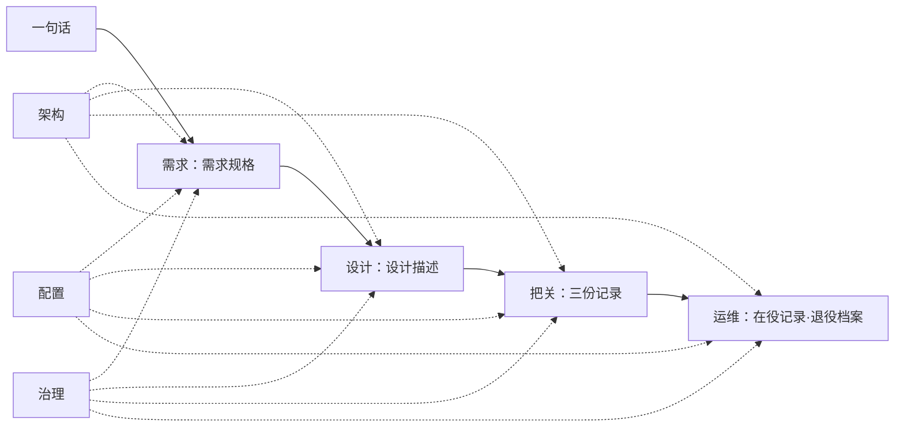

# 第17章 一路贯通：从需求到上线运行

## 17.1 引言

工程现场从来不缺词。需求、设计、评审、架构、配置、治理，每一件都有人做，每一件都有流程、有模板、有责任人。可系统还是会在某个地方出问题，而且常常出在所有人都做对了的地方。

这一章不给新词。它只跟一条变更：从它被人说出口那天，一直跟到它退役。

**误解现场。**恒信的季度经营会上，财务总监说了一句："超过一百万的合同，得加一级总经理审批。"

郑亮管业务，散会后把这句话转给了顾言。

顾言把它写成一条规则，罗建在设计里加了一个判断节点，苏婷测了三条用例。两周后上线。

上线第一周，财务抽查了一批合同，翻出十七份没走加签的。这十七份有一个共同点：合同金额九十六万，含税总额一百零五万。

王默管运维，先查自己这一摊：部署记录、版本基线、配置项，一条条核过，都对得上。"不是部署的事。"

罗建把审批规则调出来："规则写得没错，金额过一百万就加总经理。"

苏婷翻了一遍用例："我测的是合同金额，九十九万、一百万、一百零一万，三条都过。"

顾言把需求文档翻到那一页，上面写着："合同金额超过一百万的，增加一级总经理审批。"

四个人说的都对。那十七份合同从中间漏了过去。

"我们不是哪一步做错了。"顾言合上电脑，"需求评审、设计评审、验证、确认、基线、变更控制，一样不少。可这条规则从一句话变成一道闸，中间换了三个说法：合同金额、含税总额、审批单上的数。三个说法都对，就是不是同一个数。"

同一天，三千公里外，冰链的会议室里也在说一件差不多的事。

客户提了一句："十秒不报警，等于没报。"林涛把断链判定从三十秒改成十秒。上线后，报警一天四十一条，其中一半是误报——固件按十秒采样，云端还按三十秒判定。

**这一章的人和物。**恒信这边：郑亮管业务，顾言管需求，罗建是系统架构师，苏婷管开发，王默管运维。冰链那边：石军管硬件与固件，林涛管需求与客户，吴浩管云端与 App，小周管制造与批次，小张是系统工程师。这一章冰链只作镜子。

**本章要回答什么。**读完这一章，你应该能答上五件：

1. 一条需求从客户说出口，到系统退役，中间要经过哪几段？每一段交出什么，下一段才接得住？
2. 架构、配置、治理这三样，是三个阶段，还是每一段都要用上一次的三样事？
3. 每一段都做对了，一条变更为什么还是可能走不完？
4. 走不完的那条变更，坏的是一样东西，还是两样东西之间那句没人写的话？这种断处有几种接法？
5. 把断处接上之后，怎么才算有人管、下次不会再断？

**本章的骨架。**先摆一张分类图，看这条路上有哪几段、哪几样（17.2）。然后按实际走的顺序一段一段跟：需求把它写成依据（17.3），架构先替它定住几样（17.4），设计把它换成方案（17.5），把关把它量成记录（17.6），运维接着管到退役（17.7）；最后配置与治理让它算数（17.8）。走完回头看，它断在哪儿（17.9）；再把断处写成一张单子（17.10）。

**这一章要用的词。**下面几个词先给一句话，正文第一次用到时还会再解释一遍。

| 词 | 一句话 | 去哪看 |
|---|---|---|
| 切片 | 同一个系统，按一种切法切出来的那一片 | §17.2〔T-227〕 |
| 顺次切片 | 顺着时间切出来的段：上一段交出来的，是下一段的输入 | §17.2〔T-99〕 |
| 横切切片 | 穿过每一段、但不在时间线上占一段的那几样 | §17.2〔T-100〕 |
| 接缝 | 两片之间那处没有主人的地方 | §17.9〔T-101〕 |
| 缝合 | 把接缝连上：承接、参照、记录、问责，四种连法 | §17.9〔T-228〕 |
| 缝合清单 | 一条缝写成一行三栏：哪两处之间、靠哪一种连上、谁负责 | §17.10〔T-229〕 |
| 规定需求 | 能当依据用、验得着的那一条要求 | §17.3 |
| 产品数据 | 开发过程中留下来的那些可查的东西：需求规格、设计描述、记录、决策 | §17.2 |
| 基线 | 定下来的那一份；往后的改动都以它为参照 | §17.8 |

前六个里，切片、缝合、缝合清单三条是本书立的名字，不是任何标准的条文。

---

## 17.2 一条变更，从一句话走到退役档案

一条变更，从客户在走廊里说出口，到它退役，中间要经过几处手。先把这几处摆出来——**这是一张分类图，不是流程图**；为什么这么讲，下面就说。

先看顺着时间的那一段。它一段接一段，前一段交出来的东西，是后一段的活：

| 这一段 | 接手什么，交出什么 | 容易停在哪 | 账落在哪份产品数据 |
|---|---|---|---|
| 需求 | 一句话 → 一份需求规格 | 没说出口的那句，有没有被写下来 | 需求规格 |
| 设计 | 需求规格 → 一份设计描述 | 两片之间那条接口，有没有人接 | 设计描述 |
| 把关 | 设计描述 → 三份记录 | 跨两段、又没写进任何一段的那条依赖 | 测试记录、确认记录 |
| 运维 | 上线 → 在役记录、退役档案 | 所有接缝在这里总验一次 | 运维记录、退役档案 |

这四段是顺次切片。顺序不是习惯，是依赖：没有前一段交出来的东西，后一段无从下手。

最后一列是四段共用的一个交代：每一段都交出一样东西。那样东西有名字、有版本，下一段拿去就能用。

这条路上唯一的实物，就是那些东西。它们有一个总名：**产品数据**。需求规格、设计描述、测试与确认记录、基线、退役档案，都是产品数据的一种。一条变更落地，落的就是这些；它每过一次手，这些就换一次名字、上一个版本。

再看横着的那三样。它们不占这四段里的任何一段，各问一问：

| 这一样 | 它问的那一问 | 它在哪一段非问不可 |
|---|---|---|
| 架构 | 定住什么：概念、原则，走不走这一步 | 设计动笔之前 |
| 配置 | 哪一份算数：哪一版是定下来的 | 每一份产出一定稿 |
| 治理 | 谁说了算：谁有权批、谁担责 | 前面都有东西可裁之后 |

这三样是横切切片。

两张表摆在一起，有一句话必须说清：**图是分类用的，不是流程用的。**

分类上它们是"四段加三样"；走的时候只能按硬时点走——架构必须在设计动笔之前立住，配置跟着每一份产出定稿，治理要等前面都有东西可裁。三样不占队里的位置，可各有非出现不可的那一刻。

这条区分不是绕口令。"把分类当流程"，正是恒信这次犯的错：一条"加一级审批"的规则，被当成审批流里加一个节点，加完就过去了。没人回头看金额按哪个数算、看历史合同、看谁有权改这个数。

冰链那边也是一样：断链判定从三十秒改成十秒，被当成固件那一站的技术选择，其实它是一条穿过所有段的决定。

再往深一层：这两件事不是两种病，是同一种病的两副面孔。前面十六章治的是"同一个词各指各的"；这两件是另一种病，词都用对了，事还是漏了。

病根不在词上，在关系上。把这些词当成彼此不相干的东西，每一件都单独做到位，看上去就都合格了。可系统不是几件东西拼起来的，它是一件事的几种讲法。

> **四段是站，三样是线。**站排着队，线不占位置——可线各有非穿过不可的那一段。

"穿过每一段"说的是覆盖面，不是另开三条并行的流水线。

---

## 17.3 需求：一句话写成一份需求规格

这一段的入口是一句话。财务总监在会上说的："超过一百万的合同，得加一级总经理审批。"

按三年前的做法，这句话会直接变成一张开发任务单。顾言这次没急着写条款。

他先写了一份运行概念，讲一个场景：财务审一份一百零五万的合同，系统看一眼含税总额，发现过了线，把审批单转到总经理那一栏；总经理批完，合同才归档。

运行概念里他专写了一栏异常：金额是一百万整，加不加？外币合同按哪天汇率折？

一份合同拆成三份签，算不算？在途那批已经走到一半的，要不要重走？

故事讲完，才轮到条款。最后他划了一条：单份合同按含税总额折算，超过一百万的，增加一级总经理审批。

这条看着像抄下来的，其实不是。原话只说"超过一百万"，没说哪个金额、没说哪天汇率、没说在途怎么办。这几样是问出来的。

**这一段交出去的，是一份产品数据：需求规格。**

停住的地方在这儿：这几句问出来的话，当时只在评审会上说过一遍。要是不写进条款，下一手就够不着它们。

---

## 17.4 架构：每一段都得先定住几样

需求写完，下一段是设计。但在设计动笔之前，得先把架构立起来。

这不是因为架构是第二段。它不占队里的位置：从需求到运维，每一段它都还要再出现一次。可它有一个硬时点——设计开工前必须先有它。没有它，设计只能凭手感往下分。

这一回，它要定住两样。

一样是审批链的形态：**规则是配置出来的，还是写死在代码里**。写死，下一回调阈值就得改代码、走发版；配出来，改一个数就能生效，可这个数谁能改，就成了另一件事。

一样是金额按哪个数算、由谁定：合同金额、含税总额、审批单金额，三个数都在系统里，得有人指定"以哪一个为准"。这一条不定，设计就只能猜。

两样都要过两关。

目的关：这个决定守的，是不是"目的不走样"？去掉它，闸门还拦得住吗。代价关：它有多难改？按难改的程度，决定给它什么待遇、排到什么时候。

两关的次序不能颠倒：难改不难改只管排序与时机，够不够格进架构，看的是目的。

定下来的，要留成两份东西：一份是架构描述——基本概念与属性、管控原则；一份是决策记录——名称、背景、选项、选择、影响、能不能反悔。

这两份东西不在队里，它们在每一段上：

| | 需求 | 设计 | 把关 | 运维 |
|---|---|---|---|---|
| 架构 | 金额口径与审批边界怎么划 | 规则落在配置还是代码里 | 架构自身与描述各评一遍，评的人不是设计它的人 | 改阈值走哪条路，退役时怎么交接 |

看这一行：四个格子，四个不一样的活。它不在时间线上占一段，可每一段都躲不开它。

定下来之后还要收得住、放得开。收得住，是它能回答各方关心的事、能被评估；放得开，是它不替设计把话说死。

冰链那边，断链从三十秒改成十秒，往深里问一层，是"断链算不算发生"这条判据由谁定：固件说按采样算，云端说按上报算。这也是被当成固件那一站的事，其实穿过所有段。

这里要防一个误会："架构穿过每一段"说的是覆盖面，不是另开一条并行的流水线。它在每一段里与那一段的活揉在一起做。

---

## 17.5 设计：需求规格换成一份设计描述

设计开工前，先把架构交过来的那一份取下来。架构描述里定下的概念与原则、决策记录里写明的取舍，都是这一段要遵守的约束。

罗建列了一份框架定义：审批流、金额、汇率折算、通知。

每一块下面挂详细定义，每一条有编号、有描述、有指标、有验收标准。

分完，顾言来挑刺。他指着两片说："这片管审批流，那片管金额。中间呢？那三个金额，系统按哪一个判？"

罗建没急着答。他把需求规格翻回去，一条一条找依据。那条"含税总额"，他挂到了"金额取数"上。

可"合同金额"这个字段是业务录进来的，"审批单金额"是审批流自己算的，两边都不是"含税总额"的现成来源。

这个转换，落在两片之间，哪一片都不是它的家。

他补了第三片：金额取数。这一片不是从哪条需求搬下来的，是从两片之间的空处补出来的。

冰链那边是同样的动作，只是没人补。断链那条需求拿给两端看：固件写"十秒没有心跳就算断"，云端写"三十秒没收到就告警"。两棵树各自都对，中间没有一片说"这两处的十秒和三十秒怎么对齐"。石军当场问了一句："这条谁负责？"没人答得上来。最后是吴浩开口，把口径说定了；这句话留在了会议纪要里，没有进任何一片叶子。

**这一段交出去的，是一份产品数据：设计描述。**

停住的不是某一片，是两片之间那句话。需求里的约束有没有传下来，是可以查的；两片叶子之间那条接口，不在任何一片叶子上，得有人专门去看。

---

## 17.6 把关：三把尺子，量出三份记录

三把尺子量的不是一样东西：评审抬头看目标，验证低头对条款，确认出门看真用途。三样混成一份"测试总结"，其中必有一头是虚的。

恒信这次分开办。

评审会上，财务那边问了一个条款里没有的问题："一份合同先后改过三版，最后一版过了一百万，前面两版没过，加签加在哪一版？"这是对目标的追问，不是对条款的核对。

验证对着需求规格一条条给证据。九十九万、一百万、一百零一万，三条都测。

确认是郑亮带着财务的人，在真实的审批流里走了一份合同，从录入、折算、加签、归档走了一遍。确认的参照在流程里，不在文档里。

**这一段交出去的，是一份产品数据：三份记录。**

尺子只照写下来的东西。"金额取数"那一片，在验证用例里没有：测了合同金额的边界，没测含税总额的边界；一百零五万那份，也没人写过。

苏婷把这一条补了进去，标得格外醒目。她在旁边写："这一行以前不在任何用例里。"

---

## 17.7 运维：上线记录、在役升级、退役档案

上线那天，部署完成，审批流跑通，通知发得出去。

王默盯着刚上的线说："这只能证明技术那一侧醒了。算不算成功，得看财务那边这一周敢不敢说'这闸拦住了'。"

接下来一周，顾言盯着后台看一件事：过了一百万的合同，有没有真的从"财务审"一路走到"总经理批"，再走到归档。

他请三方各答一问。财务的人：这一周拦住的，是不是都该拦。郑亮：业务那边有没有被卡住的正常合同。总经理办公室的人：加到这一级的，批复时间还能不能接受。

第三周那个数出来了：十七份该加签的没加。查下来，它们的合同金额都是九十六万，含税总额一百零五万。

再往后还有一站，最常被整个行业忘掉：在途与退役。在途那一百多份合同走到一半，按旧规则走到底，还是按新规则补加签，得有人定。

系统退役时也一样：这套闸门的规则、口径、裁决记录，得有人交接，不然下一个系统会从零再问一遍。

冰链那边，三十秒改成十秒之后，同一件事发生在在役升级上。新采样策略要推向在役批次，可箱子有标准版、医疗加强版、工业版，交叉在役。这件事归小周。

他把在役升级那份边界摊开，问旁边的小张："这一版能不能升？"她没答，把封面翻到"签在哪一版"那一页，顺手把笔搁到他手边。他也没再问，在那一行签了字。

签完他说："不是我不想升，是边界在那儿。每批升不升、什么时候升、升完基线在哪，台账上都记着。"

**这一段要交的，是三笔记录：上线、在役、退役。三笔都是产品数据。**

> **每一片都合格，缝还是会断。**

---

## 17.8 配置、治理：哪一份算数，谁说了算

这两样压在最后讲，不是因为它们排在队尾，是因为它们要等前面有东西——等那些产品数据攒出来。

前面每一段都在产出东西：需求规格、设计描述、三份记录、在役与退役两笔账。产出会改，改了会乱。这时候才轮到这两样各答一问。

配置答的是"哪一份算数"。它不改你的架构，只把"哪一份是定下来的那一份"固定下来。改来改去，最容易出的问题就是：手上这一份，到底是不是大家说好的那一份。

配置最有用的一处，是它把一次变更变成一段能查的路：变更申请、影响评估、批准、实施、建立新的一版。

恒信那次改阈值走的就是这条路，影响评估里写清一句：改的是审批规则那一版，取数的规矩不动。三个月后有人问起，这一句还查得到。

治理答的是"谁说了算"。判断算清楚了，还得有人点头才算数。这一版谁批的、按什么程序、改它要走哪条路、依据是哪一条，四句答得上，这条才立得住。

两样在各段上各出现一次：

| | 需求 | 设计 | 把关 | 运维 |
|---|---|---|---|---|
| 配置 | 需求定稿立一版 | 分配定稿立一版 | 证据挂在哪一版上 | 在役批次各挂哪一版基线 |
| 治理 | 金额口径归谁定 | 这条接口谁担责 | 谁有权说"这算过了" | 改阈值谁批 |

恒信那六处里，配置那一处落在王默头上；治理那一处谁都定不了，只能拿到台面上裁一条：阈值与取数规矩归财务定，改它要走变更流程。

冰链那三处里，配置那一处是批次台账——每批升不升、升完基线在哪，都记着；治理那一处是医疗加强版要过数据所有权那道裁决，不是小周一个人说了算。

一句话分清：**配置管"哪一份算数"，治理管"谁说了算"**。一个是版本与基线，一个是裁定与资格。

还有半句要说清：配置管理这一侧，工程只做一半。把候选挑出来、递过去，是工程这一侧的事；收下、定成基线、维护它，是配置管理那一侧的事。

---

## 17.9 断了，只有承接、参照、记录、问责

切开是为了看清，不是为了分开。可这一刀下去，哪些地方会断开、要有人接住，前面还没说。

把那些词放回一条时间线，它们连的是同一批地方。本书把两片之间那处没人管的地方叫接缝。接缝不是坏了的地方，是接不上的地方：两边都是好的，中间那一句没有人说。

这些连接处有四种。

**第一种，承接。上一段交出来的东西，下一段能直接接住吗？**

相邻两段之间，总有一份是交出去的那一份，一份是接住的那一份。交出去的那一份说不清，接的那一段就无从下手。

恒信断在这一条上。"超过一百万"没说清是哪个金额，需求那一段没写死，设计那一段就没有东西可接——它只能自己挑一个，挑的是最顺手的那个。

冰链也断在这条上。固件和云端各自写对了自己那半句，可"十秒和三十秒怎么对齐"这句话，谁也没有交出去。

**第二种，参照。几段对同一件事的说法，对得上吗？**

关于同一个对象，有三问要在几段之间接上：应该是什么、实际是什么、怎么变成这样。需求回答"应该是什么"，验证回答"实际是什么"，配置记录回答"怎么变成这样"。

三个答案都对得上，才是同一个系统。

恒信那一周的现场就是三个答案对不上：需求说合同金额，系统判含税总额，财务台账记审批单金额。三个数都对，就是不是同一个数。

**第三种，记录。人走了，还查得到吗？**

决策记录、配置信息、追溯矩阵、评审记录，都在往同一份组织记忆里写。这一种缝靠记录连上，不靠默契。

恒信那次"阈值与取数归谁定"，评审会上说定了，没写进任何一份基线。冰链那条口头约定，会上说定了，没进任何一片叶子。

写下来，是给不认识你的人写的。

**第四种，问责。这条缝有名字、有主人吗？**

有些缝不是手艺能连上的，得有人有资格为它负责：所有权定给谁、规则由谁定、由谁执行。

恒信"阈值与取数"断掉，本质是没人被授予裁这一条的资格：财务说该他们定，架构说这属于流程规则。冰链那条补上了，本质是有人为这条接口担了责。

四种连法，配四句自问：

- 承接：这一段的产出，下一段能直接拿来用吗？
- 参照：几段对同一件事的描述，对得上吗？
- 记录：这条缝，人走了还查得到吗？
- 问责：这条缝，有名字、有主人吗？

四句都答得上，缝是连好的；任何一句答不上，那里就是将来的事故现场。

这四句要在动笔之前问，不是出事之后问。前三种靠手艺：识别得出来、写得好、记得住。第四种靠资格——手艺缝的缝会随人走，资格缝的缝才立得住。

四句问的不是"做没做"，是"连没连上"。做了而没连上，和没做一样，都是下一手接不住。

---

## 17.10 缝合清单：缝在哪、怎么连、谁负责

四句话是判断。判断落到纸上，才是活的。

这张单子本身也是一份产品数据：能签收、能入库、能改版本。

它和需求规格、设计描述同族，只是记的不是系统长什么样，而是这条链上哪些缝有人管。

一张缝合清单，每一行只写三件事：缝在哪两处之间；靠哪一种连上；责任人是谁。最后这一栏要的是一个能写字的名字，不是一个部门。

三样写全，这条缝才算有人管。

第三栏最容易被写成部门名。"归口到财务"听着已经定下来了，可财务是一个屋子，屋子里还得有一个人。出事那天，追到屋子门口就断了。

恒信事后补的那张清单，列了六行。

| # | 缝在哪两处之间 | 靠哪一种连上 | 责任人 |
|---|---|---|---|
| 1 | 需求："超过一百万" ↔ 规格里那条"含税总额" | 承接 | 顾言 |
| 2 | 设计：审批流 ↔ 金额口径 | 承接 | 罗建 |
| 3 | 把关：合同金额的边界 ↔ 含税总额的边界 | 记录 | 苏婷 |
| 4 | 架构：规则放配置还是代码里 ↔ 各段的实现 | 记录 | 罗建 |
| 5 | 配置：阈值与口径的变更 | 记录 | 王默 |
| 6 | 治理：阈值与口径归谁定 | 问责 | 委员会（归口到财务） |

六行逐条对着上面那三样写。需求那一段，补一条"含税总额超过一百万的，增加一级总经理审批"；设计那一段，把"金额取数"作为一片叶子补在两片之间。

后四行各归其位：把关那一段把"含税过线但合同金额未过线"补成一个用例；架构那一段把"规则放配置"这条决定补进决策记录；配置那一段把这次变更写进基线；治理那一段把归口裁一次。

六行，六处缝。六次漏，一个漏法。

冰链补了三行。需求规格里补一条："断链以十秒无心跳为准，采样与判定用同一个计时办法。"固件与云端两棵树之间，补一片"计时对齐"的接口叶子。再跑一趟真实隧道。

小张把这几句收进单子的时候，第三栏空了一格。她把笔停在那儿，抬头问林涛："这条往后归谁？"林涛想了想说，归他和石军两个人：他管取数，石军管采样。

她指着最后一行说："三行都有人签字，换个人来，照这张单子也接得住。清单要是只写前两栏、第三栏空着，这条缝还是没主。"

清单不是把简单的事说复杂。它把散在几个人脑子里的默契，搬到一张谁都能看的纸上。王默说了一句实在话："以前这条链在监控里是隐形的。部署看得见、服务看得见，看不见'金额按哪个数算'。"

清单也不是给检查看的台账。检查要用它，是因为它本来就该在那儿；没有人靠一张检查用的单子把活干对。

这张纸还有个用法：它不是补完这一次就收起来。往后每来一次变更，谁动了哪两片之间，就在上面加一行、或者改一行。清单是活的才有用。

两周后，财务又抽查了一批合同：过了一百万的，一份没漏。

冰链那边的收尾是另一副样子。客户来复查，问的还是那句："十秒那条，你们是怎么判的？"

石军指着接口规格，一字一句："固件十秒没心跳就算断，云端按同一个十秒判，采样和判定用同一个计时办法。这条写进了需求规格，接口描述上也写着；它是 v3.0 那一版定的，谁批的、改了什么，变更记录都在这。"

客户点点头，过了。

> **写不出责任人的那一行，就是下次出事的地方。**

---

**认知反转。**回到章首。恒信的十七份合同漏了过去，冰链的报警一天四十一条误报。现在能看清，这两件事连着错了三层，一层比一层深。

第一层，把"每一段做对"当成"系统做对了"。需求评审、设计评审、验证、确认、基线、变更控制，每一样都做了，可系统死在段与段之间。

第二层，把词当成彼此不相干的东西。需求管需求，架构管架构，配置管配置，各干各的。可这些词说的是同一件事：换个角度，就换一套词。

第三层，把缝合当成最后多出来的一道工序。以为这是全书结尾的总复习，等所有事情做完，再回头把概念串一遍。

可缝合不是最后一步：需求那一段把没说出口的话写成条款，是缝合；设计那一段把两片之间那条接口补成一片叶子，是缝合；把关那一段把跨段的场景补成一个用例，是缝合。

配置那一段把口头约定记进基线，是缝合；治理那一段把"谁有权定"裁清楚，也是缝合。没有哪一段天生带着接缝，接缝都是每一段上有人连出来的。

最后一句可以说出口了：前面十六章教的不是十六样东西，是同一件事的十六种讲法。你学到的那些词，每一个都对；它们的用处，是让你在一条真实的链上指得出位置、看得见缝、找得到人。

**小结。**一条变更，从一句话走到退役档案，中间换过几回手：一句依据，一份描述，三份记录，还有在役与退役那两笔账。这些都是产品数据，一份一份换下来的。每一次换手，都有可能断。

断的地方只有四种：上一段交出来的下一段接不住，是承接；几段对同一件事的说法对不上，是参照；人走了就查不到，是记录；这条缝没有名字、没有主人，是问责。

缝有四条，每条都要有一个人负责。承接、参照、记录、问责，四句问完不到一分钟，可答不上的那一句，就是下次出事的地方。

如果只带走一句话，带走这一句：

> 每一片都合格，缝还是会断。所以一路贯通不是最后多出的一道工序，是每一站都在做的事。

运维台前，王默把那张缝合清单钉在了墙上。清单上一行一行写着：哪两处之间、靠哪一种连上、谁负责。以前他盯的是"系统活着没活着"；现在他抬头就能看见，这条链上哪一处有人，哪一处还没人。

到这里，一条变更从出生到退役走完了一整圈。书还没走完：还有一个"物种"没有回答，那就是架构师。下一章回答这本书的书名。

---

## 附录

**A 本章概念总图**

> 读这张图注意：实线是排队走的四段，一段把东西交给下一段；虚线是那三样，它们不从队里走过去，可在每一段上都要出现一次。

**B 本章的能力级**

本章以"全书"为单位清点。本书的能力分四级：表征是把词说准，图式是把结构画出来，心智模型是能推演，解释框架是能回答"凭什么信"。

按第1章 §1.4.4 那把尺子量一下：**本章以第 ④ 级为主**。前三级本章各沾一点：词过一遍，结构画一张，判据推得动。真正升上来的，是第四级。

- **解释框架（本章主级）**：值得信的不是"每段都做对"，是那条线走完了全程、中间没断；断是每一次过手的风险，四句话能问出来；判断要落成纸上的东西，人走了还查得到；它最后长在"第几手"这个人身上。

> 收束句：**能答全四问**，才算拥有——一条变更摆在面前，你说得出：它要走过哪几段、哪几处缝可能断、每条缝靠哪一种连上、由谁负责。

本章的能力落在哪里？第9章那份清单列了六项。本章一项也不新长，它给的是这六项的**合用地基**：能在这条链上指出自己守哪一处，你才知道该交出什么、该接住什么。

**C 自查 · 这些说法对吗？**

1. "需求、设计、评审、架构、配置、治理都做了，系统肯定没问题。"——**错**。每一片合格不等于系统合格，问题常出在片与片之间。
2. "把所有概念汇总一遍，就是这一章。"——**错**。本章不汇总概念，只跟着一条变更走一遍，看它在哪儿停住。
3. "架构是设计之后的一个阶段。"——**错**。架构硬在设计动笔之前，之后每一段还要再出现一次。
4. "配置管理就是发布前打个版本号。"——**错**。配置管的是"哪一份是定下来的那一份"，全程都算。
5. "治理是项目结束后的评审。"——**错**。治理管的是"谁有权定"，从头到尾都在。
6. "技术上线了，这个项目就成了。"——**错**。要看用的人接没接上：财务敢不敢说这闸拦住了。
7. "接缝记在心里就行，不用写下来。"——**错**。缝靠记录连上，不靠默契；换个人来查不到，就是断了。
8. "不属于任何一片的东西，不归我管。"——**错**。落在片与片之间的依赖，必须有一个责任人；没有名字，那里就是下次出事的地方。

**D 练习**

1. 画一条你们最近一次真实变更的完整时间线，标出那四段，在每两段之间写上它容易在哪儿停住，圈出最弱的一处。
2. 找一次"每一段都做了、系统还是失败"的经历：指出它断在哪两处之间，断在承接、参照、记录、问责里的哪一条。
3. 找一条你们组织里"没归属"的依赖，写一行：缝在哪两处之间、靠哪一条连上、责任人是谁。写不出责任人的那一行，标出来。
4. 挑你们最近一次变更里最难改的那个决定，写清两关：它守的目的是什么；它有多难改、给了什么待遇。
5. 把你们最近一次上线之后的三份记录找出来——上线记录、在役升级记录、退役档案，看哪一份缺、缺了该由谁补。

**E 参考文献**

> 编号怎么读：`[k]` 是本章内的文献序号；括注的 `R-xx` 是全书参考文献总表（附录 D）的编号。

**标准**

- [1] **R-04** ISO/IEC/IEEE 42010:2022《架构描述》—— 架构作为实体在其环境中的基本概念或属性与管控原则；架构描述是工作产品。**用于本章 §17.2、§17.4**
- [2] **R-05** ISO/IEC/IEEE 42020:2019《软件、系统与企业 — 架构过程》—— 架构过程的三项核心活动与架构治理、架构管理两个过程；架构是约束。**用于本章 §17.2、§17.4、§17.8**
- [3] **R-28** ISO/IEC/IEEE 42030:2019《架构评估》—— 评估以规定的评估目标为基准。**用于本章 §17.6**
- [4] **R-37** ISO/IEC/IEEE 15288:2023《系统与软件工程 — 系统生存周期过程》—— 配置管理过程；各技术过程中的系统需求定义、架构定义、设计定义，以及运行、维护、处置三个过程（正文按"上线、在役、退役"表述）。**用于本章 §17.2、§17.7**
- [5] **R-38** ISO 9000:2026《质量管理 — 基础和术语》—— 质量与要求的术语基础。**用于本章 §17.6**
