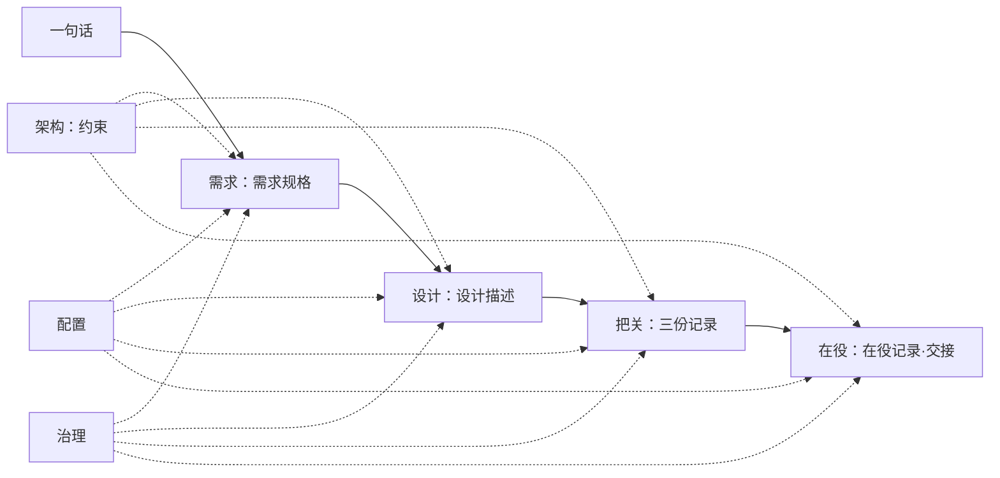

# 第17章 一路贯通：从需求到上线运行

## 17.1 引言

**误解现场**。恒信的季度经营会开到一半，财务总监放下笔说了一句话："超过一百万的合同，得加一级总经理审批。"

郑亮管业务，散会后把这句话转给了顾言。顾言管需求，把它写成一条规则；罗建是系统架构师，在设计里加了一个判断节点；苏婷管开发，测了三条用例。两周后，规则上线。

上线第一周，财务抽查了一批合同，翻出十七份没走加签的。

十七份有一个共同点：合同金额九十六万，含税总额一百零五万。

王默管运维，先查自己那一摊：部署记录、版本基线、配置项，一条条核过，都对得上。"不是部署的事。"

罗建把审批规则调出来："规则写得没错，金额过一百万就加总经理。"

苏婷翻了一遍用例："我测的是合同金额，九十九万、一百万、一百零一万，三条都过。"

顾言把需求文档翻到那一页，上面写着："合同金额超过一百万的，增加一级总经理审批。"

四个人说的都对。那十七份合同从中间漏了过去。

"我们不是哪一步做错了。"顾言合上电脑，"需求评审、设计评审、验证、确认、基线、变更控制，这六样流程一样不少。可这条规则从一句话变成一道闸，中间换了三个说法：合同金额、含税总额、审批单上的数。"

**本章的人和物。** 恒信这边五个人：郑亮管业务，顾言管需求，罗建是系统架构师，苏婷管开发，王默管运维。冰链是另一家公司、另一个行当，等走到它那一段再认人。

**本章要回答什么。** 读完本章，你应该能答上六件：

1. 一份合同九十六万、含税一百零五万，规则说"超过一百万"——它到底该不该加签？这条线是在哪一环松掉的？
2. 每一段都有人做、也都做对了，一条规矩为什么还是可能整条走漏？
3. 两段之间那处谁都不认的地方，靠什么才算接上？
4. 一条缝写到纸上要写几栏？哪一栏空着，这条缝等于没写？
5. 这条链上你守的是第几手？你交出去的那句话，下一手能不能直接用？
6. "一路贯通"是完工前补的一道工序，还是每一站交出去时都在做的事？

---

## 17.2 上路：一条变更要过几处手

一条规矩从说出口到被改掉，要换几回手。

路是这样的：有人把一句话变成一份能当依据用的要求；有人照着要求，把它写细成一层能照着做、能验得着的要求；有人量它合不合格；有人把它上线，然后在它跑着的这些年里接着管它。

一段接一段。前一段交出来的东西，是后一段的活。这不是习惯，是依赖：没有前一段交出来的那一份，后一段无从下手。

这四段要排队走。另有一些东西不排队：它们在每一段上都要出现一次，可真要说"它在这段时间里属于哪一段"，说不出来。本书把切开之后的那一片叫切片。

把这条路竖起来看，还有一件事：交出去的东西，每次换一个人接。一句话从财务总监嘴里出来，落到顾言手上；顾言写完，落到罗建手上；罗建分完，落到苏婷手上；苏婷测完，落到王默手上。

换手的地方，就是后面要出事的地方。

每一次交出去，都带一句"我这边做完了"；下一手要的不是这句话，是那份东西。所以这一章讲的不是流程，是过手：谁把什么交给谁，交出去的那一份能不能用。

每一段都要交出去一样东西。那样东西有名字、有版本，下一手拿去就能用。

这些东西有一个总名，叫**产品数据**：开发过程中留下来的、说得清这个产品是什么的那些信息。需求规格、设计描述、测试与确认记录、决策记录、在役记录，是它的不同形态。

一条规矩落地，落的就是这些；它每过一次手，这些就换一次名字，上一个新版。

出事的地方不在某一段里，在两次交出去之间：上一段交出的那一份说得清不清楚，下一段接不接得住。这跟做这一段的人努不努力，是两件事。

> 六问里第五问，问的就是这一份：它能不能被下一手直接用。答不上，这一次过手就算没完成。

---

## 17.3 需求：把一句话写成一条依据

第一手是需求。

需求那一段的活，是把会上的一句话，变成一份能当依据用的要求。

顾言手上那一句是："超过一百万的合同，得加一级总经理审批。"十七个字，看着能直接用。

按三年前的做法，这句话会直接变成一张开发任务单。顾言这次没急着写条款。

他先写了一份运行概念。运行概念是需求里那份讲"它在什么场合被谁怎么用"的说明。

他写的是一个场景：财务审一份一百零五万的合同，系统看一眼含税总额，发现过了线，把审批单转到总经理那一栏；总经理批完，合同才归档。

运行概念里他专写了一栏异常：金额是一百万整，加不加？外币合同按哪天的汇率折？一份合同拆成三份签，算不算？

三个问题，一个也没有现成答案。他去问财务，问回来三句话。

问完了，才轮到条款。他划了一条：单份合同按含税总额折算，超过一百万的，增加一级总经理审批。

这条看着像抄下来的，其实不是。原话只说"超过一百万"，没说哪个金额、没说哪天汇率、没说在途怎么办。这几样是问出来的。

**这一段交出去的，是一份需求规格。** 它比原话多出三句：判定的数、折算的时点、拆单怎么算。

一份要求要能当依据用，得满足两条：说得死，验得着。说得死，是不留"大概""原则上"；验得着，是有人能拿着它判这一条过没过。运行概念里那三个问号，问的就是这两条。

三个问号各有各的去处：金额是一百万整加不加，落成"超过"还是"达到"；外币按哪天汇率，落成折算的时点；一份合同拆成三份签，落成按单份算还是按合计算。

三句话都得写死，少一条就留一个口子。

停住的地方在这儿。这三句话，当时只在评审会上说过一遍。真要没写进条款，下一手就够不着。

他照着"超过一百万"往下走，走出来的东西自己都对，就是跟财务心里的那个数不是一回事。

会上说定，为什么不算数？因为会是一场事，不是一个件：在场的人记得，不在场的人不记得；三个月后换一个人接手，他能查到的只有条款。

三年前那套做法更快，一句话就是一张任务单，谁也不用问。它一直没出事，是因为没人回头查过"我们到底按哪个数判"。

他还在条款里多写了一句：在途的合同按老规矩走到归档，不追补。写进去，是因为这句话一犹豫，下一手就会来问。

> 每一片都合格，缝还是会断。可缝不长在片里，它长在两片交出去的那一下。

话写死了，下一手就一定接得住吗？

---

## 17.4 架构：它不在队里，但得先做完

这条路上，需求交出了一份规格。下一段要做的，是照着这份规格再写细一层，细到能照着做。

写细之前，有几样必须先定住。定住这几样的那件事，叫架构。

它不在队里。四段的规矩是"前一段交出来的，是后一段的活"，可架构交出去的东西没人接走。

每一段各自拿去用一次：需求那一段用它划边界，把关那一段把它本身单独评一遍，上线以后改它又要走另一条路。把它排进队里，就排错了。

可它有一个硬时点：设计动笔之前。这个时点不许挪。设计一旦凭手感写下去，架构再补，就只是给既成事实写一份说明。

这一回它要定住两样。

一样是**判定金额是哪一个**。合同金额、含税总额、审批单金额，三个数都在系统里转；系统认哪一个当判定用的那个数，只能有一个，不能三处各算各的。

这是概念层的事：三个名字各自指什么，哪一个是判定用的那一个。

一样是**两条规则分不分开**。审批阈值是一条，取数办法是另一条；两条分开定义，改一个不动另一个。这要立成一条管控原则，写进架构描述，往后每一次改都照着它。

两样都要过两关。目的关问：去掉它，这道闸还拦得住吗。代价关问：它有多难改，按难改的程度决定给它什么待遇、排到什么时候。

拿目的关问恒信这一条：这道闸守的目的是"大额合同多一道人看"。去掉金额取数这一条，闸门还拦得住吗？它拦的是哪个数？这一问会直接把"按哪个数算"问出来。这一问在当时没被问。

两关的次序不能颠倒。难改不难改只管排序与时机；够不够格进架构，看的是目的。次序一颠倒，"难改"就成了"重要"。

定下来的，要留成两份东西。一份是架构描述，写基本概念与属性、管控原则。

一份是决策记录。它不写方案长什么样，写的是为什么长成这样：有哪些选项、为什么选这个、被否的那几条差在哪、谁有权定、什么时候作出与获批。

两份东西记的不是一回事。决策记录里记的是判断与手段，比如"规则放配置还是写死在代码里"——它说的是怎么实现，不是这个系统是什么。别把它当架构描述里的一条原则。

这里要防一个误会：架构不是设计出来的那一半。

设计答"怎么写细、写到能实现"，架构答"这个系统是什么、靠哪几条立住"；两者是两类工作，不是同一件事的两档精度。它先做完，交出去的是约束，那一段接住的是依从。

恒信这一回，时点到了，人也在，可两样都没定住。需求条款里写了"按含税总额折算"，可系统里没有"判定金额"这个说法；两条规则也没分开，改阈值会不会动到取数，没人说得清。

事后补进决策记录的，是"规则放配置"那一条——补的是手段。缺的那条原则（改阈值不动取数），是后来走变更时才写下来的。

> 它先做完，做完就走；没定住的那两样，会一直留在路上。

---

## 17.5 设计：把需求化成能实现的要求

设计这一段有两个来源：规定下来的那些需求，和架构交下来的约束。

它要做四件事：化成更细的要求、分给各部分、分析合起来成不成立、核每块守哪条约束。

前两件看得见，后两件看不见。看得见的错了当场就知道；看不见的错了，要等到上了线才露。

罗建先把系统分成四块：审批流、金额、汇率折算、通知。

每一块下面写的不是"谁干什么"，是更细一层的要求，每条有编号、有描述、有指标、有验收标准。

比如审批流这一块，落到三句话：合同提交时按判定金额路由；判定金额超过一百万，加一级总经理审批；审批节点上显示的那个数，不作判定用。

三句话，细到能照着改代码。

分配的时候，罗建给每一条要求找个去处。找得到的挂上，找不到的先记下来。记下来是这一段的规矩；空着不说，就是留给下一段的麻烦。

"含税总额过一百万加签"这一条，挂到了"金额"上。

可"金额"那一块，从一开始是按"合同金额"写的。业务录入的就是这个数，最顺手——人挑最顺手的那个，不算错，只是那一个是自己挑的。

四块各就各位，每条要求都有了去处。分配这一步看着做完了。

顾言来挑刺。他指着两处说："审批流说按判定金额路由，金额这一块按合同金额算。判定金额到底是哪一个？"

这一问，分配里没有答案。

于是罗建做分析：三个数各自从哪来、什么时候定、谁改得动。

分析下来是三句话。合同金额是业务录入时定的；审批单金额是审批流自己算的，不代表合同有多大；含税总额没人算过，它该等于合同金额加上税额，可系统里没有一处算它。

结论落成一条新要求：判定金额只能是含税总额，而含税总额现在没有来源。

这条要求没有哪一块接得住。罗建单设一块"金额取数"，由它负责折算，并且是唯一判定的那个数。这一块不是从哪条要求搬下来的，是分析出来的。

分完、分析完，还有一核：每块说得出守的是哪一条约束，证据在哪。说不出的，要么这块越了界，要么那条约束本来没立。

恒信这一核核不下去。架构那两样都没定住；四块加新的一块，没有一条约束可依。

核不下去，不是这一段的人不认真。它说明上面那一层空着：没有约束，依从无从核起。

**这一段交出去的，是一份设计描述。** 它比需求规格细一层，每块都写到能照着做的程度；哪块守哪条约束，也写得出来。写不出来的，就留在那儿，留给下一次事故。

三千公里外，冰链的会议室里，同一件事有人做全了，有人只做了前两件。冰链做的是冷链箱子，客户说了一句："十秒不报警，等于没报。"

冰链这边五个人：林涛管需求，石军管固件，吴浩管云端，小周管制造，小张是系统工程师。林涛把断链判定从三十秒改成十秒。

两边都转化了、分配了。缺的是后两件：合起来分析一遍，再核一遍各自守的是哪条约束。

固件按十秒写，云端还按三十秒写。各自都合规，合起来不对齐。

评审会上，石军当场问了一句："这条谁负责？"没人答得上来。最后是吴浩开口，把那个数定成了十秒。这句话留在了会议纪要里，没有进任何一块。

> 这一段的分量，不在分得多齐，在分完之后的两个问题：合起来成不成立，每一块守的又是谁。

---

## 17.6 把关与上线：尺子只照写下来的

设计描述写出来，得有人量。

**三把尺子各照一头**。

评审对目标，验证对规定需求，确认对预期用途。三件事混成一份"测试总结"，其中必有一头是虚的。

恒信这次分开办。

评审会上，财务那边问了一个条款里没有的问题："一份合同先后改过三版，最后一版过了一百万，前面两版没过，加签加在哪一版？"这是对目标的追问，不是对条款的核对。

验证对着需求规格一条条给证据。九十九万、一百万、一百零一万，三条都测。

确认是郑亮带着财务的人，在真实的审批流里走了一份合同，从录入、折算、加签、归档走了一遍。确认的参照在流程里，不在文档里。

走到折算那一步，财务的人停了一下：含税总额是系统算出来的，他们手上那份合同写的是合同金额。当时有人记了一句"回头问一下"，然后往下走了。

**这一段交出去的，是三份记录**。

尺子只照写下来的东西。"金额取数"那一块，在验证用例里没有：测了合同金额的边界，没测含税总额的边界；一百零五万那份，也没人写过。

苏婷把这一条补了进去，标得格外醒目。她在旁边写："这一行以前不在任何用例里。"

**上线只是技术那一侧醒了**。

上线那天，部署完成，审批流跑通，通知发得出去。

王默盯着刚上的线说："这只能证明技术那一侧醒了。算不算成功，得看财务那边这一周敢不敢说'这闸拦住了'。"

接下来一周，顾言盯着后台看一件事：过了一百万的合同，有没有真的从"财务审"一路走到"总经理批"，再走到归档。

他请三方各答一问。财务的人：这一周拦住的，是不是都该拦。郑亮：业务那边有没有被卡住的正常合同。总经理办公室的人：加到这一级的，批复时间还能不能接受。

第三周那个数出来了，还是那十七份：该加签的没加。

冰链那边的数也不好看。改成十秒以后，一天四十一条报警，一半是误报。设备自己每十秒看一次心跳，云端还按三十秒收不到才报——会上定的那个十秒，没落到云端代码里。

**再往后还有一段，最常被整个行业忘掉：在役与终点**。

一条规矩不会退役，它会被下一次变更改掉。改的时候有两件事要交下去：这条规矩本身，和它这些年攒下的取数与裁决记录。不然下一个改它的人，会从零再问一遍"一百万是哪个数"。

恒信那次赶上了：业务系统要升一个版本，这条审批规则跟不跟着升。跟，得先知道上一版按哪个数算；不跟，得说清两个版本并存多久。

冰链那边是同一个问题，只是箱子多。新的采样办法要推向在役批次，可箱子有标准版、医疗加强版、工业版，交叉在役。这件事归小周。

他把在役升级那份边界摊开，问旁边的小张："这一版能不能升？"她没答，把封面翻到"签在哪一版"那一页，顺手把笔搁到他手边。他也没再问，在那一行签了字。

签完他说："不是我不想升，是边界在那儿。每批升不升、什么时候升、升完基线在哪，台账上都记着。"

> 量过、跑过，都过了。可回看这条路，能断的地方到底有几处？

---

## 17.7 断了，只有四种连法

**四段走完，这条路能铺开看了**。

| 这一段 | 接手什么，交出什么 | 容易停在哪 | 账落在哪份产品数据 |
|---|---|---|---|
| 需求 | 一句话 → 一份需求规格 | 没说出口的那句，有没有被写下来 | 需求规格 |
| 设计 | 需求规格＋约束 → 一份设计描述 | 分完没再分析，几处放在一起才看得出的关系 | 设计描述 |
| 把关 | 设计描述 → 三份记录 | 跨两段、又没写进任何一段的那条依赖 | 评审记录、测试记录、确认记录 |
| 上线与在役 | 上线 → 在役记录、交接 | 所有接缝在这里总验一次 | 运维记录 |

最后一列是四段共用的一个交代：每一段都交出一样东西。

这张表是苏婷抄在白板上、一行一行对出来的。它比开头那条路多了两列：容易停在哪、账落在哪儿。多这两列，是因为路已经走过一遍。

有三样不在这张表里，可每一段都躲不开：架构问"定住什么"，配置问"哪一份算数"，治理问"谁说了算"。

它们不进表，不是漏了。这张表只收"前一段交出来、后一段接住"的活；这三样没有接走它们的那一段，每一段各自拿它用一次。

这张表是分类用的，不是流程用的：分类上它们是四段加三样，走的时候只能按硬时点走。架构硬在设计动笔之前，配置跟着每一份产出定稿，治理等前面都有东西可裁。

**断处只有四种**。

这一路走下来，每一处停住的地方，追到底只有四种。停住的地方有个共同点：两边都是好的，中间那一句没有人说。本书管这叫接缝，把接缝连上叫缝合。

**第一种，承接。上一段交出来的东西，下一段能直接接住吗？** 交出去的那一份说不清，接的那一段就无从下手。

这话是个比方：没有谁把话递过去，也没有谁伸手接。说的只有一件事——上一段交出来的那份件，下一段能不能拿去直接用。

恒信断在这一条上："超过一百万"没说是哪个金额，写细的人就没有东西可接，只能自己挑一个，挑的是最顺手的那个。

冰链也断在这条上：固件和云端各自写对了自己那半句，"十秒和三十秒怎么对齐"这句话，谁也没有交出去。

**第二种，参照。几段对同一件事的说法，对得上吗？** 同一个对象有三问要在几段之间接上：应该是什么、实际是什么、怎么变成这样。

需求答"应该是什么"，验证答"实际是什么"，配置记录答"怎么变成这样"。

恒信那一周的现场就是三个答案对不上：需求说按含税总额判，系统里按合同金额算，财务台账上记的又是审批单金额。三个说法都对，就是不是同一个数。

**第三种，记录。人走了，还查得到吗？** 决策记录、配置信息、追溯矩阵、评审记录，都在往同一份组织记忆里写。

恒信那次"阈值与取数归谁定"，评审会上议过，散会就散了，没写进任何一份基线。冰链那条口头约定，会上说定了，没进任何一块。

**第四种，问责。这条缝有名字、有主人吗？** 有些缝不是手艺能连上的，得有人有资格为它负责：所有权定给谁、规则由谁定、由谁执行。

恒信"阈值与取数"断掉，本质是没人被授予裁这一条的资格。

四种连法，配四句自问。这四句抄下来，就是随身带的那张便签；一处问不上，别处补不回来。

- 承接：这一段的产出，下一段能直接拿来用吗？
- 参照：几段对同一件事的描述，对得上吗？
- 记录：这条缝，人走了还查得到吗？
- 问责：这条缝，有名字、有主人吗？

四句都要在动笔之前问，不是出事之后问。前三种靠手艺：识别得出来、写得好、记得住。第四种靠资格。靠手艺连的缝会随人走，靠资格连的缝才立得住。

> 四种查法有了。前三种靠手艺，第四种靠的不是手艺——资格从哪儿来？

---

## 17.8 配置与治理：哪一份算数，谁说了算

配置与治理放在最后，不是因为它们排在队尾，是因为它们要等前面有东西——等那些产品数据攒出来。

**配置答的是"哪一份算数"。** 它不改你的架构，只把"哪一份是定下来的那一份"固定下来。改来改去，最容易出的问题就是：手上这一份，到底是不是大家说好的那一份。

配置最有用的一处，是它把一次变更变成一段能查的路：变更申请、影响评估、批准、实施、建立新的一版。

它管的是"定下来"，不是"定得对"。对不对是架构与评审那两处的事；配置只管一件事：从现在起，大家照着哪一份干。

恒信那次改阈值走的就是这条路，影响评估里写清一句：改的是审批规则那一版，取数的规矩不动。三个月后有人问起，这一句还查得到。

定下来的那一版，叫基线：经批准、被正式定住，往后的改动以它为参照。

还有半句要说清：配置管理这一侧，工程只做一半。把候选挑出来、递过去，是工程这一侧的事；收下、定成基线、维护它，是配置管理那一侧的事。

**治理答的是"谁说了算"。** 判断算清楚了，还得有人点头才算数。

治理不是出事时找人裁一件。它管的是资格与程序，往外递的是指令与指导：谁有权立这条规、谁有权改它、改它要走哪条路、什么时候复审一次、什么时候它自己作废。

裁一件，只是它的一个动作。

拿四句话问一条规矩：这一版谁批的？按什么程序？改它要走哪条路？依据是哪一条？四句答得上，这条才立得住。

这四句问的不是流程走没走，是这条规矩认不认。四句里只要有一句答成"找某某问问"，这条规矩就没有主人。

还有一条要说清：这次不决定的，不算决定。它不进决策记录，进未决议题——两处一混，将来就分不清哪些是定了没做、哪些是根本没定。

恒信"阈值与取数归谁定"这一问，谁都定不了，最后只能拿到台面上裁一条：阈值与取数规矩归财务定，改它要走变更流程。这一条补上，那处缝才算有人。

冰链那边，配置那一处是批次台账：升没升、升完的基线在哪，都记着；治理那一处是医疗加强版要过数据所有权那道裁决，不是小周一个人说了算。

一个管版本与基线，一个管资格与程序。

> 少了哪一个，那四种查法都落不到地上。

---

## 17.9 缝合清单：缝在哪、靠什么连、谁负责

四句自问是判断。判断落到纸上，才是活的。

一张缝合清单，每一行只写三件事：缝在哪两处之间；靠哪一种连上；责任人是谁。最后这一栏要的是一个能写字的名字，不是一个部门。

三栏写全，这条缝才算有人管。

第三栏最容易被写成部门名。"归口到财务"听着已经定下来了，可财务是一个屋子，屋子里还得有一个人。出事那天，追到屋子门口就断了。

恒信事后补的那张清单，列了六行。

| # | 缝在哪两处之间 | 靠哪一种连上 | 责任人 |
|---|---|---|---|
| 1 | 需求："超过一百万" ↔ 规格里那条"含税总额" | 承接 | 顾言 |
| 2 | 设计：审批流 ↔ 金额取数 | 承接 | 罗建 |
| 3 | 把关：合同金额的边界 ↔ 含税总额的边界 | 记录 | 苏婷 |
| 4 | 架构：规则放配置还是代码里 ↔ 各段的实现 | 记录 | 罗建 |
| 5 | 配置：阈值与取数的变更 | 记录 | 王默 |
| 6 | 治理：阈值与取数归谁定 | 问责 | 委员会（空） |

第六行那一格填的是"委员会"，那不是名字，是归口。这张单子交上去的时候，它就是空的。

六行逐条对着上面那四种查法写。需求那一段，补一条"含税总额超过一百万的，增加一级总经理审批"；设计那一段，把"金额取数"单设成一块，由它负责折算。

后四行各归其位：把关补一条用例，架构补一条决策记录，配置把这次变更写进基线，治理把归口裁一次。

六行，六处缝。一处没写，整条就漏。

冰链补了两行，另加一趟动作。需求规格里补一条："断链以十秒无心跳为准，采样与判定用同一个计时办法。"固件与云端之间，补一条"计时对齐"的接口要求；补完再跑一趟真实隧道。

小张把这几句收进单子的时候，第三栏空了一格。她把笔停在那儿，抬头问林涛："这条往后归谁？"林涛想了想说，归他和石军两个人：他管取数，石军管采样。

她指着最后一行说："三行都有人签字，换个人来，照这张单子也接得住。清单要是只写前两栏、第三栏空着，这条缝还是没主。"

清单不是把简单的事说复杂。它把散在几个人脑子里的默契，搬到一张谁都能看的纸上。

王默说了一句实在话："以前这条链在监控里是隐形的。部署看得见、服务看得见，看不见'金额按哪个数算'。"

清单也不是给检查看的台账。检查要用它，是因为它本来就该在那儿；没有人靠一张检查用的单子把活干对。

这张纸还有个用法：它不是补完这一次就收起来。往后每来一次变更，谁动了哪两处之间，就在上面加一行、或者改一行。清单是活的才有用。

这张单子本身也是一份产品数据：能签收、能入库、能改版本。它和需求规格、设计描述同族，只是记的不是系统长什么样，而是这条链上哪些缝有人管。

它有它的位置：不进基线那一摞，是基线旁边的一张活页。基线回答"定下来的是哪一份"，清单回答"还有哪一处没人定"。两张纸放在一起，才看得出这条链上哪些事已经定了、哪些还悬着。

两周后，财务又抽查了一批合同：过了一百万的，一份没漏。

冰链那边的收尾是另一副样子。客户来复查，问的还是那句："十秒那条，你们是怎么判的？"

石军指着接口规格，一字一句："固件十秒没心跳就算断，云端按同一个十秒判，采样和判定用同一个计时办法。这条写进了需求规格，接口描述上也写着；它是 v3.0 那一版定的，谁批的、改了什么，变更记录都在这。"

客户点点头，过了。

> **写不出责任人的那一行，就是下次出事的地方**。

---

**认知反转。** 回到章首。恒信的十七份合同漏了过去，冰链的报警一天四十一条，一半是误报。现在能看清，这两件事连着错了三层，一层比一层深。

第一层，把"每一段做对"当成"系统做对了"。需求评审、设计评审、验证、确认、基线、变更控制，每一样都做了，可系统死在段与段之间。

第二层，把词当成彼此不相干的东西。需求管需求，架构管架构，配置管配置，各干各的。可这些词说的是同一件事：换个角度，就换一套词。

第三层，把缝合当成最后多出来的一道工序。以为这是全书结尾的总复习，等所有事情都做完，再回头把概念串一遍。

这三层错，一层比一层便宜，也一层比一层难改。第一层改流程就行，第二层要换看法，第三层要改的是一件事归谁。

三层错在恒信和冰链同时出现，不是巧合。两家公司的人都不笨，也都不懒；他们各守一段，各把自己那一段做到了能交差。问题不在谁没干，在于没有一个人的活是"把两段之间那句话连上"。

**小结。** 一条变更，从一句话走到下一次变更把它改掉，中间换过几回手：一句依据，一份描述，三份记录，还有在役与交下去的那两笔账。这些都是产品数据，一份一份换下来的。每一次换手，都有可能断。

断的地方只有四种：上一段交出来的下一段接不住，是承接；几段对同一件事的说法对不上，是参照；人走了就查不到，是记录；这条缝没有名字、没有主人，是问责。

缝有四条，每条都要有一个人负责。承接、参照、记录、问责，四句问完不到一分钟，可答不上的那一句，就是下次出事的地方。

如果只带走一句话，带走这一句：

> 每一片都合格，缝还是会断。所以一路贯通不是最后多出的一道工序，是每一站交出去时都在做的事。

运维台前，王默把那张缝合清单钉在了墙上。清单上一行一行写着：哪两处之间、靠哪一种连上、谁负责。以前他盯的是"系统活着没活着"；现在他抬头就能看见，这条链上哪一处有人，哪一处还没人。

到这里，一条变更从出生到被改掉走完了一整圈。书还没走完：还有一个"物种"没有回答，那就是架构师。下一章回答这本书的书名。

---

## 附录

**A 本章概念总图**

> 读这张图注意：实线是排队走的四段，一段把东西交给下一段；虚线是那几样，它们不从队里走过去，可在每一段上都要出现一次。

**B 本章的能力级**

本章以"全书"为单位清点。本书的能力分四级：表征是把词说准，图式是把结构画出来，心智模型是能推演，解释框架是能回答"凭什么信"。

按第1章 §1.4.3 那把尺子量一下：**本章以第 ④ 级为主**。前三级本章各沾一点：词过一遍，结构画一张，判据推得动。真正升上来的，是第四级。

- **解释框架（本章主级）**：值得信的不是"每段都做对"，是那条线走完了全程、中间没断；断是每一次过手的风险，四句话能问出来；判断要落成纸上的东西，人走了还查得到；它最后长在"第几手"这个人身上。

> 收束句：**能答全四问**，才算拥有——一条变更摆在面前，你说得出：它要走过哪几段、哪几处缝可能断、每条缝靠哪一种连上、由谁负责。

本章的能力落在哪里？第9章那份清单列了六项。本章一项也不新长，它给的是这六项的**合用地基**：能在这条链上指出自己守哪一处，你才知道该交出什么、该接住什么。

**C 自查 · 这些说法对吗**？

1. "需求、设计、评审、架构、配置、治理都做了，系统肯定没问题。"——**错**。每一片合格不等于系统合格，问题常出在片与片之间。
2. "架构是设计的前半截，先粗后细。"——**错**。架构与设计是两类工作，不是同一件事的两档精度；它不在队里，只在一个硬时点上先做完。
3. "把所有概念汇总一遍，就是本章。"——**错**。本章不汇总概念，只跟着一条变更走一遍，看它在哪儿停住。
4. "配置管理就是发布前打个版本号。"——**错**。配置管的是"哪一份是定下来的那一份"，全程都算。
5. "治理就是出事时找个人拍板。"——**错**。治理管的是资格与程序，裁一件只是它的一个动作。
6. "技术上线了，这个项目就成了。"——**错**。要看用的人接没接上：财务敢不敢说这闸拦住了。
7. "接缝记在心里就行，不用写下来。"——**错**。缝靠记录连上，不靠默契；换个人来查不到，就是断了。
8. "清单写三栏太啰嗦，写个归口部门就够了。"——**错**。第三栏要一个能写字的名字；追到屋子门口就断了。

**D 练习**

1. 画一条你们最近一次真实变更的完整时间线，标出那四段，在每两段之间写上它容易在哪儿停住，圈出最弱的一处。
2. 找一次"每一段都做了、系统还是失败"的经历：指出它断在哪两处之间，断在承接、参照、记录、问责里的哪一条。
3. 找一条你们组织里"没归属"的依赖，写一行：缝在哪两处之间、靠哪一条连上、责任人是谁。写不出责任人的那一行，标出来。
4. 挑你们最近一次变更里最难改的那个决定，写清两关：它守的目的是什么；它有多难改、给了什么待遇。再自查一件事：你是不是先看它难不难改，才决定它算不算数。
5. 把你们最近一次上线前后的三份东西找出来——上线记录、在役升级记录、交接清单，看哪一份缺、缺了该由谁补。

**E 参考文献**

> 编号怎么读：`[k]` 是本章内的文献序号；括注的 `R-xx` 是全书参考文献总表（附录 D）的编号。

**标准**

- [1] **R-04** ISO/IEC/IEEE 42010:2022《架构描述》—— 架构作为实体在其环境中的基本概念或属性与管控原则；架构描述是工作产品。**用于本章 §17.2、§17.4**
- [2] **R-05** ISO/IEC/IEEE 42020:2019《软件、系统与企业 — 架构过程》—— 架构过程的三项核心活动与架构治理、架构管理两个过程；架构是约束。**用于本章 §17.2、§17.4、§17.8**
- [3] **R-28** ISO/IEC/IEEE 42030:2019《架构评估》—— 评估以规定的评估目标为基准。**用于本章 §17.6**
- [4] **R-37** ISO/IEC/IEEE 15288:2023《系统与软件工程 — 系统生存周期过程》—— 配置管理过程；各技术过程中的系统需求定义、架构定义、设计定义，以及运行、维护、处置三个过程（正文按"上线、在役、交接"表述）。**用于本章 §17.2、§17.6**
- [5] **R-38** ISO 9000:2026《质量管理 — 基础和术语》—— 质量与要求的术语基础。**用于本章 §17.6**
