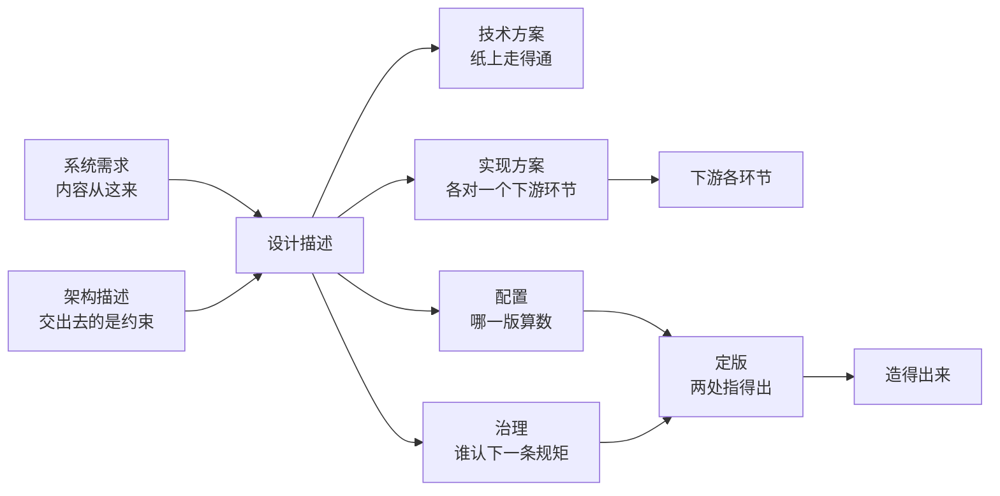

# 第18章 架构应用：从设计描述到治理示例

## 18.1 引言

### 18.1.1 误解现场

冰链的设计交底会开在三月。石军把系统级那份设计描述放在桌上，三块依次开工：箱体与结构、温控板与固件、云端与追溯。

交底只用了一个上午。散会时三块都拿到了同一份文字，都说了"没问题"。

一个月后合件，问题出来了。箱体那一块按判定窗口十秒做密封与走线，温控板那一块按采样周期五秒编的固件，云端那一块干脆自己另起了一个时间来源。三份都写得很齐，各有各的目录、版本号、改动记录，翻不出一处涂抹。

石军问了一句：你们依的是哪一版？

箱体那边答：v3.0，三月十二号发的。

温控板那边答：我手里是二月那版，三月这版我没收到。

云端那边答：我依的是接口视角规格，架构描述我没看全。

三份东西凑在一起，谁都没做错，合起来却是一台判不了断链的箱子。季昭拿着样机测了两天，最后给出一句：这台机器在功能上都对，在"断链"这件事上不成立。三块记的"断"不是同一件事。

同一个月，恒信那边的会上问的是另一件事。合同审批系统要上线，王默问：部署方案在哪？

苏婷说：还没写，等系统定了再说。

王默说：上线顺序、回滚条件、监测点，这三样不定，我这边的窗口排不出来。

罗建补一句：排不出来就得往后压，可客户那边月底要跑第一轮对账。

那天会开到中午，谁也没有吵。散会前郑亮问了一句让全场安静的话：我们是不是把"交下去"当成了"交完了"？

两边卡住的其实是同一件事的两头。一头是设计描述交下去之后，谁依的是哪一版说不清。一头是方案没写全，下游那一步就开不了工。这一章把两头并到一起看。

### 18.1.2 本章的人和物

恒信这边六个人：郑亮管业务，顾言管需求，罗建是系统架构师，组里唯一顶着这个头衔的那一位；苏婷管开发，王默管部署与运维，曹峰是产品开发经理。

冰链这边六个：林涛管需求，石军管温控硬件与固件——架构那一页也压在他手上，吴浩管云端与追溯，小周管制造与供应链，季昭管测试，小张是系统工程师。

两件产品。冰链的温控箱，本章看 v3.0——把断链判定改成十秒的那一版。恒信的合同审批系统，看 v2.3——规则从写死在代码里改成走配置的那一版。

本章读的是架构描述交出去之后往下那几份东西：设计描述、配置、治理。设计描述又分技术方案与实现方案，下一节拆开讲。前几章把这些词的定义都给过了。这一章不重讲定义，只看它们在一件真产品上各长什么样、各要向谁交代。

### 18.1.3 本章要回答什么

读完本章，你应该能答上六件：

1. 设计描述是一份还是几份？技术方案与实现方案，各自是什么、为什么要分开？
2. 架构描述交到设计手上，交出去的到底是什么？为什么它给不了"怎么做"？
3. "我依从架构"这句话，要答出依哪一版、吃哪一版，才算有内容？
4. 需求少了一条，那份方案是没了，还是别的什么没了？
5. 一份东西凭什么算"定下来了"？改的时候走哪条路？
6. 一条规矩出了事，该问谁？

先说四句用词，往后不再解释。

第一句，"设计描述"是标准里的名字，本书一直用它，也就是第14章说的"系统设计描述"。口语里常说的"方案"，本章按位置分开叫：技术方案一份，实现方案几份。这样分开数，是为了看清每一份各自向谁交代。

同一个词在两处管的地盘不一样。第7章拿"实现方案"指那八份合起来的整摞，技术方案也在里头。本章把它拆开数，说"技术方案一份、实现方案几份"时，只数技术方案以外的那几份。往下都按本章的拆法读。

第二句，"定版"指这份内容被选为候选、由配置管理批准并冻结、收进基线，此后能当依据用，不是"最新的那一版"。

第15章把这个动作叫"正式化"；本章一律叫"定版"，指的是同一件事。

第三句，本章说"依从"，一律指两样都答得出，不是一句态度。

第四句，题里的"架构应用"指架构描述在这几份件上被用起来。设计方去取约束、拿它核相容、每一份都要答出依哪一版，最后由一个人认下一条规矩。

题里的"从设计描述到治理示例"，说的是这一整段里依次要交代的四样东西——技术方案、实现方案、配置、治理——以及每一样在一件真产品上长什么样。给的是示例，不是模板。四样也不是一级做完了才做下一级，它们可以同一天发生，也可以倒着被追问回来。

---

## 18.2 设计描述：技术方案与实现方案

### 18.2.1 技术方案：纸上走得通

技术方案答的是一件事：这东西本身长什么样、怎么实现。冰链这一版的技术方案分四段写。

结构布局这一段：双压缩机冗余，左右各一路。任一路故障时，另一路承担全部冷量。箱体分冷藏舱与控制舱，控制舱独立隔热。箱盖开三次以上要记录次数。

模块划分这一段：采集端、判定端、上报端三段；判定端只在采集端给出的时间基准上判定，不得自行计时。

接口关系这一段：采集端与判定端之间走内部总线，采样周期五秒；判定窗口十秒，偏差超过五百毫秒记一条异常。

关键技术指标这一段：箱内控温 −20℃ 到 8℃，稳态偏差不超过 ±0.3℃；断电保温七十二小时；整机控制在二十公斤以内。

这份东西合格的标准是"纸上走得通"：懂这一行的人看了，能判断原理上成不成立、指标之间打不打架。比如把采样周期定在五秒、判定窗口定在十秒，两处不矛盾。再比如断电保温定在七十二小时，电池容量又限制在某个量级，一算就知道做不做得到。

它答完了这一问，也**只**答完这一问。

它没有说这份方案谁来造、产线上按哪份文件装、装箱之后按什么判、坏在客户那里谁去修。

这些不是技术方案漏了，是它们本来就不在技术方案的射程里——它们各自有各自的那一份。

恒信那边对照一眼就看得出。合同审批系统的技术方案写的是规则引擎怎么划、审批链的数据结构长什么样、并发多少路。这份东西让"这套系统能不能跑起来"在纸上成立。它同样没写上线的顺序、没写回滚到哪一版、没写积压多少条要告警。

### 18.2.2 实现方案：各对一个下游环节

技术方案之外，还有几份。

冰链这一版这次补了两份：制造与测试。加上原有的技术方案，它这边能拿出手的是三份。恒信那边同一个月补的是另外两份：部署与运维。

制造方案里，工艺路线写成七步：注塑、装配、烧录、气密、低温老化、整机标定、包装。每一步后面跟着一句接收准则。烧录那一步写的是"固件版本号写入后回读一致，不一致即返工"；气密那一步写的是"充气保压三分钟，压降不超过 0.5 千帕"。

测试方案是一份试验大纲。到站活性怎么测，写清了取样点位、保温时长、判定阈值。断链告警怎么测，写清了模拟十秒静默、看后台是否在三十秒内生成记录。断电保温怎么测，写清了满载断电、每小时记一次箱温。每条后面跟一句"接收准则"，最后一条写的是"三项全过才判通过，任一项不过，整批退回"。

恒信的部署方案写上线顺序：先规则库、再审批引擎、最后前端。每一步后面写着三样：回退到哪一版、回退由谁触发、触发之后多久要回到旧版。写这条的时候，王默在会上说了一句：回滚条件不写清楚，我这边的窗口就只是个时间，不是个方案。

运维方案写监测点与告警。三个点：规则生效时延、审批积压条数、对账差异笔数。每个点各自多久采一次、超过什么值告警、告警发给谁。王默在这份东西的末尾另加了一段：凡新增监测点，须写清它的判据来自哪一条需求。

这几份东西摆在一起能看出一件事：它们不是技术方案的附件，是另外几问的答案。技术方案答的是"这东西长什么样"，实现方案答的是"这一环怎么把它做出来、怎么判它做对了"。

还有一句要交代清楚：标准对整份设计描述只给一条出口——拿得去采购，或者拿得去实现。

本章把它拆成"纸上走得通"与"手上造得出"两问，是本书的分工读法，不是标准把出口分了两档。

一份方案对一个环节，这条界线要守住。制造那一份要是把测试的接收准则也写进去，两份就会互相等着改。

### 18.2.3 设计描述：每一段都有人认领

一沓东西交下去，接住的人要做三件事：说得出这一段是从哪来的，说得出它落到自己这一块的哪一处，说得出哪一条他接不住。

冰链合件那天，三块各报了一遍。

箱体那一块说得出前两条：密封结构依系统级第 4 条，走线依系统级第 6 条，落到本层的箱体图与工装清单上。第三条答不上来——温控板把判定窗口从十秒改成八秒，箱体这套密封与走线是按十秒留的余量，接不住。可这句"接不住"，当时没人说。

吴浩那一块报得干脆：接口视角规格第 2 条我接得住，第 5 条接不住，因为第 5 条要求追溯域记到批次，而云端这边只记到箱号。

石军听完，把这两条写进了交底会的记录：**接不住的那一条，必须当场说出来**。说不出来，等于默认接得住；等到合件才发现，改的是三块，赔的是时间。

所以这一沓东西的合格标准，不在它写得多厚，在每一段是不是都有人认领。认领了来处，也认领了落处；接不住的，是缺口，须当场报出来。

小张在会后做了一张表，只有三栏：这一段在哪一份里、它是从哪一条来的、谁认的。表填完，她指着最后一栏说：这一栏空着的，就是还没人认领的。

再往下一层的那几份设计描述，这里不单讲，只作为"每一段都要有出处"的例子出现。哪一份归哪一层、层与层之间怎么分，前几章已经说过。

---

## 18.3 架构描述：交出去的是约束

### 18.3.1 划的是不许

架构描述交到设计手上，交出去的不是做法，是约束。

冰链那份架构描述里，有三条是"不许"：

时间只有一个来源，由采集端给出，云端不得另起。

判定逻辑必须挂在这个来源上，新增的判定不许自带计时。

新增的接口不许绕过追溯域，要出去就走受控导出。

三条都不是"你应该怎么做"。第一条没说你用哪个晶振，第二条没说你判定写成什么结构，第三条没说你导出用什么格式。它们把不许的事划掉。没划的地方由设计自己定值，但要写清这个值由哪一条架构特性转来、指得回哪个架构实体。

石军在评审会上被问过一次：这三条是不是太粗了？

他说：粗的地方正是留给设计的地方。我要是一路说到用哪个型号，那我写的就不是架构描述，是设计描述了。

"不许"这一侧还有一层用处：它让争论有个停的地方。冰链那次讨论要不要上北斗授时，谁都说得出好处，最后停住讨论的是第一条——时间只有一个来源，由采集端给出。加一路外部授时，要么并进采集端，要么就是第二个来源。讨论从"要不要"变成"并进去还是不加"，半小时就完了。

恒信那边同一条界线：配置项不得绕过引擎的能力面，也就是引擎本身已经会做的那些事。这条一划，讨论"要不要给某个配置项开个后门"就不必再开了。

### 18.3.2 取不到就是缺口

约束不会自己跑到设计那边去，是设计方主动去取。取的是三样：适用于本层的基本概念或属性，指导设计及其演化的原则，以及适用于本层的约束。

恒信那边出过一次取不到的事。苏婷做子系统设计，写到扩展点时停下来：什么算破坏性变更，架构描述里没写。她问罗建，罗建翻了半天说，当时没想到会有人问这一条。

这一处不是"架构描述写得不够细"，是**取不到**。取不到的那一处，就是一个缺口：设计这边要么自己猜一个，要么停在那里等。猜的那一个没人认，等的那一段没进度。

罗建后来补了三行：破坏性变更指字段语义变化、接口出入参变化、历史数据不可回读；三样任一出现，按变更走。

补完他说了一句话：缺口不是设计的错，是交的那一方没交到。

冰链那边也有过一次。石军把接口视角规格挂进项目之后，吴浩做子系统那一层，问的是另一件事：我这层的降级状态该分几级？

石军反问：五级是你定的，还是我这条视角规格定的？

吴浩把规格翻了一遍：规格里只说"连续性不得中断"，没规定级数。

石军说：那它管不着你。它管的是"不能断"，不管分几级。

于是吴浩在设计描述里补了两栏：一栏写"本层取值：五级"，一栏写"依据：接口视角规格第 4 条（连续性要求）"。林涛看过之后说了一句：架构没管你的取值，但你的取值有了出处。

这两件事说的是同一件事的两面：取得到的，要写出出处；取不到的，要说出来，不能猜着往下走。

### 18.3.3 依不依从看相容

设计做出来之后，要拿架构描述核一遍。核什么、不核什么，得先说清。

冰链有一版固件，为了省电，把心跳间隔拉到了十二秒。功能上都对，判定窗口也照旧是十秒。可它违背了第一条：时间只有一个来源，它自己另起了一个更慢的节拍。

这一条被拦下来的时候，写固件的人不服：不就是慢了两秒？

石军说：不是慢两秒。

这个箱子判"断没断"，靠的就是那一个时间来源；你另起一个，它判出来的"断"和云端记的"断"就不是同一件事。这不是某人不高兴，是这么造出来，它**就不再是这台箱子了**。

相容这条判据的硬处就在这里：它不评比好坏，它判的是这个实体还是不是原来那个。

恒信那边有同型的一例。一个配置项在引擎的能力面上找不到对应的位置，功能测试全过，做出来的演示也跑得漂亮。罗建把它拦下来时用的也是这一句：这不是做得好不好；它执行时靠的不是引擎给的能力，那它就不是这套系统的配置项。

相容查出来之后，处置只有两条：要么改设计，让它回到里面；要么回架构，把这条约束本身改掉。中间那条"先用着、以后再说"，就是下一次对不上的起点。

---

## 18.4 系统需求：给得出怎么造

### 18.4.1 把怎么造问出来

"怎么做"这一问，架构描述答不了：它只划边界，不给做法。可这一问也不是设计自己凭空答的——题目由系统需求出，边界由架构描述划，设计把两边一起答。

冰链这一版有一条系统需求，原文是这样的：

采样与判定共用同一个时间来源；这个来源由箱内采集端给出，随每次上报一并送出；云端不得另起时间来源。采样周期五秒，判定窗口十秒，偏差超过五百毫秒记一条异常。

这一条到了设计手上，就变成一道具体的题。采集端用哪一路时钟、怎么随包送出、判定端怎么对齐、偏差怎么量、超了怎么记。题是需求出的，答案是设计给的。

这条界线要划清：需求说"断在哪一段要说得清"，架构说"时间只有一个来源"，设计说"用哪一路时钟、怎么对齐"。三句各管一头，谁也不能替谁写；三句同时在场，不分先后。

把它写反了会怎样？石军在一次会上试过。他先把技术方案那几段念了一遍，问林涛：这几句能不能当你那条需求的判据？

林涛说：不能。它说的是我做成了什么样子，不是客户要什么。

再倒过来问：那条需求能不能直接拿去当设计描述？也不能。它没说到落在哪几个元素上、每处给出什么。

两样都不能替对方，于是这一步必须有人做——两边都要答，而且答得对不对，要答得出"这一条落到哪"。

### 18.4.2 可实现性谁来提

需求里有一类，客户不会提，只能承制方自己提：造不造得起、造不造得出来。

这一类按生存周期环节展开，一个环节一样：物料采购、制造、测试、交付、部署、运维、回收；最后再压一条横切全程的总账——经济可承受性。前七样各对一个环节，最后那一条不是第八个环节，它横切每一项。

按生存周期环节列的那张表，取自第5章。它与第3、7章那"八份方案"不是同一张：八份里有"操作"、没有"回收"，两个名字各占一边。本章按第5章这张表走，不把两张并作一张。

还有一层要说清：这一条先落进**相关方需求**，也就是承制方各业务代表提的那一类。再由需求那边转成系统需求。功能与环境适应性两类归第5、17章，本章不重讲。

提的人是各业务代表：采购、制造、测试、交付、部署、运维、回收的业务代表，加市场代表。

冰链这边，可制造性与可测试性是这一个月补上的两条。

可制造性那一条，内容是一句话：产线上装得出来，产线尾上测得出来。判定方法是工艺路线与物料清单逐条对一遍，测试台跑三台、记节拍。

可测试性那一条，内容是：断链判定要能在产线上验；判定方法是模拟十秒静默，看后台是否在三十秒内生成记录。

补这两条的会上，季昭说了一句：这两条不写，我这边测什么都是猜。

小周说得更直：你们不写可制造性，我不提；我不提，产线那边就等图纸。

恒信那边补的是另两条：可部署性与可运维性，提的人是王默。他把这两条写成了一句一句可判的话：上线顺序能一次排出来，回滚条件能指到具体一版，三个监测点各有阈值与收件人。

这两条补得晚，代价也看得见：早前上线，回退到哪一版没人说得清。

### 18.4.3 写全了才同时开工

快与慢，差别不在开会，在需求里有没有给每个专业留位置。

冰链这次快，是因为小周从第一天就在场。技术方案第一稿拿出来那天，他就坐在那儿，问的是三句。这道密封圈产线上压得出来吗？整机标定要多久？低温老化箱够不够排？

三句都有答案，因为需求里写了可制造性那一条。工艺路线与技术方案是一起改的：技术方案把密封结构从三道改成两道，工艺那边省了一道工装。改完小周算了一遍，产线节拍从每台二十六分钟降到十九分钟。

季昭那边也是从第一天就在。她的那一条是可测试性。测试大纲与技术方案一起长：技术方案里凡是写"必须能测"的地方，她当场就要求写清测试点在哪、怎么接。

同一个月，恒信那边的对照很难看。部署与运维起初没有需求，也没有人提。

结果是系统做完才补：上线顺序是临时排的，回滚条件写成了"出问题回退上一版"——上一版是哪一版，没人说。

王默后来讲：不是我不想早做，是那时候我手上没有一条能让我开工的东西。

这就是"同时开工"的实情：它不是把各专业的代表叫到一间会议室，是需求里给每一个专业留了一条自己的需求。留了，他第一天就能动；没留，他只能等。等项目做到最后一周才把人叫来，那不是同时开工，是同时催工。

### 18.4.4 缺了，方案就没依据

方案齐了，才叫方案可实现；齐不齐看份数，有没有依据看底下那条需求。这一节问的是后一件。

需求少一条，对应的那份方案会怎么样？

份数不会变。环节还是那几个，方案还是那几份——制造方案不会因为少了一条需求就消失，测试方案也不会。变的是另一件事：那一份**失去了依据**。

冰链早前那一版，没写可回收性。回收那一份方案还是写了，写的是"由客户处置"。这句话没错，可它底下没有一条需求顶着，等于是凭印象写的。后来客户那边换了处置要求，这一份从头返工。

恒信那边更清楚：运维方案先交了，写的是"按常规监测"，那时候底下还没有可运维性这一条。什么叫常规，谁定的，答不上来。上线三个月，负载掉到三成，王默把台账拿出来，才有人问：当初这份方案是照什么写的？

苏婷后来把这个毛病说成一句话：没有需求顶着的方案，写的时候最省事，验的时候最没底。

所以这一节的判据不是"方案齐不齐"，是**每份方案底下有没有一条需求**。齐是看得见的，有依据是看不见的；看不见的那一头才要查。

小张补过一张对照表，两栏：左边一份方案，右边它底下有几条需求。填完发现有两份底下是零条。她说：这两份看着最完整，其实最悬。

---

## 18.5 定版：哪一版是定下来的

### 18.5.1 依错了版本，等于没依

设计依的是哪一版架构，这句话必须答得出来。答"最新那一版"不算答——最新只说明它走到最远，不说明它算数。

冰链那次合件，温控板那边答"二月那版"，问题就出在这儿：二月那版比基线旧。它依的是一个已经作废的版本。

云端那边答"我依接口视角规格"，比基线新——它依的是一个还没被批准的版本。

两种错法后果不同：依旧的，等于按一份已经不算数的东西在做；依新的，等于按一份还没人批的东西在做。两种都不算依从。

正确的答法只有一种：依的是被批准、已冻结、收进基线的那一版。

冰链现在的做法是，每一块的设计描述首页写两行。一行记本层依据的架构基线版本号、批准人、批准日期；一行记吃的是哪一版需求、谁确认的、哪一天。制造、测试、部署、运维那四份同样处理：每一份被谁拿去当依据，谁就给它立一条设计基线，首页也写这两行。

这两行补上之后，还出了一次小场面。小周在产线准备会上问：这一版能不能升？小张把产线那份设计基线翻到落款那一页，看了看，没答话，把笔搁过去了。石军说：能不能升，先看它签的是哪一版基线；签的那一版对不上，就不能升。

填这两行还有个讲究：批准、冻结、能作参照，三样缺一样，这一栏就是空的。王默在恒信那边见过只批不冻的：批了，可后来还在改，改完没人重新批——那一版严格说没有一刻是定住的。

### 18.5.2 需求也得有版本

冰链这一版的判定窗口能定成十秒，靠的不只是架构那一版。需求基线里那条写的就是十秒，而且有人认过这个数。要是需求那边还在改，设计这边按哪一版做都不算数。

恒信出过一次两头对不上的事。需求这边把审批阈值从五十万改到三十万，架构那边没动，设计按三十万做了，测试按五十万验的。

四份东西各自都有版本，可它们不是同一对。

事情查出来的时候，郑亮问了一句：四份都有版本，为什么还会错？

顾言答：因为版本各管各的，没人对过它们是不是同一对。

后来顾言把这件事说成一句话：不是四份都要同时定。是每一次有人说"我依从"，他得能把两处都指出来。而且这两处，得是彼此相容的那一对。

冰链那边把这件事落成了动作：每次基线变更，配置那边出一张对时单，两列——架构基线版本、需求基线版本，一行一对。谁引用其中一版，就把另一版一并写上。

### 18.5.3 依从不是一句表态

到这儿可以把"依从"这句话拆开了。

它不是一个态度，不是一个签字动作，是两处都指得出来：依的是哪一版架构，吃的是哪一版需求。两处都指得出，而且彼此相容，这句话才有内容。

这两处比的是版本。标准里那条双向追溯比的是元素：设计特性要指回架构实体，也要指上系统元素需求。这一层由设计自己写，对时单管不到。

冰链现在交设计描述，首页就带这两行：

依据：架构基线 v3.0，架构评审组批准，石军落款，三月十二日。

依据：需求基线 R-2026-03，林涛确认，三月九日。

两行都不长，可少了任何一行，这份设计描述就只是"我们做完了"，不是"我们依着做的"。

季昭在测试记录上补基线栏的时候说过一句话，用在这儿正合适：这一栏补的不是手续，是别人敢不敢用你的结论。

反过来说，"我依从架构"这句话要是只在会上说过、只在邮件里写过，它后面就没有东西可查。查的时候只有一件事可做：把两行拿出来，看它们对不对得上。

---

## 18.6 签字：谁认下一条规矩

### 18.6.1 署的是名，不是部门

规矩发下去之后，出了事要问一句：这一条谁认下的。答"架构组"不算答，答"评审会通过"也不算答。能认下、也能担着的，是一个有名有姓的人。

恒信那边有一年吃过这个亏。季度委员会开了四次，每次都定了一条，纪要上写的是"会议决定"。两个月后两边又对不上，曹峰去问，项目经理指着纪要上那四个字说：定了啊。

定了不等于成立，这是两件事。纪要上没有作出的人、没有理由，也没有传达给要照做的人，这一条就还没有被认下。

那次追问之后，恒信的纪要多了一行：裁定人。那一行填的是名字。第一次填的时候，曹峰愣了一下，然后把自己的名字签了上去。

他的原话是：以前这行不写名字，出了事谁也说不清；现在写了，反而不太敢随便定。

署名的人不必是做判断的人。判断由谁作出、效力由哪一处给，是两件事——这一层第16章说过，本章只把它落到这一行名字上。

冰链那边的例子更小。有一页早年的"老规矩"，石军一直收在手上，页尾没有落款，谁写的、什么时候写的，没人说得清。补上落款之后，那一页才进了架构库；进库那天他说：这一页现在有了去处。

### 18.6.2 裁定只落在一处

冰链那边出过一次，同一条规矩有两个家。

两处都能改，等于两处都不用改——改坏了谁也不知道该找谁。断链判定的时点，架构描述里写"以采集端为准"，接口视角规格里写"以云端对时为准"。两份都是有效文件，两份都有人维护。

季昭测的时候发现了：同一条记录，按两份文件算，一个是断链，一个不是断链。她把两份都打印出来，摆在评审桌上，问了一句：我按哪一份判？

石军把这一条收回到一处，另一处改成一句指引：见架构描述第几条。收回来之后，他补了一句：**规矩不能有两个家。**

收回来那天还顺手做了另一件事：把两份文件的版本对了一遍。架构描述 v3.0、接口视角规格 v1.2，两处引用的是同一份约束。石军说：引用的版本也得对得上，不然收回来只是表面。

### 18.6.3 答不出名字就没主人

判一条规矩有没有主人，问四句就够：谁批的？按什么程序？改它走哪条路？依据是哪一条？

还是那页老规矩。前两问答得出，后两问答不上：改它走哪条路，没人写过；依据是哪一条，抄的是行业惯例。

石军把这一页重新写了一遍，末尾加了一行：本页的变更，由架构评审组裁定，须记录理由与影响范围。

恒信那边把四句做成了勾选：一条规矩上台之前，四句逐句答，答不出就留在未决议题里，不进指令。曹峰起初觉得这套手续太重，用了半年之后改了说法：重的是第一次写，省的是以后吵。

四句里只要有一句答成"找某某问问"，这条规矩就没有主人。不是治理做得差，是这一处根本没有主。

---

## 18.7 没交代清楚的地方

### 18.7.1 没交代清楚：看它断在哪儿

一整章讲下来，可以回头把毛病收成一个词：没交代清楚。

它有四种样子。

第一种，没交到下一手：那几份实现方案根本没人写，或者写了没交。恒信那边的部署与运维就是这一种。

第二种，几处说法对不上：同一条记录，两份文件给出两个答案。冰链断链时点那两个版本就是这一种。

第三种，人走了查不到：哪一版、谁批的、什么时候，答不出。恒信纪要上那句"会议决定"是这一种。

第四种，没有主人：这一条规矩出了事，问谁去。冰链早前那页老规矩是这一种。

四种不是四类毛病，是同一条路上的四处空着——来处、落处、哪一版、问谁。这四处都不在任何一个人的手里，所以只能写在交接处；不写，它不会当场露出来，只会等到合件才现形。

季昭在评审会上说过一句很像总结的话：这四种错，每一种都不影响今天出货，每一种都在明天等着。

### 18.7.2 写在一张单子上

补法很笨：一张纸，三栏——本章叫它三栏交接单。三栏是哪两处之间、靠哪一种连上、谁负责。它和前面小张那张表不是一张：那张查每一段有没有人认领，这张查两处交接有没有人接。

冰链这次只有两行。第一行：箱体与温控板之间，靠接口视角规格与采样周期那一份连上，小周负责。第二行：温控板与云端之间，靠时间基准那一条连上，吴浩负责。

恒信那边六行，从审批流到规则库、从规则库到前端，一行一行填下来。填到第六行停住了：迁移脚本与历史数据之间那一处，谁负责，当时没人认。

小张把第三栏空着的那一格留着，说：这一格空着就对了，空着说明我们现在知道它是空的；填个"待定"上去，反而没人再看。

那张单子后来被抄成了两份：一份贴在设计组墙上，一份随交件走。两行都有人签字，换个人来照这张单子也接得住。

后来冰链把这张单子加了一栏：这一处交接的判据写在哪。石军说，光有人负责不够，还得知道按什么判。

### 18.7.3 认知反转

回到章首那间会议室。

石军问"你们依的是哪一版"，三个人答出三个；王默问"部署方案在哪"，答"还没写"。这两件事看起来都是"人没到位"，其实是同一件事：交接处没有写清楚。

最容易走偏的读法是把它读成排队——需求在上，架构在中间，设计在下，一层等一层。要是这样，三个人答出三个版本就是正常的，因为谁也不必知道别人依的是哪一版。

这一章要说的是相反的一句：**没有谁听谁的**。需求要什么，架构不许什么，设计两边都要答得出。哪一边答不出，那一处就还空着。

空着的那一刻不痛。它会等到很久以后，以"对不上、查不到、没人认"的样子回来。

还有一种读法也走偏：把这一章当成"文件的规矩"——以为写齐了格式、填满了目录，就算交清了。格式对得上的东西，照样可能是三块各按各的理解做的；这三块交上来的时候，没有一处不合规。

---

## 小结

架构描述交出去之后，往下还有几份东西：设计描述、配置、治理。本章逐份看过，每一份都按同样两问去读：依的是哪一版架构，吃的是哪一版需求。

两问答得出、两处指得出来、而且彼此相容，这一份才算交得出去。

如果只带走一句话，带走这一句：

> **架构描述管不住你怎么做，它只管你做的和它相不相容；而"相不相容"这句话要成立，得先答得出依的是哪一版、吃的是哪一版。**

散会的时候，苏婷把恒信那六行单子折起来夹进设计描述首页。石军看见了，也回去把冰链那份设计描述的首页补上了那两行：本层依据，架构一行、需求一行。

---

## 附录

### A 本章概念总图

> 读这张图注意：两条箭头都指向设计描述，一条给内容、一条给边界，两样一样重；配置与治理各托一头，缺任一，箭头指不回去。

### B 本章的能力级

本章以"全书"为单位清点。本书的能力分四级：表征是把词说准，图式是把结构画出来，心智模型是能推演，解释框架是能回答"凭什么信"。

按第1章 §1.4.3 那把尺子量一下：**本章以第 ④ 级为主**。前三级各沾一点，真正升上来的是第四级。

- **解释框架（本章主级）**：值得信的不是"方案写得全"，是每一份都能答出依哪一版、吃哪一版；架构描述给的是约束不是做法；依从不是表态，是两处都指得出且相容。
- **收束句**：**能答全两问，才算依从**——一份设计描述摆在面前，你说得出它依的是哪一版架构、吃的是哪一版需求，两处都指得出来，而且彼此相容。

  全书那句"能答全四问，才算拥有"是家法，本章这两问是它在这一站的落法：第1章那四问答"这个词是什么"；到了设计描述这一站，四问收成两问——依哪一版、吃哪一版。
- **刻度行**（按第1章 §1.4.4 那把尺子）：合上书，拿你手上最近一份设计描述，给它添两行出处：依的是哪一版架构、吃的是哪一版需求；哪一行添不出来，就在那一处做个记号。

本章的能力落在哪里？第9章那份清单列了六样：科学素养、方法论素养、实践能力、职业伦理、工程判断、可复现意识。本章一项也不新长，它给的是这六样在这几份件上共用的一套底子。

### C 自查 · 这些说法对吗？

1. "设计描述就是一份文件。"——**错**。技术方案一份、实现方案几份，合起来才是它。
2. "技术方案写完，设计就做完了。"——**错**。它只让纸上走得通，另外几份才让手上造得出。
3. "架构描述交下来，设计照着做就行。"——**错**。交下来的是约束，得主动去取；取不到的那一处就是缺口。
4. "依从就是签个字。"——**错**。依从要指得出两处，还要这两处彼此相容。
5. "需求少一条，方案就少一份。"——**错**。份数不变，缺的是那一份的依据。
6. "最新那一版就是定下来的那一版。"——**错**。最新只说走到最远，不说算数。
7. "纪要上写了'会议决定'，这一条就成立了。"——**错**。没有作出的人、没有理由、没有传达到要照做的人，它还没被认下。
8. "同一条规矩在两个地方各写一遍，更保险。"——**错**。两处都能改，等于没人改。
9. "先出图，工艺再跟，是行业惯例。"——**错**。那是需求里没给工艺留位置时的退法，不是惯例。
10. "份数齐了就等于有依据。"——**错**。齐是份数，依据是每份底下那条需求；齐了只说明份数到了，不代表每一份都站得住。

### D 练习

1. 拿你手上最近一份设计描述，找出它有没有写明"依的是哪一版架构、吃的是哪一版需求"。
2. 把技术方案与实现方案分开列一遍：哪几份有、哪几份没有、没有的那份底下缺哪条需求。
3. 找一条架构描述里的"不许"，追到设计描述里它落在哪一句；追不到，就是缺口。
4. 挑一条规矩，问那四句：谁批的、按什么程序、改它走哪条路、依据是哪一条。答不出的记下来。
5. 画一张三栏单子，把你这周经手的两处交接填进去，第三栏空着的那一格别急着填。
6. 拿你手上那几份方案，逐份问一句：这一份底下有几条需求？零条的那一份，写一句"它现在照什么写"。

### E 参考文献

> 编号怎么读：`[k]` 是本章内的文献序号；括注的 `R-xx` 是全书参考文献总表（附录 D）的编号。

**标准**

- [1] **R-37** ISO/IEC/IEEE 15288:2023《系统与软件工程 — 系统生存周期过程》—— 设计定义过程的目的与输出、设计特性、追溯要求；系统需求定义与架构定义两过程的分工。**用于本章 §18.4、§18.5**
- [2] **R-04** ISO/IEC/IEEE 42010:2022《架构描述》—— 架构描述与设计描述的关系、对应关系的适用范围。**用于本章 §18.3**
- [3] **R-05** ISO/IEC/IEEE 42020:2019《软件、系统与企业 — 架构过程》—— 架构过程与设计过程的次序、治理过程的位置。**用于本章 §18.6**

**本书内的原料**

- 24 号《架构与设计边界研究报告》§18——两个方向并列与 1＋N 的构成
- 第15章（配置管理）—— 依的是哪一版架构、吃的是哪一版需求
- 第5章（需求的完整性）—— 可实现性需求与对应方案的那张表
- 第7章（产品数据）—— 八份方案与"方案齐备即可实现"
