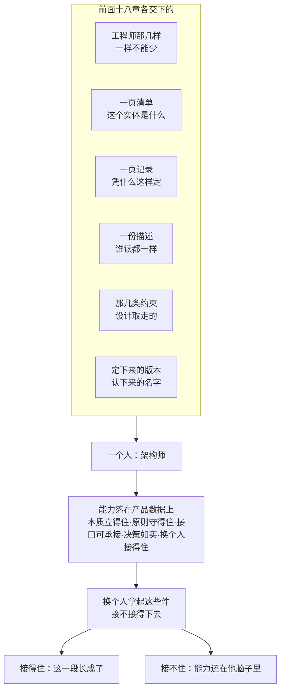

# 第19章 架构师：还是一份能力清单

## 19.1 引言

第十八章把设计描述、配置、治理逐份验完，末一节的收束落在一句话上：来处、落处、哪一版、问谁，这四处都不在任何一个人的手里。这一章问的是另一件事——交这些件的人是谁。

这一章不新增概念。它只做一件事：把前面十八章交下的东西，合到一个人身上。

### 19.1.1 误解现场

恒信集团，年度评优会。

主持人念到"年度架构师"，念的是罗建，颁奖词两句：全年产出架构图最多，架构文档最全。掌声响起来。

罗建从第三排站起来，上台，接过那块牌子。灯光有点晃，他把牌子翻过来看了一眼，又翻回去。

散会以后，需求分析师顾言在走廊上把他叫住，问了一句："当选架构师，意味着你现在是什么？"

罗建张了张嘴。他试着替自己答，答了三次。

第一次，他想说"我是画架构图的"。可评优会夸的是图多、图全；那四张图下面有没有一条决定，没人问过。

第二次，他想说"我管架构"。可真要动架构，得先提理由、再进基线、最后还得有人批；他手里那点权，只够把话说清楚。

第三次，他想说"我技术最好"。那是工程师的尺子，量不出架构师。

三条都走到头，没有一条通到他身上。顾言没再问，走开了。当天下午，办公室里三个人替他答了：

开发说："架构师就是更高级的工程师——升上去了嘛。"

测试说："架构师是画架构图的人，图最多的那个。"

运维说："架构师是什么都管的人，出了事都找他。"

三句话，三个"架构师"。两年前，两间会议室为"架构"两个字吵得不可开交；两年后，一间办公室为"架构师"三个字各说各话。

三句都错，错法还一样：第一句把职级当成能力，第二句把图当成架构，第三句把权力当成责任。

三句说的都是他坐在哪儿、手里拿着什么——没有一句说的，是他交得出去什么。

### 19.1.2 本章的人和物

两家。冰链造温控箱，恒信做审批系统。这一章要量的人，前面各章都露过面。

先看两个。

恒信的罗建，名片上印着系统架构师，四张图画得规整，其实是四个域的四张图；被点醒以后，他把图分拣进描述、把决定补成一节，又照清单给自己写了一份体检。

冰链的石军，嵌入式硬件，管 M3 的温控与固件。他没换过名片，手上那页老规矩从第十一章写下来，一直没换。

其余人各有各的角度。恒信这边：顾言做需求，走廊上那一问是他问的；小张是系统工程师，两本账分得最清；郑亮管业务，看的是月底对得上账；苏婷管开发，交出设计描述；王默守运维，问的是出事查不查得到。冰链这边：林涛是产品经理，季昭管测试，小周管制造，赵刚签字。

### 19.1.3 本章要回答什么

读完本章，你应该能回答七句：

一、名片上印着"架构师"、手上也画过图——这两样，凭什么都不算数？

二、一个架构师先得是个工程师；这一层没走扎实，上面那几层能力为什么都长不起来？

三、同一个人做到架构师，手里的本事是换了一套，还是同一套换了用法？

四、架构师交出去的东西有几样？每一件，接的人拿它判什么？

五、架构师写下的一份判断，要让别人能当依据用，还缺哪几样？

六、架构师不担哪些责任——和系统工程师、和业务方，各差在哪？

七、换个人接手架构师交出的那批东西，接不住的时候，缺的是清单上哪几条能力？

七句底下压着更硬的一句：从工程师到架构师这条路，终点长什么样。

这一章不是教你争头衔。它要把评优会上那三句答不上的东西，一样一样补出来。

## 19.2 架构师先是一个工程师

### 19.2.1 工程师的能力，一样都不能少

前面各章各交下一件东西，第 9 章把它们收成一份清单，清单底下压着这样几样：科学素养、方法论素养、实践能力、职业伦理，另加横穿的工程判断与收口的可复现意识。

这几样怎么来的，第 2 章到第 9 章讲过，这里不重讲。要说的只有一句：**一样都不能少**；缺哪一样，上面长出来的就落不了地。

- 缺科学素养：说不清这个系统靠什么成功，后面的取舍没有根据。
- 缺方法论素养：那套判断只在他一个人脑子里，人一走就带走。
- 缺实践能力：判断悬在半空，落不到任何能被造出来的东西上。
- 缺职业伦理：判断越准，破坏越大。
- 缺工程判断：取舍没有依据，只能看谁的声音大。
- 缺可复现意识：他交出去的东西换个人接不住，等于每次都从零开始。

> 判据：上列几样里任何一样答不上来，先别提后面那几件。架构师先是工程师——这句不是资历上的客气，是清单上的次序。

### 19.2.2 同一套能力，架构师怎么量

这几样能力一样没多、一样没少，换的是量的对象，和问的那句话。

| 这一样 | 工程师那一格 | 架构师那一格 |
|---|---|---|
| 科学素养 | 这个部件靠什么成功 | 这个系统靠什么成功、做错什么最致命 |
| 方法论素养 | 我这套做法，别人学得会吗 | 我这套判断，别人拿得去用吗 |
| 实践能力 | 最近一次亲手做出来，是什么时候 | 判断的依据还查得到吗 |
| 职业伦理 | 压力面前，有没有为进度悄悄牺牲可靠性 | 原则是不是先立、例外有没有批、依据是不是事后补的 |
| 工程判断 | 冲突里怎么取舍 | 信息不全时怎么做选择、留不留得下改的余地 |
| 可复现意识 | 写下来了吗，别人接得住吗 | 整套描述与决策受不受控，下游是不是必须依据它 |

表里工程师那一格，第 9 章逐条论证过。右边那一列，是第 10 章往后各章各自长出来的一截。

举三处。**科学素养**那一格，做法是先问三句：这个系统靠什么成功、最大压力在哪、做错什么最致命。答得出这三句，才谈得上判断"什么算基本"。

**可复现意识**那一格，到第 15 章变成基线——不是文档写全，是每一种内容都答得出哪一份是定下来的。

**职业伦理**那一格，到第 16 章变成治理——目的、原则、红线写在纸上，改它要走程序、要留名字。

三处都指向同一件事：这几样能力在架构这一层，不是做得更多，是**对象换了**——从部件换到系统，从这一版换到往后几版。

### 19.2.3 工程师量成果，架构师量产品数据

第 9 章和本章用同一句判据，换的只是量的对象。

第 9 章那一句是：换个人，用同样的需求和约束，能不能交付质量相当的**成果**。成果有参照——参照是需求，对不对得上，验一次就知道。

本章这一句是：下一个人拿起他签过字的**产品数据**，接不接得下去。判断没有参照——它不落成一次交付，只能等到后头几个版本，才对得上账。

差别就在这一处。第 10 章说过，架构没写下来从来不等于没有，它藏在第一版方案里替所有人做了决定；第 12 章说过，决策不承诺选对，它能承诺的是让将来信息齐了的人查得出、改得起；第 15 章说过，配置管理不做，技术过程产出的一切都停在草稿这一档。

三句说的是同一件事：**这个人的产出是判断**，而判断没有一次交货能替它结账。

所以"他做出来过"证明不了他。一个工程师交出图纸与测试报告，"做出来了"就在那儿；一个架构师交出一份决策记录，"做对了"要等下一次改动才知道。

> 判据：不问"他做出过什么"，问"他交出的东西，下一个人能不能接着用"。

### 19.2.4 架构师的工作，从构思到维护

标准给这件活立过一个词条，说的是在所关注实体的整个生存周期内，构思、定义、表达、记录、沟通、认证恰当实现、维护与改进架构。七件事，一件一件点：

- 构思：从关切出发，把可能的做法想出来。
- 定义：划边界、做选择，收敛到一个。
- 表达：把它翻成一组各有其主的视图。
- 记录：把内容与决定固化成能签收的一份。
- 沟通：让要照做的人理解，说到一处。
- 认证恰当实现：查造出来的东西符不符合这套架构。
- 维护与改进：对着腐化，把它守住。

> 译名注：对照版把这七件译作"构想""编制文档""证实其正确实施"，与本书的"构思""记录""认证恰当实现"同义，件数与次序两版一致。

两件要注意。**七件事不是七道工序**，它们在整个生存周期里反复回来：今天在构思，下周在定义，明年还在维护。

**它和前面那份清单是两套切法**：清单是体检切法，看这个人身上有什么；这七件是工序切法，看他一天在做什么。

两套对得上——七件里有四件，记录、沟通、认证恰当实现、维护与改进，做的都是同一件事：**把判断交出去。**

还有一件事必须说清，否则整份清单都悬着：**标准只认活，不认名片。**那份标准的词条里没有"架构师"这一条；`architect`（架构师）只在一个词条里被举作角色名，有角色名，没有词条。

全书唯一给"架构师"下角色定义的，是一本系统工程手册。本书说的架构师，是把这个活动背在身上的人；正式名叫系统架构师。

> 判据：拿一个人来问——构思、定义、表达、认证这些活，他做过哪几件、各留下什么件——不问他的名片上印的什么。

标准既然只认活，那接下来就不问头衔，只问他交出了什么。

## 19.3 架构师交付什么

上一块说的是他会什么，长在他身上；这一块说的是他拿得出什么，落在纸上。六件事，一件事留下一份东西：前四件在这一块交；定版与认下在下一块，依从再说两处怎么对得上。每一份都要答得出同一句话：交给谁，他拿它判什么。

### 19.3.1 清单：交付拿掉就不成立的那几条

第一件，说清这个实体是什么。

它不是一张图。第 10 章把这件事压成一页纸：最上面一句目的，下面三样——必须先说准的几个概念、必须守住的那几条属性、造它改它时不许违反的规矩。

写成什么样才算数，判据是同一条，用三次：**拿掉它，这个实体还达不达成目的。**

属性的那几条，每条后面都跟一句"拿掉它会退成什么"：拿掉全程可追溯，它退成一只会调温的箱子；拿掉断链三十秒内告警，它退成一台事后才查得出来的记录仪；拿掉断电保温七十二小时，它退成长途运输就可能断链的箱。三次只减不加，那条门槛落在哪儿，自己就露出来了。

第 11 章补了两处。三样有次序：概念先立，判据才说得出口；规矩要分两类，管实体的与管过程的，只有管实体那一类，等于有属性、没过程——将来改流程，它一条界也拿不出来。

规矩的效力也不是扣分，是**不予承认**：这么造，就不算这个系统的一个做法。

冰链这一份的落处很朴素：石军把填表时用的三样誊到一页上，存进共享盘。

文件名他没写"架构 v1.0"，写的是"M3 的架构：一句话，三张清单"；旧图没删，改名叫"参考图，别照它做"。

这一页说清了它是什么，没说清"凭什么定的是这一条"。那是下一件。

### 19.3.2 记录：交付当初的理由

第二件，把当时摆着的几条、为什么否掉，一起留下来。

第 12 章把决策重新拆过一次：它不是拍板那一下，是一个集合——编号由谁生成、状态怎么划分、历史数据怎么迁移、对外接口给不给导出，四件各有各的理由。

写成一份记录，一页纸，六问，一行一条：这条决策叫什么；为什么会有它；当时考虑过哪些做法；定了哪一个，谁定的，什么时候；定了它影响什么；它有多难反悔，什么情况下要重审。

六问里最容易省掉的是两处。第一处是"叫什么"——看着多余，其实它是索引，没有它，别的决策指不到它、计划也引不了它。

第二处是"谁定的"——记录不产生授权，这一栏空着，等于没人认领。

恒信那次改编号，四件选择被打包成一句"改个字段"，一个都没写；记了选什么，没记为什么是它；把"定下来"当成了"被批准"；又把记录当成一次定死，而它可以改、可以复审，所以记录里要留时间点：作出、批准、修改。四样错，是同一个判断的四个侧面。

冰链那边留下的两行，小得多：吴浩想在追溯平台开一条直连，石军拦住，最后落成"受控导出"四个字——数据怎么出去、每次出去留不留痕，从那天起有据可查。

记录的是理由。理由要能被人拿去对，就得写成别人读得一样的一份。

### 19.3.3 描述：交付谁读都一样的内容

第三件，交出去的是写着它的那份文件。

第 13 章的办法是把同一批内容排两遍：按类别排一遍是清单，保证一条不少；按"谁要判什么"排一遍是视图，保证每条关切有处可答。

两遍中间要有账——对应关系、对应方法、已知问题，一段一条。

**先订视角，再画视图。**视角是一套读的规矩：这类问题看哪些面、按哪套记号、拿什么去对。规矩写进规格才算数——规格里有七项要写全：相关方角度、它框定的关切、相关的方面、持有关切的典型相关方、模型种类与图例、对应方法、信息来源的引用；另加一条可选的视图方法。合格只有三个词：完整、精确、可验证——意思是换个人拿去用，产得出同一个东西。

现成的先用。标准自带的视角集、业界目录、描述框架里的视角库，都算；等到有一条关切在现成的几份里答不全，才自己切一份新的。答得全还加，是重复；答不全不加，是漏。

两处最容易被想岔。一处是把视图当图：多数视图其实是表格；判一样东西是不是视图，只问三句——在一份描述里吗、受某个视角治理吗、组件标了模型种类或给了图例吗。

另一处是把写下来当定死：写下来是为了查得下去、改得留痕，不是把话钉死。

交出去之前，第 13 章那两张单子逐条过：动笔之前手上该有的、交出之前该交的。恒信那边最见分量的一笔，是一格空着没填：描述里"决策权属方"那一格，当时没有人有权拍板，就空着——**事后补上去的名字，不是当时拍板的人。**

罗建把十五张图过了一遍，收进描述的是十一张；剩下四张，一张是流程总览，另外三张凭习惯画的示意图，既没标模型种类，也没配图例。他没扔：总览挪进附录，另三张留在原型那一摞。

写下来不等于交得出去。交出去之后，设计要拿走的是约束。

### 19.3.4 约束：交付的是不许，缺口要认领

第四件，设计接手时要拿走的，是那几条约束。

第 14 章把这一步的入口说反了常识：设计接手的第一步不是收文档、归档、转发，是**去那份描述里检查、取出东西**——取出适用于本层的基本概念或属性，取出指导设计及其演化的原则，取出适用于本层的约束。

苏婷把这三种抄成两栏，抄完说了一句：我以为我们缺的是文档，其实缺的是那一次"取"。

取不出来的那一处，就是缺口，不是"写得不够细"。恒信做子系统设计，写到扩展点停住：什么算破坏性变更，描述里没写。

罗建翻了半天说，当时没想到会有人问。补完他讲了一句：**缺口不是设计的错，是交的那一方没交到。**

交出去的也不是做法。冰链那三条，一条没说你用哪个晶振、判定写成什么结构、导出用什么格式；它们划的是不许——时间只有一个来源、判定逻辑必须挂在这个来源上、新增接口不许绕过追溯域。

没划的地方由设计自己定值，但要写清这个值由哪条架构特性转来、指得回哪个架构实体。

吴浩把降级状态定成五级，旁边补两栏：一栏"本层取值：五级"，一栏"依据：接口视角规格第 4 条"。林涛看过说：架构没管你的取值，但你的取值有了出处。

设计长出新东西是正常的，不正常的是长出来的没主人。**无主比违规更危险**——违规有人拦，无主看上去只是一个"细化结果"。

到这四件，他交出去的都是内容。可内容交出去还不算数：还得有人把它定下来，有人认下它。

## 19.4 架构师怎么让接的人用得上

上一块交出的是四份内容。可写得出来，不等于别人敢用。接的人要敢拿它判、敢照它做，还得有一样东西：这一份是定得下来的。

要三处一起答：哪一版被定下来、哪个名字担着、跟它一起吃的那一份对不对得上。

### 19.4.1 定版：定下来才用得上

第 15 章把三个词分开，各答一问。配置答"它是什么样"，版本答"走到哪一步"，基线答"哪一份是定下来的那一份"。

**版本只给位置，基线才给资格**——批准给资格，冻结给状态，参照给用途，三样缺一样就散架。第 15 章把这个动作叫正式化；本章与第 18 章同叫定版，指同一件事。

最容易漏的是第三样。会开了、字签了、文件归档了，然后大家接着用各自电脑上那份"顺手改过一点"的版本——批准和冻结都有，参照没有，基线于是名存实亡。

恒信那个按日期命名的文件夹就是一个例子：里面躺着两个包，"合同系统_final.zip"和"合同系统_final_2.zip"，回滚到上上个版本时，分不清哪个是哪个。

顾言把两个包的名字并排看了一眼说：版本是回滚的地址，基线是变更的参照；你只有日期文件夹，地址和参照都没有。

还有一层：基线不是一条。需求、架构、设计各有各的一份；被下游引用的东西有几种，基线就有几条。所以"我们建基线了"这句话，得追问一句——建的是哪一条。

定下来这件事，也不在他自己手里。挑候选的是架构与设计，收下并把它定下来的是配置管理；谁有权批这一版，归治理。这一条后面那一块还要用。

> 判据：这一份是哪一版、谁批的、什么时候。三问有一问答不出，它就不是能用的那一份。

### 19.4.2 认下：有人担着才用得上

第 16 章那一句最不舒服，也最要紧：一个组里把一条判断做清楚的人，**往往不是有权让这条判断成立的人**。

这不是不信任，是分工——做判断的人总偏向自己的结论，让另一处来接，那条结论才对全组都成立。

恒信吃过这个亏。季度委员会开了四次，每次纪要都写"会议决定"，两个月后两边又对不上。曹峰去问，项目经理指着那四个字说"定了啊"。

复盘时有人点破：纪要上没写作出判断的人、没写理由，也没传给要照做的人，这一条还没有被认下。

改造之后，纪要多了一行"裁定人"，填的是名字。曹峰第一次填时愣了一下，然后签了自己。

他的原话是：以前这行不写名字，出了事谁也说不清；现在写了，反而不太敢随便定。

署的是名，不是部门。答"架构组"不算答，答"评审会通过"也不算答——能认下、也能担着的，是一个有名有姓的人。

冰链那边小一号的例子：那页早年写下的老规矩一直收在石军手上，页尾没有落款，谁写的、什么时候写的说不清；补上落款之后，那一页才进了架构库。

还有一条边界要分清：一条规矩只能有一个家。断链判定那两个时点，架构描述里写"以采集端为准"，接口视角规格里写"以云端对时为准"，两份都是有效文件，两份都有人维护；季昭测的时候发现，同一条记录按两份文件算，一个是断链、一个不是。

石军把这一条收回到一处才收手——**规矩不能有两个家。**

> 判据：谁批的、按什么程序、改它走哪条路、依据哪一条。四句里有一句答成"找某某问问"，这条规矩就还没有主人。

### 19.4.3 依从：版本对得上才用得上

前两节答的都是"这一份"。接的人真正要的，是**跟它一起吃的那一份也对得上**。

第 15 章把"我依从架构"这句话拆开：它不是表态，是两处答复——依的是哪一版架构，吃的是哪一版需求。两处都指得出，而且彼此相容，这句话才有内容。

设计不是从架构里推出来的，标准写得明白：驱动设计的是需求，而进到设计那一步的需求，已经先跟架构对过一遍。所以设计有两个上家，两条线都得有基线。

冰链现在交设计描述，首页就带两行：一行写架构基线的版本、批准人、日期，一行写需求基线的版本、确认人、日期。

两行都不长，少了任何一行，这份描述就只是"我们做完了"，不是"我们依着做的"。

光有首页两行还不够，还有一张对时的单子：每次基线变更，配置那边出一张，两列，架构一行、需求一行，一行一对。

测试那一头也补了一栏——季昭在测试记录的"结论"旁边加了一格"基线"，填三样：对哪一版测的、那一版谁批的、测的时候这一版处于什么状态。

三个月后有人问"这批测试结论是针对评审前那版做的，还是评审后改过的那版"，她把记录翻开，指着那一栏：三月十四号那版，评审前定的基线，测完没动过。以前这样的问题，答案要翻半个小时邮件。

小张在会上还追问过一句：架构那份定了，需求那份呢？那一问不是抬杠，是把半句话补全。

> 判据：两行都拿得出来，而且对得上；只有一行，就是半句依从。

到这，接的人敢用了。可还有一面没答：他不担哪些责任。

## 19.5 架构师担什么，不担什么

上一块说的是他让判断被人用起来。这一块说另一面：哪些账不在他身上。

一个角色站得住，一半靠他担起的，一半靠他不担的——两样都划清，别人才知道出事该找谁。

### 19.5.1 终责：不在架构师手上

这是全书最容易混的一对，因为两个名字都带"系统"，都像统管的角色。其实两本账分得很清。

系统工程师对系统成败负终责：整个系统的账，出了事他兜着，这本账不可委托。

架构师对架构（基本概念或属性与管控原则）的成立与守持负专责：这两半立不立得住、守没守住，这本账可以委托出去，做砸了也要追到他头上（这一二分是本书主张：标准不规定组织结构，也不指定角色）。

一句话：架构师搞砸了，追责追到架构师；**对外担责的是系统工程师**。用本章的话说，他签的是"这一条立住了"，不是"这个系统成了"。

冰链那边小张分得最清。她把两份规格推到桌子中间，说：首页那两行补上之前，我们每一段都说得出"我按哪一版做的"，没有一段说得出"那一版是谁批的、什么时候定的"；系统能不能用，这个账在我这儿；他那页老规矩立没立住，是他的账。合成一本，出了事就没人说得清该问谁。我这边可以替他兜，账不能替他记混。

两者的关系不是指挥与执行，是两头互相对话：系统工程师把"架构的成立与守持"委托出去，架构师以描述回馈，评审认可。

中间还有一层协商——选了一个架构方案，等于给系统加了一批它本来没有的要求，这批派生需求要回流去更新规定需求。

拍板权在系统工程师，理由权在架构师。标准在架构定义那一步收口时，用的是一句"就架构定义取得一致意见"——它要的是一个答复，不是一个结论。

> 判据：出事以后问两句：系统成败的责任在谁头上，架构立没立住的责任在谁头上。两句落在同一个人，要么是兼任，要么是有一本账没记清。

### 19.5.2 目的与拍板：都不归架构师

再往上游走，还有一条界。

系统目的与任务的定义权和问责在业务方。架构师的职责是让架构忠于目的，不是替目的做主。

这并不意味着他被动——他对目的有四件事要做：理解，把目的当作判据吃透；澄清，目的模糊时向上游回溯，推动业务方表达到可判定的粒度；质疑，用可行性、成本、一致性去检验它；守护，全程盯着目的漂移。四件里有一件是有产物的：理解。

那份产物是一张单子，分三部分：目的原文照引，业务方的原话只引不改；架构师的复述；业务方签字。

它是纯理解、不含一点架构内容——复述里冒出架构语言，就是越界了。这份单子是架构活动的入场券：签字之前，后面的一切产出都没有判据锚点。

恒信那边第一次签，产品开发经理曹峰想省一步："目的还用写？我们心里都清楚。"顾言没让他省："心里清楚不算数。您把它说到我能判真假，我才好开工。"曹峰把那张单子签了，签完说了一句："这么一问，我这边倒先把目的想清楚了一遍。"

拍板也一样。选定是判断，认下是决定；判断可以由架构活动给出，决定得由有权的人作出。能把这两件分开，才不会出现"评审通过就等于决策生效"这种账。

还有一件事要分清：角色分离不等于人员分离。小团队里，一个人可以同时戴业务方和架构师两顶帽子；但做每个决定时，得知道此刻戴的是哪一顶。

两顶帽子在脑子里互相迁就，是很多架构失控的起点。

> 判据：拿一份目的陈述来问——这句话是谁说的，说得出来源和签字人，它在链上；说不出，它只是房间里的一句共识。

### 19.5.3 评估与认证：架构师管什么

第 8 章把评审、验证、确认三个词钉住了。另有两个动作，前十八章没有落处，本章补上。

**评估，对的是架构本身。**标准给评估过程写的目的是：确定一个或多个架构在多大程度上达成其目标、应对利益相关方关注点并满足相关要求。

判的是"多大程度"，不是对错——这也正是第 12 章那句"决策不承诺选对"的另一面。

**认证，对的是造出来的东西。**证实架构的正确实施，有时被表述为架构师向客户或用户作出的正式声明，即所构建的系统满足可投入使用准则。

这句话的分量在两处：它是标准原文里少数把动作挂到架构师名下的地方之一；它对着的是交付，不是内部自娱。

五个动作各对一个对象——评审对材料，验证对需求，确认对用途，评估对架构，认证对实现。

最容易混的是把评估、认证塞进评审桌上——评审桌上放的是那一版材料；评估问的是这套架构值不值、够不够；认证问的是实现有没有按这套架构做。

有一处边界要标清：架构师在技术评审里有没有固定席位，是组织分配的，不是标准赐予的。

上句说的席位，是本书据系统工程手册那份名单所作的说明，属本书主张，不是标准条文。

> 判据：手上这件事，问一句"对着的是什么"。对象一清，动作就定。

到这，他不担的账划清了。剩下最后一件：拿什么量他。

## 19.6 能力落在产品数据上

前面几块说的是他交什么、怎么让人用、不担什么。这一块收口：这些能力到底在哪儿看得见。

### 19.6.1 产品数据：架构师交出去的那一类

能力长在人身上，看不见，也没法直接检验。面试官会看走眼，领导会凭印象打分。它最终要落到一处能被翻、能被查、能被接手的地方——他交出去的那批产品数据。

第 7 章立过一句：开发产品就是开发产品数据。产品有两个存在，开发阶段亲手造的是信息那一个，实物只是照它复制出来的。

这句话在架构这一层同样作数：他交的不是图，是那批能签收、能入库、能打版本号的东西。

这一族以架构描述为核心，往外一圈是：基本概念或属性清单、管控原则、决策记录、接口定义、框架定义、派生需求清单、权衡报告、基线、演化路线图、系统级验证方案。

按标准明文的清单对一遍，还得补几件：架构评估的报告与价值评定结果、未处理项与不符合项声明、符合性正式声明、基线候选物、评审问题的处置记录。

还有一件职责最容易漏：**架构符合性把关。**这件事本来就写在架构活动的定义里（认证恰当实现），可责任矩阵里不一定有一格写着它。

也就是说，他不只写架构，还要查别人做出来的东西有没有按这套架构造。

> 判据：把这些件摊开，一件一件看：哪一件在，哪一件缺。

### 19.6.2 产品数据：什么样算好

不是图多，不是文档厚。好是这样几条：

**本质立得住。**那一页上写的几条，拿掉任何一条，这个实体就不是它了——不是"重要"，是"去掉就不成立"。分不清这两样，清单会越写越长。

**原则守得住。**规矩要能被违反、违反了能据此判。写成"要重视可靠性"的，是愿望；写成"未过回归测试不得发版"的，才是规矩。

接口可承接。两边怎么对接、谁先谁后、改一处要通知谁，接的人拿得着，不用再问一遍。

决策如实。取舍如实记，被否的备选连理由一起留着。恒信后来立了一条自己的规矩：六问写不全的，不进评审。

可这条只管记录写全没写全；这条规矩本身谁有权改，不在它管的范围里。

**换个人接得住。**前四样都是为这一样服务的。

这几样量的是这批件写没写到能判，不是判断对不对——真要判品质，参照仍是需求与目的。

冰链那边有一个很小的场面。产品开发经理赵刚在评审结论上签字，落笔前总问一句："这一条谁验的？"问清了才签，签完在背面记一行"为什么"。

答不上来的那一条，他照样签，背面记一行"待补"。那行字，下一个人翻开就接得住。

> 判据：拿这几条当尺子，一件一件量；量不出来的那一件，就是缺的那一格。

### 19.6.3 产品数据：换个人接得住

全章的清单、责任、判断，最后都收到一句话上。这句话和第 9 章量工程师的那句是对称的。

第 9 章那句是：换个人、换团队，用同样的需求和约束，能不能交付质量相当的成果。在这里，对象换成了架构：

> **换个人，拿着他签过字的那些件，接得下去吗？**

接得下去，架构就在；接不下去，再大的图也只是装饰。

这一问还顺手把前面几块的账一起算了。定版那一处问"你不在场，它接得住吗"；认下那一处问"要改它，走哪条路、谁批"；依从那一处问"接的人接的是哪一版、哪一份"；符合性那一处问"别人做出来的东西，还认得出这套架构吗"；专责那一处问"接的人接的是哪一本账"。五个问法，落到同一句话上。

拿两个人量一遍。罗建最早那四张图接不住——那是评优会之前的事：图下面的决定他没写下来；后来换上的那份决定清单和那份体检单，才开始能交出去。

石军那一页老规矩接得住——改的人照着它改，验的人照着它验；可他缺两格：方法论素养与可复现意识。

他的判断准、落地稳，可那一套在他手里长成了技艺，没长成别人能接着用的东西。他没有头衔，缺的也不是头衔。

> 判据：不必等出事才问。把手上那批件交给一位同事一周，只回答他提的问题，不主动补充；一周后看他问的是什么——那些就是件里本该写着的。

### 19.6.4 认知反转

回到评优会。

上一场吵的是"架构"这个词指什么，这一场吵的是"架构师"这个人算什么。吵的东西换了，病没换：

人们把一个本该由能力定义的东西，**交给了名分去定义**。

名分回答不了"你现在是什么"。能回答的是那批件：一页清单说清这个实体是什么，一页记录说清凭什么，一份描述让别人读得一样，一份约束交到设计手上，一份定下来的版本，一行认得下的名字。

用第 1 章那把尺子量一遍。对"架构师"这个词，章首的罗建停在"见过"那一级——叫得出头衔、画得出图，却答不上"你现在是什么"；到这里，量下来的结果是"拥有"那一级——他能拿清单打勾，认得出自己缺什么。

石军那边是另一条量法。小周说过一句："石军，你做的这些，是架构师的活。"他没接话。他手里那页纸写着三条规矩，边角已经磨毛了——那页纸从第十一章写下来，到第十三章补成规格，到今天还在用。

改的人照着它改，验的人照着它验。它不是图，也不是头衔，是这个团队能接着用下去的东西。

两个世界，各开各的会，到这里对上了同一个答案。顾言两年前在那两间会议室里问的那个问题——"这个产品到底是什么"——问的是系统；今天这一问换到人身上，答案是同一个：这个物种不由头衔认，**由他交出去的那批产品数据认**。

## 小结

本章把前十八章收到一个人身上。

收成之后，清单是这样的：先是工程师那几样，一样不能少；在这几样之上，他多做六件事——认出这个实体必须守住的那几条，把选择连同理据定下来，写成一份别人读得一样的描述，把约束交给设计并把长出来的认领回来，让每一份内容都有基线，让每一条规矩有人认下。每一件事，留下一份下一个人能用的东西。

它划了界：终责不在他手上；目的与拍板也不归他；评估对着架构本身，认证对着造出来的东西。

最后它把能力从人身上挪到纸面上：下一个人拿起他签过字的那些件，接得下去，这一段才算长成。

如果只带走一句，带走这一句：

> 这个物种不由头衔认，**由他交出去的那批产品数据认**。

## 附录

### A 本章概念总图

> 读这张图注意：上面那几样不是几摞知识，是同一个人在同一条链上做的几件事；下面那一处检验也不是新加的题目，它是第 9 章量工程师那句话换了个对象。

### B 本章的能力级

本章以"全书"为单位清点。本书的能力分四级：表征是把词说准，图式是把结构画出来，心智模型是能推演，解释框架是能回答"凭什么信"。

按第 1 章 §1.4.3 那把尺子量一下：**本章以第 ④ 级为主**。前三级各沾一点，真正升上来的是第四级。

- **解释框架（本章主级）**：值得信的不是"这个人头衔高、图画得多"，是那批件交得出去、接的人敢用；终责与专责是两本账；判断与效力分属两只手；同一套能力，换到架构这一层换了量法。
- **收束句**：**能答全四问，才算拥有**——拿一个人来，第 1 章那四问收成三句：这份清单上他亮了几格、他背的是哪本账、他交出去的产品数据换个人接不接得住。
- **刻度行**（按第 1 章 §1.4.4 那把尺子）：合上书，拿你团队里一个人的履历，照这份清单逐格打勾；空着的那几格，就是他下一步该补的。

本章不新增能力项：它给第 9 章那六样一个共同的宿主，并把其中两样长到头——可复现意识长成配置与基线，职业伦理长成治理。

### C 自查 · 这些说法对吗？

| 说法 | 病 | 药 | 判据 |
|---|---|---|---|
| "架构师就是升职后的工程师" | 把职级当能力 | 职级不定义人；分工看那一层的变更权在谁手上 | 拿一个决定问：这一层的谁有权改它 |
| "图画得最多、最全的人，就是架构师" | 把图当架构 | 架构是那份内容；删掉图，决定还在的才算 | 把图全删掉，还剩下什么 |
| "架构师应该什么都管" | 把专责当成终责 | 两本账：架构的成立与守持是专责，系统成败是终责 | 出事以后，责任落在谁头上 |
| "被任命为架构师，就是架构师了" | 把名分当能力 | 名分是时间的快照，能力是一格一格长出来的 | 这份任命让清单上哪一项变了 |
| "架构师负责把系统的目的定下来" | 越界改写目的 | 目的的定义权在业务方；他做理解、澄清、质疑、守护 | 这份目的陈述，是谁说的、谁签的字 |

### D 练习

1. 对号：把这份清单抄成一列，逐项问自己"这件事我做过哪几件、留下什么件"，空着的记下来。
2. 换量法：拿你手上那件事，按"工程师那一格"与"架构师那一格"各问一遍，看哪一格答不上来。
3. 删图一次：把你那套架构材料里的图全放到一边，只留文字；剩下的够不够别人接着干？
4. 摊件一周：把手上的产品数据交给一位同事一周，只回答他提的问题，不主动补充；记下他问的每一句。

### E 参考文献

> 编号怎么读：`[k]` 是本章内的文献序号；括注的 `R-xx` 是全书参考文献总表（附录 D）的编号。

**标准**

- [1] **R-04** ISO/IEC/IEEE 42010:2022《软件、系统与企业——架构描述》（§3.1 架构活动及其七件事；§3.2 架构定义；§6.10.1 决策记录）。用于本章 §19.2.4、§19.3.2、§19.3.3。
- [2] **R-05** ISO/IEC/IEEE 42020:2019《软件、系统与企业——架构过程》（§3.2 注 2 符合性正式声明；§9 架构评估目的句；§8.4.5 目的陈述；§8.4.7 立概念与原则）。用于本章 §19.3.1、§19.5.3。
- [3] **R-37** ISO/IEC/IEEE 15288:2023《系统与软件工程——系统生存周期过程》（§6.4.4 系统架构定义过程；§6.4.4.3 e) 2) 就架构定义取得一致意见；§5.9 概念与系统定义（驱动设计的是需求））。用于本章 §19.3.4、§19.5.1。
- [4] **R-38** ISO 9000:2026《质量管理——基础和术语》（§3.11.2 评审）。用于本章 §19.5.3。

**研究报告**

- [5] 12 号《工程师与架构师能力研究报告》v2.6、13 号《工程角色谱系研究报告》v2.8——能力增量、成长路径、粒度与责任、专责与终责（§19.2、§19.5.1、§19.6）。
- [6] 39 号《架构师职责与产品数据研究报告》v1.1、40 号《架构治理研究报告》v1.0——唯一角色定义、过程级责任、四件不负责、判断归定义与效力归治理（§19.2.4、§19.4.2、§19.5）。

**经典文献**

- [7] **R-63** INCOSE《系统工程手册》第五版中文版（与 15288:2023 同版同年）——全书唯一给"架构师"下角色定义之处，库外·二手。
