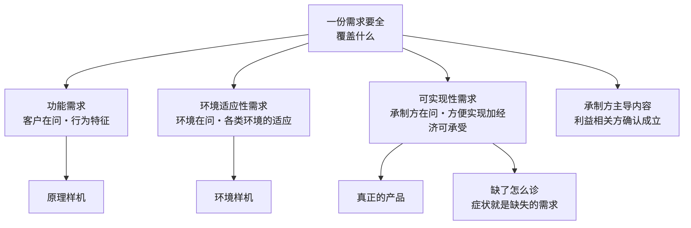

# 第5章 需求的完整性：全不全，责任在承制方

---

## 5.1 引言

### 5.1.1 误解现场

冰链科技的 M3 医疗冷链温控箱，原理样机做出来了。

嵌入式硬件工程师石军把一台样机摆在桌上。它能把箱内温度稳在 2℃，波动不超过半度。金属箱体、半导体制冷片、一块单片机，走线是手焊的，电源是实验室的。它跑了一周，温度曲线漂亮极了。

产品经理林涛站在白板前宣布：“原理样机验证通过，我们的产品成功了。接下来就是放大生产。”

产品开发经理赵刚点了头：“样机跑通了，验证也过了——放大生产，我签。”

会议室一片掌声。

只有角落里的制造代表小周皱着眉。他翻着样机的零件清单，摆了三件事，最后问了一句：

> “制冷片买得到，可这颗控温芯片是定制料，供应商说最小起订量五万片、交期二十周。外壳是 CNC 一件件铣出来的，量产要改注塑，这个结构和壁厚注不出来。还有，这个精度是靠手工校准的，产线上没人会做。你们管这些叫'成功'？”

会议室安静了。

屋里没有一个人觉得不对：样机跑通了，验证也过了，怎么会不是成功？

本章要推翻的正是这个直觉。它错在一个动作上：林涛那句“验证通过”验的只是一部分，签字的却是一整件产品。

### 5.1.2 本章的人和物

这一章的事大多在冰链，少数在恒信。

原理样机做出来了，产品经理林涛说“我们的产品成功了”；制造与供应链小周一句“你们管这些叫成功”把话问住。产品开发经理赵刚、测试季昭、系统工程师小张各从自己那份交付物上看这台样机；嵌入式硬件石军与云端软件吴浩分别守着箱子与云端。恒信那边，需求分析师顾言出的是另一道题。

物有两样：一台冰链的 M3 温控箱，一套恒信的合同审批系统。

### 5.1.3 本章要回答什么

读完本章，下面这几问，你应该答得出来。

1. 一份需求要“全”，得覆盖哪几样内容？
2. 同一个“能不能测”，为什么在用户那边和承制方这边归成两类需求？
3. 原理样机做出来了、需求也通过了，凭什么不能说产品成功？
4. 客户不问、法规也不强制的那些需求，靠谁想起来？
5. “非功能需求”这个名目为什么不能用？隐含需求为什么不算另一类？
6. 量产时每一声“不方便”，怎么反推成一条当初没写的需求？

这几问合起来，问的是一件事：一份需求全不全，凭什么由承制方负责到底。

---

## 5.2 需求要全，先看是谁提的

第4章的末尾点到过三类需求：功能、环境适应性、可实现性，点到就停了。为什么分的是这几类，每一类拿什么去验，缺了算谁的——那是这一章的事。

### 5.2.1 一份需求要覆盖哪些内容

第3章说过，需求要写成可判定的样子；第4章说过，需求是开发出来的，要能当依据用。再往前一步是更基本的一问：一份需求要“全”，到底覆盖哪些内容？

答案藏在一份讲正向设计的培训材料里。它把“产品”和样机分得很干净：

> 产品：满足功能需求、环境需求和可实现性需求的成品。

也就是说，“产品”这个词成立，本身就要求这几类内容都在场。引文里的“环境需求”，就是这一章的环境适应性需求。

反过来推：缺了哪一类，交付物就降一档。缺可实现性需求，它就不是产品，只是一台样机；连环境适应性需求也缺，样机还得再降一档。

冰链那台 M3 缺的正是可实现性需求。它连环境适应性也还没验，所以不是产品。

这几类不是几个笼统的筐。每一类都能展开、能设指标、能派给一个具体的人。

| 它在回答什么 | 需求类别 | 一句话说清 |
|-------------------------|--------------|-------------------------------------|
| 它做不做得到要它做的事 | **功能需求** | 系统所具备的行为特征，以输入、处理、输出定义 |
| 它在我的场合活不活得下去 | **环境适应性需求** | 对气候、国家、文化、风俗、法律等各类环境的适应 |
| 我造不造得起、造不造得出来 | **可实现性需求** | 生存周期各环节“方便实现”，加经济可承受 |

功能需求是唯一有现成用例链可走的一类：业务用例、业务场景、系统用例、用例场景。它从“利益相关方要办什么事”一路走到“系统在什么场景下做什么动作”，也因此是后面往下一级分解时最主要的素材。

环境适应性需求靠环境分析展开：先把产品打算投放的环境集定全，再逐项核实。这里的“环境”是广义的，不只是温度、湿度、盐雾这些自然条件。卖到哪个国家，就有那个国家的法规；装在哪类车上，就有那类车的振动与供电。法规强制的那几条不用商量，捕获的动作是从法规文本里摘录，一条一条摘进需求。

负责 App 与追溯平台的吴浩跟着补了一句：“冷链车进了山区连不上网，App 得先把温度数据存在本地，出了山区再补传。弱网环境也算一条，别到验收那天才发现。”

可实现性需求靠实现方案展开，后面单独讲。

这么分、并说清每一类加进去之后交付物长到哪一档，是本书对军品与工程界“完整需求”实践的凝练与命名，不是任何标准的原文——一手来源是这份培训材料，它给了这几类内容的正式清单。所以这三类不是三个并列的名目，是一个谁在问、加到哪一档才成产品的结构。

### 5.2.2 同一个特性，算哪一类

这几类最容易搞混的地方，是拿“特性的名字”来分。分类的判据不是名字，是“谁在问”。说白了，是谁提的。

- **功能需求**，是客户与使用者在提：我要的产品，做不做得到我要的事？
- **环境适应性需求**，是使用环境在提：你到了我的地盘，守不守规矩、活不活得下去？
- **可实现性需求**，是承制方在提：我造得出来吗？造得起吗？交付得了吗？

拿“测试性”说。它在使用环境下被提，问的是“在役期间测得出状态、定得了位”，归环境适应性需求。

承制方的生产与交付里提的是另一问：产线上测得方便、测得快，归可实现性需求。

同一个特性，两种归类。叫法也跟着提的人走：使用环境下写“测试性”，承制方的生产交付里写“可测试性”。

再拿“备件与维修”这件事说。使用环境在问：这东西在冷链车上坏了，当地能不能马上修好、备件够不够？这条在环境适应性需求里叫保障性。

承制方也在问：备件库铺几处、维修网点配几个人，我撑不撑得起？这条叫可运维性，归可实现性需求。

同一个关切，两个主人，两个名字，两套验证条件。

所以分类的动作不是查表，是问一句“这一条是谁在问”。问不出来，就说明这一条还没想清是谁的需要。

还有两个名目会冒充别的类别，这里先画开。第一个是“非功能需求”。非功能需求是用排除法划出来的：凡是不能当场演示“能干什么”的，全被划到它底下。拿“谁在问”一量就散了——底下装的是环境适应性需求与可实现性需求两块，主人、来源、验在哪一档都不同。用它分类，判据丢了，验在哪一档也糊了，还没有终点。

第二个是“隐含需求”。明示的、通常隐含的、必须履行的，说的是需求怎么呈现，第4章按来路分过这三种；功能、环境适应性、可实现性，说的是需求归哪一类。两条轴正交，谁也不推谁——隐含需求不是第四类，它是“怎么出现”的一种形态，哪一类都可能以它出现。顺序也就有了：先定这条需求归哪一类，再看它怎么出现。

### 5.2.3 没有指标，就只是愿望

每一类包括什么、谁来提，都说清了。还剩一条共用的规矩：需求等于描述加指标。

缺了指标，前面分的那几类全成了空话。拿 M3 说：

- 功能需求的指标：温控精度 ±0.5℃、响应时间、续航时长、容量；
- 环境适应性需求的指标：工作温度 −20℃ 到 8℃、防护等级、电磁兼容的限值；
- 可实现性需求的指标：目标成本、关键尺寸公差 ±0.2 毫米、交期二十周、服务周期。

一句“要控温准”是愿望。“箱温波动不超过 ±0.5℃”才是需求。样机实测那半度摆幅，比这条要求还紧。

### 5.2.4 案例进展①｜上线出问题，不是功能的事

恒信的合同审批系统没有物理样机，可同一副框架照样成立。

需求分析师顾言复盘时发现，公司里反复出现的“上线后一堆问题”，很多不是功能问题：

- 功能需求（合同能发起、能审批、能归档，月末五百人同时用也不卡），恒信做得最早，原型阶段就把流程跑通了；
- 环境适应性需求（审计留痕、内网安全合规），这些是监管在问，只在试点时才验；
- 可实现性需求（可部署、可运维、成本可承受），只有真正的产品跑过一年才验。

恒信的“样机”是原型、试点、真正的产品；冰链的“样机”是原理样机、环境样机、真正的产品。同一副框架，两个世界，长一个样。

复盘会上，顾言把投影关了：“原型跑通那天，后面那两关，我们签过几个字？”

没有人接话。

他转身在白板上写下一句：“恒信大部分上线事故，坏的不是功能，是最后那一样。部署文档缺失、运维没人接、升级要停机、一年运维成本是预算的两倍。原型跑通那天，这几样一条都验不了。”

---

## 5.3 需求缺一块，交付物就退一档

“谁在问”定了它是什么；三类加到哪一块，交付物才长到哪一档，是接下来要问的。

### 5.3.1 每一块，只在它那一档验得成

只写了功能需求，做出来的东西最好也就是原理样机；加上环境适应性需求，才到环境样机；再加上可实现性需求，交出去的才是真正的产品。

这不是分法的巧合：需求写到哪一块，那一块要的验证条件就定死了，交付物也就只能长到哪一档。

| 需求写到哪一块 | 交付物长到哪一档 | 要在什么条件下验 | 证据由谁认 |
|---------------|---------------|--------------------------------|-------------|
| 功能需求 | **原理样机** | 把功能从环境与量产成本里剥出来，单独验原理 | 客户与使用者 |
| ＋环境适应性需求 | **环境样机** | 在真实环境下逐条验环境指标 | 环境利益相关方 |
| ＋可实现性需求 | **真正的产品** | 在量产经济性的约束下实现出来 | 承制方 |

为什么不能一档验到底？因为这几类要的验证条件互不相容。验“原理对不对”，环境干扰越少越好。验“真实环境下活不活得下来”，就必须上真实环境。验“能不能经济、可重复地造出来”，只能在量产的约束下见真章。

低的那一档，替不了高的那一档。

负责测试的季昭点头应道：“那我手里的活也跟着档位走。原理样机上我只能测功能，环境样机上测真实环境，能不能上产线，得等真正的产品出来。”

### 5.3.2 累加的是交付物，不是验证

细看会发现，交付物是一级级累加起来的。环境样机当然得先把功能做全，不工作就谈不上环境适应；真正的产品当然得先满足功能与环境。于是很多人顺口就以为：既然一路做到最后一档，前面几块内容自然都验过了。

累加的是交付物，不是验证。

每一块内容，都有它第一次验得成的那一档：功能在原理样机上就验得成，环境适应性要到环境样机，可实现性只能等真正的产品。

为什么“做全了就都验过了”这句话会流行？因为它前半截是对的：交付物确实一级级累加。

环境样机确实比原理样机多做了环境；真正的产品确实把前面几样都做全了。看交付物，一步比一步全；可看验证，没写进需求的那一块，长到最后一档也没人验。

真正吃亏的地方在一句顺口话上：“样机都跑通了，产品自然就成了。”

这句话把交付物的累加，当成了验证的累加。于是没人再问：可实现性需求，写了没有？谁验的？

可实现性需求，只有真正的产品——量产、交付、运维跑过一遍——才能验。

工程界另有两个刻度可以借来看距离有多远：技术就绪水平管技术成熟，共九级，从“基本原理被观察到”到“在真实环境里运行”，原理样机通常落在中间几级；制造就绪水平管造不造得出来。

所以那几档是同一件交付物一级一级长大的。你手上这一件停在哪一档，就看它验得了什么、还差哪一块没验。

### 5.3.3 过了一档，不等于合用

验证与确认，这里先划一条边。那三档交付物给出的证据，都是验证的证据，判据是明示的规定需求——说出来了，就已经是规定需求。而确认不看单条对不对，看的是这套东西在预期用途下合不合用，要在真实或模拟的使用条件下做一次。

所以环境样机上“逐条环境指标达不达标”属验证；“放进真实使用环境看合不合用”属确认。确认的参照是使用情境、运行概念、用例这一族东西，与那三档交付物并列，谁也替不了谁。展开留给第8章。


---

## 5.4 造不造得起，客户不问，承制方提

前两块把“要全”和“验得成”说完了。剩下的那一样，最难，也最没人管。

### 5.4.1 造得出来，也造得起

可实现性需求是承制方对自己提的要求。可实现性需求按生存周期的环节展开，一个环节一样；最后再压一条横切的总账。

| 生存周期过程 | 可实现性需求 | 对应的实现方案 | 提的人 |
|------------------|------------------|---------------------|------------------|
| 物料采购 | 物料可采购性 | 物料采购方案 | 采购业务代表 |
| 制造 | 可制造性 | 制造方案 | 制造业务代表 |
| 测试 | 可测试性 | 测试方案 | 测试业务代表 |
| 交付 | 可交付性 | 交付方案 | 交付业务代表 |
| 部署 | 可部署性 | 部署方案 | 部署业务代表 |
| 运维 | 可运维性 | 运维方案 | 运维业务代表 |
| 回收 | 可回收性 | 回收方案 | 回收业务代表 |
| 生存周期全程 | **经济可承受性** | 成本方案 | 市场代表 |

其一，三条线是锁死的：过程、需求、方案。实现方案是对可实现性需求对应内容的符合性解答。物料采购方案回答物料可采购性，制造方案回答可制造性，如此类推。一条需求缺了，与它对应的那条方案也就没有依据。

其二，经济可承受性排在最后，却与上面几条不是并列关系：它是需求项，不是过程。七个过程加这条总账，才齐。

其三，构件级与系统级同构。可实现性需求还是那些方面，只是构件级的“可运维性”，有些材料里写成“可服务性”。本书一律用可运维性，可服务性只作别名。同构这件事有用：它意味着一个团队在系统级养成的那套问法，搬到构件级照样能用，不必再发明一遍。

### 5.4.2 客户为什么不开口

客户不关心这一块。客户只关心结果：价格、交期、质量、售后。他不关心你的成本结构，不关心物料好不好采购、好不好制造。

更麻烦的是，客户还可能反着压它：他要定制，那就违背货架产品策略；他不停加功能，制造难度就跟着涨；他压报价，成本空间就被挤。可实现性需求常常是那个需要组织顶住压力才守得住的底线。

所以提它的是承制方自己：各业务代表，加市场代表。这一块不是客户提的，是组织对自己提的。

除人之外，它的来路还有四条。

第一条是现有的能力与资源约束：人、机、料、法、环，指标边界据此设门槛。

第二条是开发过程中的现实检验：某项实现不了，物料买不到、技术不成熟、设备拿不到，就必须回头改方案，不能悄悄绕过去。

第三条是组织资产：工艺、供应商、设备方面的长期积累。

第四条是市场与竞争研究：经济可承受性来自对竞品与替代产品的价格成本研究。

这四条里，最容易被当成“别人家的事”的是第二条。现实检验发生在开发过程里，可它指向的是需求：某一项实现不了，说明当初那一条需求提得不合实际，或者边界没问清。

把它当成“技术问题就地解决”，需求那笔账就挂在那儿，下个项目原样再挂一次。

### 5.4.3 成本是需求，不是结果

经济可承受性要单独说，因为它的地位不同：它是总账。

经济可承受性差，几乎总是物料不方便采购、加上不方便制造、加上不方便测试，一起把成本顶上去。

第一，成本是需求，不是结果。产品成本是相关需求及其分解、分配、分析之后的结果，不是设计阶段随手估出来的。没有成本相关的需求，设计就没有依据和目标。每次选型、定工艺、定测试深度，都没有预算约束可以对着优化，成本只能失控。等量产报价发现太贵，再开降本大会换供应商、压工艺——每一次降本，都等于承认这条需求当初没写过。

第二，提它的不是客户，是市场代表。客户要的是报价越低越好，财务管的是账不是需求。提出这一条的是市场代表，给出价格与成本的建议，其他人负责承接和实现。团队没让市场代表在需求阶段发声，成本需求就缺位。就算设了一个成本目标，没确认利益相关方、没落到承接者，它仍然不是一条需求。

第三，它验得最晚，几乎不可逆。成本要到真正的产品阶段，才能用完整的成本记录来验。而压成本的杠杆全是设计期的决定：优先选用标准外购件（货架产品）、避免定制化外包、把核心技术模块做成可复用资产。等发现贵了再改，架构基线与物料清单已经冻结。

第四，它同样需要指标。目标成本、生存周期成本上限、降本目标——这些不写成可衡量的数，它们同样不成为需求。

---

## 5.5 承制方主导，利益相关方确认

几类内容的来源一条条列过了。剩下的是：这些需求由谁加工、谁点头、出了问题算谁的。

### 5.5.1 谁提供，谁加工，谁确认

| 角色 | 是谁 | 干什么 |
|--------|------------------------------|--------------------------------------|
| **来源方** | 客户与使用者、监管与环境、组织资产 | 提供原始素材：需要与期望、强制性标准、经验与问题 |
| **主导方** | **承制方** | 驱动需求开发全过程：捕获、分析、建模、引导范围、形成条目 |
| **确认方** | **利益相关方** | 终审：需求条目成不成立，以确认（签认）为准 |

来源方提供原料，承制方主导加工，利益相关方负责确认。

客户说了算的不是“需求是什么”，而是“这条需求成不成立”。

这里的“确认”是签认受理，判的是条目成立不成立；不是第8章那种对预期用途的确认。同一个词两个义，本章分开写。

承制方凭什么主导？因为客户知道自己的业务与痛点，却不知道另外四件事。

一是什么技术可能，有没有更优的实现路线。

二是行业横向视野——服务过很多客户与产品，知道同类业务普遍缺什么、普遍踩什么坑，单个客户没有这个广度。

三是标准与环境：法规、环境、行业规范，是承制方在摘录。

四是资产积累：组织长期攒下来的经验、建议、问题。

这四件事，正好是承制方的强项。

三方各记一本账：来源方交的是素材，承制方交的是条目，确认方交的是一个签字。账记混了，边界就乱。比如“这条需求客户没提过”，那是来源方的事；“这条需求写得不清楚”，那是主导方的事；“这条需求客户认不认”，那是确认方的事。三件事不能互相顶替。

### 5.5.2 引导可以拉满，确认不能省

承制方主导的是过程与专业内容。确认权始终在利益相关方手里。

引导的力度可以拉满：该追问的追问到底，该提的主动提，该顶住压力挡回去的就挡回去。被限制住的从来不是力度，而是最后那一个动作——替对方做决定。

越界有几样常见的样子。为了可制造性，悄悄删掉一条功能。为了用货架件，把标准件硬塞进需求。用一句“客户其实不需要”把需求压下去。这些动作看着都是在替客户着想，实质是把自己的约束伪装成了客户的需求。一旦越界，需求就不再是“客户要办的事”，退化成承制方自己方便的设想。

所以这一层边界是一条铁律：

> 承制方引导可以主动到拉满，利益相关方的确认一次都不能省。

第16章要讲的那句是同一件事：目的的所有权在业务方。内容可以主导，目的与成立的终审在外部。

### 5.5.3 全不全，承制方自己担

责任不是一句客气话，它落在具体的事上：需求全不全、明不明确、可不可度量。这些事归承制方，不归客户。

客户可以说“我不知道自己要什么”，那是他的本分。承制方不能说“客户没提，所以需求不全”，那是失职。

这条责任在这一章格外扎人，因为最容易漏的那一块，恰好是没有外部代言人的那一块。

好在补起来，它反而比另外两块容易。

功能需求随产品而变，环境适应性需求随投放市场而变。可实现性需求不一样：组织的供应链、工艺、设备、人员约束跨产品持续存在。过去在制造上踩过的坑，下一个产品十有八九还会踩。

所以这一块最适合、也最应该基于组织资产开发，而不是每个项目从零发明。它的来路是一个回路：

```
问题 / 经验 / 建议 →（转化）→ 可实现性需求资产 →（复用）→ 新产品需求 →（产生新问题）→ 回到起点
```

关键词是“转化”。问题不是照抄进需求，而是被提炼成一条规范的需求条目，并配上指标。

- 问题“这批零件公差太严，装配车间返工率三成”，转化为可制造性需求：“零件关键尺寸公差 ≥ X，装配间隙 ≥ Y”；
- 建议“接口统一成标准件”，转化为物料可采购性需求：“优先选用标准外购件”；
- 教训“上一代装配靠老师傅手工对位，批量做不出来”，转化为可制造性需求资产的一条。

“自觉”两个字是这套积累成立的前提，也定义了它的反面：问题靠口口相传，只在现场应付，从不落成条目。这样的组织看着也在积累，其实那些经验是散的、隐性的、没法复用的。判断一个组织自不自觉，只看一条：它有没有一条制度化的回路，问题、分析、转成需求条目、入库、新产品复用、复盘更新。

于是有一个更硬的推论：没有资产积累机制的组织，天然捕获不到全面的可实现性需求。不是承制方的代表不肯说，是组织根本没有可复用的东西可以拿来提。

---

## 5.6 从“不方便”倒推缺了什么

缺已经缺了，还能倒回去查吗？能。查之前，得先知道它当初是怎么漏的。

### 5.6.1 倒推之前，先看为什么漏

**利益相关方错位**：可实现性需求的提出者是承制方，不是客户。团队习惯只访谈客户，自然捕获不到。

**时间错位**：功能需求缺失，原理样机阶段就爆；环境适应性需求缺失，环境样机阶段爆；可实现性需求缺失，要到量产、交付、运维才爆。最晚，也最贵，于是在短期评估里显得不重要。

**话语权错位**：研发阶段由研发主导，采购、制造、运维的代表没有在需求阶段发声的机制，等产品定了稿才说“做不出来”。

**认知错位**：团队把可实现性当成后续工艺的事。而可实现性其实是产品的固有特性，必须写进需求。

这几个错位不是几次失误，是几处没人认领的空位：客户那一头不归他管；它离得远，不归当下管；桌上没有发言的位置；脑子里它是下游的事。几个错位叠起来，就出现一个最常见的现场：团队在量产时到处是“不方便”，然后互相指责采购、制造、运维没做好。

### 5.6.2 “不方便”，就是需求没写

按这一章的框架，那些症状不是执行问题，是需求缺失问题。

| 事后症状 | 缺失的需求条目 |
|-----------------------------------------|------------------------------------|
| 物料不方便采购 | 物料可采购性 |
| 零部件不方便制造 | 可制造性 |
| 不方便测试 | 可测试性 |
| 不方便交付 | 可交付性 |
| 不方便部署 | 可部署性 |
| 不方便运维 | 可运维性 |
| 不方便退役 | 可回收性 |
| 成本很大 | 经济可承受性 |

团队每抱怨一个“不方便”，就等于供认了一条当初没写进需求的可实现性需求。

诊断的方向整个反过来：不是“执行要不要改进”，而是“需求起点全不全”。

这一招正是第1章那套方法落到需求侧的样子。第1章问“去掉这个根概念，这个领域还解释得通吗”，这里问“没有这条可实现性需求，量产会怎样”。

这套查法好在不挑时机。项目还在需求阶段，那就照着这张表往下问一遍；已经量产了，那就拿现场那几句抱怨往回对。

这套查法也不挑角色。做制造的、做测试的、做运维的，各自手里都有一句现成的“不方便”，那就是入口。

### 5.6.3 案例进展②｜清单上缺了什么

小周在会后列了一张单子，给林涛看。这张单子后来被冰链叫作量产翻车清单。

> 定制控温芯片：物料不方便采购，最小起订量五万片、交期二十周；
> 箱体外壳 CNC 铣出来：不方便制造，注塑的模具与壁厚做不出来；
> 精度靠手工校准：不方便测试，产线上没人会、也来不及；
> 电源适配器没有认证：不方便交付，进不了冷链资质清单；
> 固件没有远程升级通道：不方便部署，客户现场只能返厂；
> 备件库里没有温控模块：不方便运维，坏一块换整机；
> 电池按环保新规要回收：不方便退役，回收成本比电池还贵；
> 全部加起来：成本超预算四成，经济可承受性崩了。

小周把单子往前推了推：“这八条我都在产线上一条一条对过，不是听来的。”

石军接了一句：“这八条里有一条是固件侧的，改起来不在产线，在固件。”

林涛越看脸越白：“没有一条是制造没做好，全是需求当初没写。”

赵刚站在旁边，脸色也没比林涛好到哪去：“放大生产是我签的字。我签的是样机跑通了，不是产品造得出来。第3章说设计开发止于可实现，第4章说需求是开发出来的；这两句今天落到我头上：这份需求从起点就缺着一块，而那一块，从来没有外部代言人。”

赵刚引的那句“止于可实现”，说的是设计开发的终点；这一章说的“可实现性需求”，是需求集里的一类内容。同词两义，别读成一件事。

赵刚把那页单子接过去，一条一条看，一条一条签。

小张把八条按产线顺序勾了一遍，勾到“备件”那一条停住了：那一条不在产线上。小周凑过来替她签上，说这一条备件他那边先备起来。

系统工程师小张把那张单子按顺序又看了一遍：“这八条不是八件麻烦，是八条需求。八条写进需求清单，各配一个指标。验的时候照那张表走，八条都得验到最后一档：真正的产品。今天写不进清单的那一条，到量产还会再翻一次车。”

### 5.6.4 认知反转

回到章首那场会。

林涛说“原理样机验证通过，我们的产品成功了”。现在可以说得更准：他把一档的通过，当成了全部内容的通过。

石军的样机验了功能需求，温控原理成立，这一关过得漂亮。环境适应性需求还没验。可实现性需求根本不在需求清单里。

那几条“不方便”，不是量产时冒出来的执行问题，是需求起点就缺位的证据。

冰链交付的不是产品，充其量是一台经过验证的原理样机：原理对、能控温，但造不出、交付不了、用不起。

反转在这里：大多数人以为产品需求等于功能清单。真相是功能只占一份，另外两份分别是环境适应性与可实现性。而最容易被漏掉的，恰恰是没有外部代言人的那一块。

更深的一层，是这个误会会自己维持自己。

跳过了那一块，交出去的是一台样机；客户把它当产品收下；问题要等到量产才爆；爆了，大家去查执行。下一轮，还是没有人替承制方自己问那一块。

误解本身维持了需求的缺失。

判断一份需求全不全，不要问“功能写全了吗”，要问“每一块内容，都答得出谁在问、又用什么交付物验它吗”。答不出来的那一块，就是欠账。

而这份欠账算谁的？算承制方的。

客户可以不知道自己要什么。承制方不能说“客户没提，所以不全”。

还有一句留给往后。当一个团队说“下次吸取教训”的时候，先问一句：这次的问题，有没有变成一条可复用的需求？问题不转成资产，教训就永远是教训。

## 小结 {.unlisted}

这一章回答的是“一份需求要全到什么程度”。

答案分三层。全不全，看每一类有没有人提：功能是客户在提，环境适应性是环境在提，可实现性是承制方在提；每一类都要带指标。

三类一块压一块，交付物也一档升一档：原理样机上只验得成功能，环境样机上验功能与环境，真正的产品上三类才算都在场。累加的是交付物，不是验证——低的那一档，替不了高的那一档。

最后那一样最容易漏，因为它没有外部代言人。所以需求全不全，责任在承制方：主导可以拉到拉满，确认一次不能省；补它靠组织的资产回路，查它靠从症状往回推。

到这里，“要什么”这一问答完了：工程是什么，需求、设计开发、质量三个词，需求从哪里来、要全到什么程度。这些都立起来了。

下一章看这份需求集合怎么被用来造东西：一份需求与一份方案结成一对，一层层变成可实现的方案。

## 附录 {.unlisted}

### A 本章概念总图 {.unlisted}





- 一、内容：功能需求（以输入、处理、输出定义的行为特征）、环境适应性需求（对各类环境的适应）、可实现性需求（生存周期各环节“方便实现”加经济可承受）；每一类都带指标；判据是“谁在问”。
- 二、验证：每一块都有它第一次验得成的那一档（原理样机、环境样机、真正的产品）；累加的是交付物，不是验证；样机通过不等于产品成功；过了一档，也不等于合用。
- 三、责任：承制方主导、利益相关方确认；全不全是承制方的责任；可实现性需求靠组织资产补，从问题转化而来；缺了就从症状往回推；成本是需求，不是结果。

恒信走完这张图：原型、试点、投产运维，一步一档。冰链走的是同一张图，只是把审批与合规换成了温度与防护。

### B 本章的能力级 {.unlisted}

**第 ② 级为主**

- **表征**——把“功能需求”“环境适应性需求”“可实现性需求”“真正的产品”“承制方主导”几个词说准：每一类各有各的提出人；需求写到哪一块，交付物才长到哪一档；内容由承制方主导、成立由利益相关方确认；
- **图式**——需求与档位的对应结构：需求写到哪一块，交付物才长到哪一档；缺哪一块，交付物就退一档；以及“谁在问”这条分类判据；
- **心智模型**——从症状反推缺了哪条需求；几个错位；问题、资产、需求这条回路；成本是需求、不是结果；
- **解释框架**——本章不建，由第17到第19章承担。

> 能答全四问，才算拥有——一份需求缺的是哪一块、该拿什么去验，你现在看得出来；样机通过，也不再等于产品成功。

用第1章 §1.4.3 的尺子量一下：本章把“需求的完整性”推到了第 ② 级（图式）。需求与档位那张对应表，你现在一眼看得出缺口在哪。

### C 自查 · 这些说法对吗？ {.unlisted}

1. “原理样机验证通过了，产品就成功了。”——**错**。只验了功能需求；环境适应性需求还没验，可实现性需求压根没进需求清单。
2. “需求写全了，就是功能写全了。”——**错**。功能只是其中一块。功能齐、环境也齐，缺了可实现性需求，交付物才是环境样机；连环境都没验，交付物停在原理样机。
3. “可实现性需求是后续工艺的事，不归需求管。”——错。它是产品的固有特性，必须写进经利益相关方确认的需求；没有它，设计就没有依据和目标。
4. “成本是算出来的，设计完再核算。”——错。成本是需求分解、分配、分析的结果；没设成本相关的需求，设计就没有优化的目标。
5. “客户不关心的需求，就是不重要的需求。”——错。可实现性需求客户根本不关心，可它决定组织能不能活下去。
6. “承制方就是听客户要什么就做什么。”——错。承制方是需求开发的主导方，更专业，也负责引导范围；但引导不等于替客户拍板，确认不能缺席。
7. “需求不够全，是客户没提清楚。”——错。需求全不全是承制方的责任。
8. “量产出问题，是采购、制造、运维没做好。”——错。每一个“不方便”，都是一条当初没写的可实现性需求。
9. “一个特性归哪一类，看特性的名字。”——错。判据是“谁在问”；同一个测试性，在使用环境下归环境适应性，在承制方的生产交付里归可实现性。
10. “原理样机、环境样机、产品是同一件东西越做越全，做到最后一段就都验过了。”——错。交付物确实一级级长大，可验不会自动跟着长；可实现性需求只有真正的产品能验。
11. “可实现性需求配不配实现方案，是后面设计的事。”——错。过程、需求、方案三条线锁死；需求缺了，方案就没有依据。
12. “非功能需求就是功能之外的需求，管性能、可靠性这些。”——错。它是排除法划出来的名目，底下装着环境适应性需求与可实现性需求两块，它们的主人、来源、验在哪一档都不同。
13. “隐含需求是几类内容之外的又一类。”——错。隐含是“怎么出现”的一种形态，不是“归哪一类”的一个答案；明示、隐含、必须履行与内容分类是两条正交的轴。
14. “先分明示还是隐含，再定归哪一类。”——错。顺序反了：先定归哪一类，再看是明说、惯例，还是法规强制。

### D 练习 {.unlisted}

1. 拿冰链那八条“不方便”复盘：它们分别对应哪八条可实现性需求？如果重做需求，哪几条最该在需求阶段就写出来？
2. 找你们的一个产品，把它的功能需求、环境适应性需求、可实现性需求各列三条。哪一块最少？为什么？
3. 对你们的产品问一遍：每一块内容，用什么交付物验？答不上来的那一块，就是欠账。
4. 你们最近一次量产事故或上线事故，症状是哪一个“不方便”？反推出来缺的是哪条需求？当时的需求评审里，为什么没人提？
5. 用“测试性”与“可测试性”举例：同一个特性为什么有两个名字、两种归类？
6. 你们做需求捕获时访谈了谁？采购、制造、运维、市场的代表，在需求阶段发过声吗？
7. 画一条“问题、资产、需求”回路：最近一次事故，有没有变成一条可复用的需求条目？没有的话，卡在哪一步？
8. 经济可承受性这条需求，你们由谁提出、设没设指标、有没有经市场代表确认？如果没有，你们的降本大会是不是每隔一段时间就开一次？
9. 用恒信的镜照走一遍：你们的原型、试点、真正的产品分别对应什么？“上线成功”与“产品成功”之间差了什么？
10. 用四问法量一量“交付物档位”或“承制方主导”：它是什么、不是什么、从哪来、往哪去？哪一问最薄，为什么最薄的那一问恰恰是你最容易出错的地方？

### E 参考文献 {.unlisted}

> **编号怎么读**：`[k]` 是本章内的文献序号；括注的 `R-xx` 是全书参考文献总表（附录 D）的编号，凭它可回总表查该条的完整说明与条款。

**素材**

- [1] **正向设计培训材料**（2025-03-26，转录稿）—— 产品与样机的分级、可实现性需求的诸方面及其利益相关方、系统级与构件级同构；“产品：满足功能需求、环境需求和可实现性需求的成品”一句出自其中。用于 §5.2.1／§5.4.1。

**标准**

- [2] **R-37** ISO/IEC/IEEE 15288:2023 —— 利益相关方需要与需求定义过程、系统需求定义过程（需求过程的框架）。用于 §5.2.1。
- [3] **R-38** ISO 9000:2026（第 5 版）—— 需求（注 2：规定的要求是明示的要求）、法定要求、法规要求、合格、设计和开发、验证、确认（注 3：使用条件可真实可模拟）。用于 §5.2.1／§5.3.3／§5.5.1。

**经典文献**

- [4] **R-10** NASA TRL（技术就绪水平）—— 技术成熟度刻度：原理样机演示落在中间几级，真实环境运行落在最高两级；“样机通过不等于产品就绪”的工程刻度。用于 §5.3.2。
- [5] **R-82** MRL（制造就绪水平）—— 生产就绪是另一把尺子。用于 §5.3.2。
- [6] **R-83** COTS（货架商用产品）—— 组织资产复用的一条通路；本书把它落在“优先选用标准外购件”那条上。用于 §5.4.3。

> 对照阅读：本章的三类内容与三档交付物，呼应第3章“需求、设计开发、质量”与第4章“需求工程”；“从症状往回推”是第1章反事实检验在需求侧的动作；验证与确认的界分留给第8章。
