# 项目管理业务活动与输出文档总表

> 本文把项目管理的业务活动逐条列全，并为每一条活动指定一份结构化输出文档。全文自足：活动怎么划、文档怎么落、结构怎么定，都在本文内说完，不引用外部标准，也不依赖本仓库既有的研究报告。
> 活动细目分三册：启动与规划 [`01-启动与规划活动.md`](01-启动与规划活动.md)、执行与监控 [`02-执行与监控活动.md`](02-执行与监控活动.md)、收尾 [`03-收尾活动.md`](03-收尾活动.md)。

**版本** v1.1　**状态** 现行　**活动** 59 条　**输出文档** 59 份　**日期** 2026-10-27

---

## 一、口径

### 1.1 什么算一条活动

三条判据同时成立才算一条活动：

1. **有独立目的**——这一步产出的东西，别处产不出。合并两条活动不损失信息，就说明它们本是一条。
2. **有唯一主责**——一个人对结果负责。主责落到岗位或人名，不落到"项目组"。
3. **有第三方可判的完成判据**——做完没做完，不由执行者自己说了算。

活动的粒度定在"一个活动产出一份主文档"。跨多条活动的文档，如项目管理计划，归主责活动，其余活动以"提交章节"的方式参与，不另立文档。

### 1.2 什么算一份结构化输出文档

每份输出文档是一个**文档包**，由四类件构成：

| 件 | 作用 | 典型形态 |
|---|---|---|
| **主件** | 写活动的判断与结论 | 说明书、计划、报告，章节骨架固定 |
| **登记表** | 逐条可跟踪的条目集合 | 编号、责任、判据、状态四栏齐备 |
| **记录** | 事件留痕 | 评审记录、会议纪要、检查记录、裁决记录 |
| **基线件** | 谁在什么时候批了哪一版 | 批准记录、版本台账、生效通知 |

四件不必齐备，但**主件与登记表是底线**：缺登记表的文档，等于把内容写成散文，事后查不到条目，也追溯不回去。

### 1.3 结构化的四条硬要求

| 要求 | 判法 | 不过关的样子 |
|---|---|---|
| **条目可编号** | 每个"一条一条"的东西有唯一编号，全项目范围内不复用 | 风险写成一段散文 |
| **责任可落到人** | 每条有且只有一个责任字段，填人名或岗位 | 责任栏填"项目组""相关方" |
| **判据可判** | 每条写"怎样算完成/通过"，写成可观察的事件 | 完成判据写"满足要求" |
| **可对账** | 每条有上游引用编号，能从结论倒推回源头 | 验收报告不挂验收准则编号 |

### 1.4 文档标识七要素与状态机

每份文档的首页固定写七项：编号、名称、版本、状态、责任人、生效日期、关联条目范围。缺一项即视为草稿。

状态按序流转，只能进不能跳：

```
草稿 → 送审 → 批准 → 基线 → 变更中 → 关闭
```

`基线` 态的文件不许就地改；需要改，另开新版并走变更流程（见 A40）。`关闭` 态只读留存，不入归档清册的文档不算关闭。

### 1.5 编号体系

**三层编号，互不借用。**

| 层 | 规则 | 例 |
|---|---|---|
| 活动 | `A` + 两位序号，一经分配即为身份，永不改号也不回收；新增活动在末尾追加，先后次序看阶段列 | `A13` |
| 输出文档 | `D` + 与活动同号，一活动一文档 | `A13` → `D13` |
| 条目 | 前缀 + 三位序号，全项目唯一、永不复用 | `RISK-007`、`CHG-014` |

条目前缀的分配见 §四。一条记录被作废时保留原号并标`作废`，编号不许回收给新条——回收会让所有引用悄悄指错。活动号同理：插入新活动不重排既有编号，宁可序号不连续，也不让任何一处引用指错。

### 1.6 责任角色

| 角色 | 管什么 | 主要出现在 |
|---|---|---|
| 业务发起人 Sponsor | 立项理由、资源承诺、项目终止 | A01~A03、A27 |
| 治理委员会 Steering | 基线批准、重大变更、阶段门 | A04、A10、A15、A27、A45、A46 |
| 项目经理 PM | 计划集成、报告、变更受理、整体协调 | 除 A01、A02 外的绝大多数 |
| 领域负责人 | 范围/进度/成本/质量各自条线的专业判断 | A07~A16 |
| 职能经理 | 人员调配、能力建设、绩效 | A17、A18、A29、A30 |
| 质量负责人 | 检验点、审计、不符合项 | A16、A31、A41 |
| 采购负责人 | 采购包、供方、合同 | A23、A24、A32、A47、A51 |
| 配置管理员 | 文档登记、版本、归档 | A36、A53 |
| 供方 Supplier | 合同范围内的交付 | A33、A47、A51 |
| 客户/接收方 | 需求来源、验收、移交接收 | A05、A49、A50 |

### 1.7 触发时点

| 类型 | 含义 | 例 |
|---|---|---|
| **一次性** | 全生命周期只做一次 | A03 项目章程 |
| **按周期** | 固定节奏重复 | A39 成本月报 |
| **按事件** | 事件发生即触发 | A40 变更控制 |
| **按里程碑** | 到达节点触发 | A45 阶段门评审 |

### 1.8 英文与缩写对照

本文出现的英文一律中英并列，缩写只在首次出现处展开，此后直接用缩写。

| 英文或缩写 | 中文 | 本文位置 |
|---|---|---|
| Sponsor | 业务发起人 | §1.6 |
| Steering Committee | 治理委员会 | §1.6 |
| PM | 项目经理 | §1.6 |
| Supplier | 供方 | §1.6 |
| WBS | 工作分解结构 | D09 |
| RACI | 职责分配矩阵，A 批准、R 执行、C 咨询、I 知会 | D17 |
| MS | 里程碑 | D13 |

---

## 二、活动全景

同一批活动有两种排法：按生命周期排，读数是一条线，看的是"什么时候做什么"；按知识域排，读数是一张矩阵，看的是"每一类管理在哪些阶段有活、哪些阶段没有"。两种排法指向同一批编号，缺口的判定以矩阵为准。

### 2.1 生命周期全景

```mermaid
flowchart LR
    subgraph S1[启动]
        A1[A01 机会识别] --> A2[A02 可行性论证] --> A3[A03 项目章程]
        A3 --> A4[A04 治理结构] --> A5[A05 相关方登记] --> A6[A06 启动会]
    end
    subgraph S2[规划]
        A6 --> P1[范围 A07~A10]
        P1 --> P2[进度 A11~A13]
        P2 --> P3[成本 A14~A15]
        P3 --> P4[质量·资源·沟通 A16~A19]
        P4 --> P5[风险·采购·相关方 A20~A25]
        P5 --> P6[A26 项目管理计划] --> P7[A27 基线批准]
    end
    subgraph S3[执行]
        P7 --> E1[A28~A37 派工·入场·培训·审计·合同·沟通·会议·文档·团队]
    end
    subgraph S4[监控]
        E1 --> C1[A38~A48 进度·成本·变更·质量·问题·风险·报告·阶段门·决策·合同·满意度]
        C1 -->|偏差| P6
    end
    subgraph S5[收尾]
        C1 --> K1[A49 验收] --> K2[A50 移交] --> K3[A51 合同关闭] --> K4[A52 复盘] --> K5[A53 归档] --> K6[A54 后评价]
    end
```



五个阶段的活动条数：启动 6 条，规划 21 条，执行 12 条，监控 14 条，收尾 6 条，合计 59 条。

规划阶段条目多，是因为范围、进度、成本三条基线各要用三到四步才立得住——定内容、拆结构、立基线、批版本，少一步就会出现"计划有了但没有判据"的空档。

### 2.2 十大知识域 × 五大阶段矩阵

| 知识域 | 启动 | 规划 | 执行 | 监控 | 收尾 |
|---|---|---|---|---|---|
| **整合** | A01 A02 A03 A04 A06 | A26 A27 | A28 A55 | A40 A44 A45 A46 | A50 A52 A53 A54 |
| **范围** | — | A07 A08 A09 A10 | — | A56 | A49 |
| **进度** | — | A11 A12 A13 | — | A38 | — |
| **成本** | — | A14 A15 | — | A39 | — |
| **质量** | — | A16 | A31 | A41 | — |
| **资源** | — | A17 A18 | A29 A30 A37 | A57 | — |
| **沟通** | — | A19 | A35 A36 | A58 | — |
| **风险** | — | A20 A21 A22 | A59 | A42 A43 | — |
| **采购** | — | A23 A24 | A32 A33 | A47 | A51 |
| **相关方** | A05 | A25 | A34 | A48 | — |

五十格里填了三十二格，空十八格。空格不是漏项，每一格都要有理由；理由说不通的空格，就是活动没列全，按段归并如下。

| 空段 | 空的是哪几格 | 为什么空 |
|---|---|---|
| **启动段 8 格** | 范围、进度、成本、质量、资源、沟通、风险、采购 | 启动期只办三件事：这件事要不要做、谁批准、牵涉谁（A01~A06）。八条管理线在规划段才各自立起来。相关方不空，A05 就在启动段 |
| **执行段 3 格** | 范围、进度、成本 | 执行期的交付记在 A28 与 A41，天数与花销由 A38、A39 记账；这三条线在执行期不产新件，产新件就是该进变更了 |
| **收尾段 7 格** | 进度、成本、质量、资源、沟通、风险、相关方 | 收尾只办验收、移交、结算、复盘、归档、后评价六件事。七条线的收口各有归属：成本归 A51，质量的判定结论归 A49，人员与权限归 A53，沟通材料归 A53，残余风险归 A53，满意度归 A48 |

### 2.3 十个知识域各自的主线

每个域是一条独立的线，从哪条活动起、在哪条活动收，写在这里。跨域的交点只有两处：A26 把九条线的产出合成一本计划，A44 把它们合成一份报告。

| 知识域 | 管什么 | 主线 |
|---|---|---|
| **整合** | 把其余九域的输出合成一件可执行的东西，偏离时做整体处置 | 起 A03 章程，经 A26 计划与 A40 变更，收 A53 关闭 |
| **范围** | 定"交什么、交到哪一步算完"，并守住它不被悄悄改掉 | 起 A07 需求，经 A10 基准，守 A56 控制，验 A49 验收 |
| **进度** | 定"什么时候做完"，并守住日期 | 起 A11 活动，经 A13 基准，守 A38 跟踪 |
| **成本** | 定"花多少钱"，并守住额度 | 起 A14 估算，经 A15 预算，守 A39 控制，结 A51 结算 |
| **质量** | 定"做到什么算合格"，过程与产品各查一遍 | 起 A16 检验点，过程查 A31，产品查 A41 |
| **资源** | 定"谁来做"，并让人到岗、能上岗、不过载 | 起 A17 职责，经 A18 配置，到 A29 入场，建 A30 培训，维 A37 运行，看 A57 负荷 |
| **沟通** | 定"谁在什么时候拿到什么"，并检查拿到没有 | 起 A19 计划，执行 A35 会议与 A36 文档，查 A58 有效性 |
| **风险** | 定"可能出什么事、提前做什么"，并把已发生的事接住 | 起 A20 识别，经 A21 评级与 A22 应对，行 A59 实施，盯 A43 预警，接 A42 问题 |
| **采购** | 定"哪些外面买"，并管住供方与合同 | 起 A23 决策，经 A24 选择与 A32 签约，管 A33 履约与 A47 变更，结 A51 关闭 |
| **相关方** | 定"谁在乎、怎么让他参与"，并量出参与效果 | 起 A05 登记，经 A25 参与计划，行 A34 沟通，量 A48 满意度 |

### 2.4 与通用四十九过程清单的偏离

十域五阶段在行业通用清单里是四十九条过程。本体系不是那张清单的照搬，偏离共七处，逐条给出理由——不给理由的偏离就是缺项。

| 偏离 | 本体系的做法 | 理由 |
|---|---|---|
| 范围、进度、成本三份"管理子计划" | 并入 D26 的对应章节，不单立文档 | 三份子计划各自只有半页，单立等于制造空壳 |
| 定性风险分析与定量风险分析 | 合成 A21 一条，定量作其中可选项 | 定量只在数据齐全的大项目上立得住，其余场合是伪精确 |
| 获取资源、建设团队、管理团队 | 拆为 A29、A30、A37 三条 | 三件事的判据不同：到岗、能上岗、在状态，合起来就判不清 |
| 实施采购 | 前置到规划段，由 A24 完成 | 签约结果要进基线，晚签就意味着基线里没有它 |
| 确认范围 | 置于收尾段，由 A49 完成 | 按里程碑验收，而不是按周期反复确认同一批成果 |
| 结束采购 | 单立 A51，不并入收尾报告 | 结算与索赔要独立成件，混进收尾报告就没有对账的主体 |
| 矩阵之外的六条 | A01 机会识别、A02 可行性论证、A04 治理结构、A06 启动会、A50 移交、A54 后评价 | 十域矩阵从"项目已获批准"起算；批准之前与交付之后的这六件事没有归属，故补入整合域与相关方域 |

---

## 三、活动总表

| 编号 | 活动 | 阶段 | 域 | 输出文档 | 触发 | 主责 | 批准 |
|---|---|---|---|---|---|---|---|
| A01 | 项目机会与业务问题识别 | 启动 | 整合 | D01 项目意向书 | 一次性 | 业务发起人 | 决策层 |
| A02 | 可行性论证 | 启动 | 整合 | D02 可行性论证报告 | 一次性 | 业务发起人 | 决策层 |
| A03 | 项目章程制定 | 启动 | 整合 | D03 项目章程 | 一次性 | 项目经理 | 业务发起人 |
| A04 | 治理结构设立 | 启动 | 整合 | D04 治理与授权文件 | 一次性 | 业务发起人 | 治理委员会 |
| A05 | 相关方识别与登记 | 启动 | 相关方 | D05 相关方登记册 | 一次性，随事件更新 | 项目经理 | 项目经理 |
| A06 | 项目启动会 | 启动 | 整合 | D06 启动会记录与启动基线包 | 一次性 | 项目经理 | 业务发起人 |
| A07 | 需求收集与整理 | 规划 | 范围 | D07 需求登记册 | 一次性，随变更更新 | 需求负责人 | 项目经理 |
| A08 | 范围定义与交付物清单 | 规划 | 范围 | D08 范围说明书 | 一次性 | 项目经理 | 治理委员会 |
| A09 | 工作分解 | 规划 | 范围 | D09 WBS 说明书与 WBS 字典 | 一次性 | 项目经理 | 项目经理 |
| A10 | 范围基准与验收准则 | 规划 | 范围 | D10 范围基准与验收准则 | 一次性 | 项目经理 | 治理委员会 |
| A11 | 活动定义与依赖排序 | 规划 | 进度 | D11 活动清单与依赖关系表 | 一次性 | 计划负责人 | 项目经理 |
| A12 | 工期与工作量估算 | 规划 | 进度 | D12 估算底稿 | 一次性 | 计划负责人 | 项目经理 |
| A13 | 进度计划编制 | 规划 | 进度 | D13 进度基准 | 一次性 | 计划负责人 | 治理委员会 |
| A14 | 成本估算 | 规划 | 成本 | D14 成本估算表 | 一次性 | 成本负责人 | 项目经理 |
| A15 | 预算编制与批准 | 规划 | 成本 | D15 成本基准与预算批准书 | 一次性 | 成本负责人 | 治理委员会 |
| A16 | 质量目标与检验点定义 | 规划 | 质量 | D16 质量计划 | 一次性 | 质量负责人 | 项目经理 |
| A17 | 组织与职责设计 | 规划 | 资源 | D17 项目组织与职责说明 | 一次性 | 项目经理 | 业务发起人 |
| A18 | 人员配置计划 | 规划 | 资源 | D18 人员配置计划 | 一次性，按阶段更新 | 项目经理 | 职能经理 |
| A19 | 沟通规划 | 规划 | 沟通 | D19 沟通计划 | 一次性 | 项目经理 | 项目经理 |
| A20 | 风险识别 | 规划 | 风险 | D20 风险登记册 | 一次性，按周期增补 | 项目经理 | 项目经理 |
| A21 | 风险分析与评级 | 规划 | 风险 | D21 风险分析表 | 一次性，按周期重评 | 项目经理 | 项目经理 |
| A22 | 风险应对规划 | 规划 | 风险 | D22 风险应对计划 | 一次性 | 项目经理 | 治理委员会 |
| A23 | 自制外购决策与采购规划 | 规划 | 采购 | D23 采购计划 | 一次性 | 采购负责人 | 治理委员会 |
| A24 | 供方选择 | 规划 | 采购 | D24 供方选择文件包 | 按事件 | 采购负责人 | 治理委员会 |
| A25 | 相关方参与规划 | 规划 | 相关方 | D25 相关方参与计划 | 一次性 | 项目经理 | 项目经理 |
| A26 | 项目管理计划集成 | 规划 | 整合 | D26 项目管理计划 | 一次性，随变更更新 | 项目经理 | 治理委员会 |
| A27 | 计划评审与基线批准 | 规划 | 整合 | D27 基线批准记录 | 按里程碑 | 项目经理 | 治理委员会 |
| A28 | 任务派工 | 执行 | 整合 | D28 派工单与任务卡 | 按周期 | 领域负责人 | 项目经理 |
| A29 | 人员入场与权限开通 | 执行 | 资源 | D29 人员入场登记与配置表 | 按事件 | 项目经理 | 项目经理 |
| A30 | 培训与能力建设 | 执行 | 资源 | D30 培训计划与记录 | 按事件 | 项目经理 | 职能经理 |
| A31 | 过程质量保证与审计 | 执行 | 质量 | D31 质量审计报告 | 按周期 | 质量负责人 | 项目经理 |
| A32 | 合同签订 | 执行 | 采购 | D32 合同及附件 | 按事件 | 采购负责人 | 治理委员会 |
| A33 | 供方履约过程管理 | 执行 | 采购 | D33 履约检查记录 | 按周期 | 采购负责人 | 项目经理 |
| A34 | 相关方沟通与期望管理 | 执行 | 相关方 | D34 沟通记录与说明材料 | 按周期 | 项目经理 | 项目经理 |
| A35 | 会议与决议管理 | 执行 | 沟通 | D35 会议纪要与决议跟踪表 | 按事件 | 项目经理 | 项目经理 |
| A36 | 文档与记录管理 | 执行 | 沟通 | D36 文档与记录管理规程 | 一次性，持续执行 | 配置管理员 | 项目经理 |
| A37 | 团队运行管理 | 执行 | 资源 | D37 团队运行记录 | 按周期 | 项目经理 | 项目经理 |
| A55 | 项目知识管理 | 执行 | 整合 | D55 项目管理知识库 | 按周期 | 项目经理 | 项目经理 |
| A59 | 风险应对实施 | 执行 | 风险 | D59 风险应对执行记录 | 按事件 | 项目经理 | 项目经理 |
| A38 | 进度跟踪与控制 | 监控 | 进度 | D38 进度状态报告 | 按周期 | 计划负责人 | 项目经理 |
| A39 | 成本控制与偏差分析 | 监控 | 成本 | D39 成本月报与偏差分析 | 按周期 | 成本负责人 | 治理委员会 |
| A40 | 变更控制 | 监控 | 整合 | D40 变更控制包 | 按事件 | 项目经理 | 治理委员会 |
| A41 | 质量检验与不符合项处置 | 监控 | 质量 | D41 检验测试记录与不符合项报告 | 按事件 | 质量负责人 | 项目经理 |
| A42 | 问题管理 | 监控 | 风险 | D42 问题登记册 | 按事件 | 项目经理 | 项目经理 |
| A43 | 风险监控与预警 | 监控 | 风险 | D43 风险状态更新与预警单 | 按周期 | 项目经理 | 项目经理 |
| A44 | 综合绩效报告 | 监控 | 整合 | D44 项目状态报告与仪表盘 | 按周期 | 项目经理 | 治理委员会 |
| A45 | 阶段门评审 | 监控 | 整合 | D45 阶段门评审记录 | 按里程碑 | 项目经理 | 治理委员会 |
| A46 | 治理层决策 | 监控 | 整合 | D46 决策日志 | 按事件 | 治理委员会 | 治理委员会 |
| A47 | 合同变更与索赔处理 | 监控 | 采购 | D47 合同变更单与索赔处理记录 | 按事件 | 采购负责人 | 治理委员会 |
| A48 | 相关方满意度管理 | 监控 | 相关方 | D48 相关方满意度与反馈处理记录 | 按周期 | 项目经理 | 项目经理 |
| A56 | 范围控制 | 监控 | 范围 | D56 范围控制记录 | 按周期 | 项目经理 | 项目经理 |
| A57 | 资源负荷监控 | 监控 | 资源 | D57 资源负荷报告 | 按周期 | 项目经理 | 项目经理 |
| A58 | 沟通有效性监督 | 监控 | 沟通 | D58 沟通有效性检查 | 按周期 | 项目经理 | 项目经理 |
| A49 | 可交付成果验收 | 收尾 | 范围 | D49 验收报告 | 按里程碑 | 项目经理 | 客户/发起人 |
| A50 | 移交与运行交接 | 收尾 | 整合 | D50 移交清单与交接确认书 | 一次性 | 项目经理 | 接收方 |
| A51 | 合同关闭与结算 | 收尾 | 采购 | D51 合同关闭与结算单 | 一次性 | 采购负责人 | 治理委员会 |
| A52 | 项目复盘与经验教训 | 收尾 | 整合 | D52 项目总结报告与经验教训登记册 | 一次性 | 项目经理 | 治理委员会 |
| A53 | 项目收尾与归档 | 收尾 | 整合 | D53 收尾报告与归档清册 | 一次性 | 项目经理 | 治理委员会 |
| A54 | 项目后评价 | 收尾 | 整合 | D54 项目后评价报告 | 一次性 | 项目经理 | 治理委员会 |

---

## 四、条目前缀分配

前缀只在登记表内部使用，一份文档只发一类前缀，不跨文档共用序号池。

| 前缀 | 含义 | 所属文档 | 编号例 |
|---|---|---|---|
| STAKE | 相关方 | D05 | STAKE-012 |
| REQ | 需求条目 | D07 | REQ-034 |
| DEL | 交付物 | D08 | DEL-005 |
| WBS | 工作包 | D09 | WBS-3.2.1 |
| ACC | 验收准则 | D10 | ACC-021 |
| ACT | 活动 | D11 | ACT-058 |
| ASM | 假设与约束 | D02 | ASM-004 |
| CST | 成本科目 | D14 | CST-009 |
| MS | 里程碑 | D13 | MS-003 |
| CHK | 检验点 | D16 | CHK-011 |
| RACI | 职责分配行 | D17 | RACI-007 |
| PERS | 人员 | D18、D29 | PERS-015 |
| COM | 沟通条目 | D19 | COM-008 |
| RISK | 风险 | D20、D21、D43 | RISK-017 |
| RES | 应对措施 | D22 | RES-011 |
| PROC | 采购包 | D23 | PROC-003 |
| SUP | 供方 | D24 | SUP-006 |
| TASK | 任务卡 | D28 | TASK-102 |
| TRN | 培训 | D30 | TRN-004 |
| AUD | 审计发现 | D31 | AUD-005 |
| CON | 合同 | D33、D51 | CON-002 |
| CCN | 合同变更 | D47 | CCN-003 |
| CLM | 索赔 | D47 | CLM-002 |
| REV | 评审意见 | D27 | REV-019 |
| DOC | 文档 | D36、D53 | DOC-041 |
| ISS | 问题 | D42 | ISS-009 |
| WP | 预警 | D43 | WP-006 |
| CHG | 变更请求 | D40 | CHG-014 |
| DEF | 不符合项 | D41 | DEF-004 |
| GATE | 门禁条件 | D45 | GATE-07 |
| DEC | 决策 | D46、D35 | DEC-023 |
| ITEM | 移交项 | D50 | ITEM-018 |
| LSN | 经验教训 | D55、D52 | LSN-006 |
| KNW | 知识条目 | D55 | KNW-012 |
| SCP | 范围偏差与蔓延条目 | D56 | SCP-003 |
| RSR | 资源负荷条目 | D57 | RSR-021 |
| CCK | 沟通检查条目 | D58 | CCK-009 |
| REX | 风险应对执行 | D59 | REX-005 |

两处例外写在表外：`LSN` 由 D55 与 D52 共用一个序号池，D55 在过程中逐条登记，D52 收尾时只做归并与去向确认，不另起号；D59 的记录直接引用 D22 的 `RES` 编号，不新发号。

---

## 五、跨文档一致性规则

十一条对账规则，逐条可机械核对。

1. **基线唯一**：范围、进度、成本各只有一条生效版本；改基线必须走 A40，同一时点不允许两份都标"基线"。
2. **验收准则一个产地**：准则只在 D10 定，D16 引用、D49 引用；任何文档不得自造判定标准。
3. **风险必有归宿**：风险处置后要么转 ISS，要么关闭并写理由；长期停在"监控中"且无措施的风险视为未处理。
4. **合同挂工作包，工作包挂合同**：每份合同至少对应一个 WBS 工作包，每个工作包的外购部分必须对应一份合同。
5. **数字要能倒推**：状态报告里的每个数字必须挂数据来源文档与编号，只给百分比不给来源的报告不受理。
6. **汇报对象先入册**：D19 的沟通对象必须已在 D05 登记；不在册的人不作为汇报对象，也不出现在 D44 的分发表。
7. **决议必有编号**：会议结论未落 DEC 编号的不成立；DEC 与纪要双向可查。
8. **职责覆盖到位**：D17 中每个工作包有且只有一个 A（批准人），D18 的岗位必须覆盖全部 R（执行人）。
9. **归档逐条对账**：D53 归档清册必须与 D36 文档登记册逐条对上，缺项即收尾不通过。
10. **知识先进册后归并**：过程中的教训先落 D55 的 KNW 条目，D52 只做归并与去向，不在收尾时凭回忆补写。
11. **每条有下一步**：任何登记表条目的状态不是"关闭"时，必须同时有"下一步动作 + 日期 + 责任人"。

---

## 六、组织级配套文档

以下三份不在项目内产生，但每个项目的活动要与它们咬合。

| 编号 | 文档 | 作用 | 与项目的接口 |
|---|---|---|---|
| O01 | 项目管理体系与模板库 | 全组织统一的模板、编号规则、裁剪规则 | D26 的裁剪说明要引用其中的裁剪等级 |
| O02 | 项目组合登记册 | 多项目的资源与优先级视图 | A03 的资源承诺、A18 的人员配置从中取数 |
| O03 | 项目管理审计与健康度记录 | 对项目过程的独立检查 | A31 的审计发现可被其采纳；D52 的教训回写模板库 |

---

## 七、裁剪规则

活动不删，只允许**合并**与**简化**，且合并后必须仍能回答四条硬要求（§1.3）。

| 场景 | 判据 | 处理 |
|---|---|---|
| **小项目** | 团队 ≤ 8 人、工期 ≤ 3 个月、单一交付物 | 可合并 D01+D02、D14+D15；D21 用定性矩阵免做定量；D24 单一来源须写理由；D31 改抽查；D45 并入 D44；D54 免做；D55 与 D52 合并为一份 |
| **常规项目** | 跨部门、工期 3~18 个月 | 59 条全做；A21 定量分析可选 |
| **大项目** | 多方参与、外部监管、工期 > 18 个月 | 59 条全做且加严：A21 定量必做、A45 设两级门、A04 增加分级授权、A54 必做、D52 按知识域分别出教训、D57 按月出负荷预测 |

**任何场景都不得删的九条**：A03、A05、A10、A13、A26、A40、A49、A52、A53。删掉其中任一条，项目就失去了"谁批准、凭什么算完、出问题怎么改、教训往哪去"的闭环。

---

## 八、使用方式

1. **建册**：以本文 §三 的总表为母表，复制成项目自己的活动台账，删或合并的行要写明理由。
2. **挂码**：每条活动开工前先立文档编号与条目前缀；没有编号的活动不许开工，因为没有编号的产出无法被引用。
3. **对账**：每个阶段门（A45）前，按 §五 的十一条规则逐条核一遍；再按 §2.2 矩阵看一遍本方需要的格子有没有对应的活动与文档。核对结果作为门禁证据。

三份细目文档给出每份输出文档的章节骨架与完成判据，照此填即可。骨架是下限不是上限：项目可以加章节，不许删掉已列章节。
