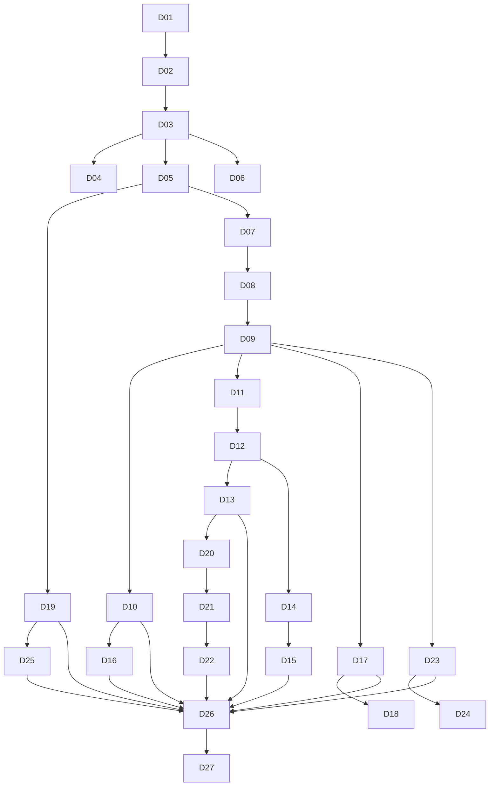

# 启动与规划活动（A01~A27）

> 本册是 [`00-总览与活动总表.md`](00-总览与活动总表.md) 的细目之一，覆盖启动 6 条与规划 21 条活动。每条活动给出目的、输入、输出文档的章节骨架、完成判据与下游承接。
> 术语与编号口径同总表 §一。章节骨架是下限，项目可加不可删。

---

## 一、启动阶段（A01~A06）

### A01 项目机会与业务问题识别

**阶段** 启动　**域** 整合　**触发** 一次性　**主责** 业务发起人　**批准** 决策层

- **目的**：把"想干一件事"变成"一件可以被判断的事"——问题是什么、值多少、代价多大、不做会怎样。
- **输入**：业务侧的现状数据；上一年度的同类事项记录。
- **输出文档** `D01 项目意向书`
  - 主件《项目意向书》章节：1 问题陈述，写现象、影响面、痛点出现的时点；2 期望收益，对应到哪项业务指标、怎么计量；3 初步范围与明确排除项；4 粗略代价，给出人、钱、时间的量级；5 备选方案比较；6 请求事项，要谁在什么时候决定什么。
  - 登记表《备选方案比较表》字段：编号、方案描述、收益、代价、风险、可逆性、结论。
  - 记录《意向评审记录》字段：日期、参与人、意见、处置、结论。
- **完成判据**：四个数字给得出量级；备选方案含"不做"一栏；请求事项写成决策句式而不是"请领导审阅"。
- **下游**：D02 可行性论证报告。

### A02 可行性论证

**阶段** 启动　**域** 整合　**触发** 一次性　**主责** 业务发起人　**批准** 决策层

- **目的**：在投入大额资源之前，把技术、经济、组织、进度四件事各给一个有依据的答复，并说清这些答复成立的前提。
- **输入**：D01 项目意向书；外部技术资料；组织的人力与产能现状。
- **输出文档** `D02 可行性论证报告`
  - 主件《可行性论证报告》章节：1 方案描述与替代方案；2 技术可行性，写关键难点、验证结论、成熟度判断、依赖的外部件；3 经济可行性，写投入、回收期、敏感性区间；4 组织与资源可行性，写人手、技能缺口、外部依赖；5 进度可行性，写关键路径能否压进窗口；6 结论与条件清单。
  - 附表《假设与约束清单》字段：ASM 编号、内容、若不成立的影响、验证方式、验证时点、验证结果。
  - 记录《论证评审记录》。
- **完成判据**：结论必须带条件清单，不允许只写"可行"；每条假设有验证时点；经济结论给区间不给单点。
- **下游**：D03 项目章程。

### A03 项目章程制定

**阶段** 启动　**域** 整合　**触发** 一次性　**主责** 项目经理　**批准** 业务发起人

- **目的**：给项目一个出生证明——写清它被批准存在、为达成什么、边界在哪、谁说了算。
- **输入**：D02 可行性论证报告及其条件清单。
- **输出文档** `D03 项目章程`
  - 主件《项目章程》章节：1 项目目标，成果目标与业务目标各给可判定的表述；2 成功判据，写清谁在什么时候按什么判；3 范围边界，写明做什么与明确不做什么；4 主要交付物与粗粒度里程碑；5 预算与工期上限；6 关键角色与授权，谁批什么额度、谁定优先级、谁有权叫停；7 主要风险与外部依赖；8 批准签署。
  - 附表《授权额度表》字段：事项类别、金额或范围、提案人、批准人、会签人。
  - 记录《章程批准记录》。
- **完成判据**：成功判据能反推出验收活动；授权表不出现"双方协商"这类空授权；每条边界都有对应的一句话理由。
- **下游**：D04 治理与授权文件、D05 相关方登记册、D26 项目管理计划。

### A04 治理结构设立

**阶段** 启动　**域** 整合　**触发** 一次性　**主责** 业务发起人　**批准** 治理委员会

- **目的**：定下谁在哪一层决定什么、冲突往上走到哪一级、升级要多久。
- **输入**：D03 项目章程中的授权条款；组织现行的审批制度。
- **输出文档** `D04 治理与授权文件`
  - 主件《治理与授权文件》章节：1 三层结构，写决策层、管理层、执行层各自处理哪类议题；2 决策权限表；3 升级路径，写清触发条件、几个工作日内、升级给谁；4 议事规则，写法定人数、决议方式、留痕要求；5 例外授权的授予、期限与收回。
  - 附表《决策权限矩阵》字段：事项类别、金额区间、提案人、批准人、会签人、知会人、时限。
  - 记录《治理结构确认记录》。
- **完成判据**：任一冲突能在三次跳转内找到终裁人；权限表覆盖 D15 的全部预算科目；例外授权的收回条件写明。
- **下游**：D45 阶段门评审记录、D46 决策日志。

### A05 相关方识别与登记

**阶段** 启动　**域** 相关方　**触发** 一次性，随事件更新　**主责** 项目经理　**批准** 项目经理

- **目的**：先弄清有谁，再谈怎么对他。漏掉一个关键相关方，后面每份文档都要返工。
- **输入**：D03 项目章程；组织架构与业务流程的现状。
- **输出文档** `D05 相关方登记册`
  - 主件《相关方登记册》章节：1 识别方法与扫描范围，按组织内、外部机构、监管、供方、最终用户、运维方六路扫；2 分类规则，按权力、利益、影响、态度四维；3 关键相关方的诉求与底线；4 参与程度，现状与目标。
  - 登记表《相关方条目表》字段：STAKE 编号、名称、类型、在项目中的角色、核心诉求、权力级别、当前行为表现、目标行为表现、对接人、影响渠道、更新时间。
  - 记录《相关方复核记录》，按里程碑更新。
- **完成判据**：每个 STAKE 有对接人与影响渠道；态度栏写可观察的行为，不用"支持/不支持"打分。
- **下游**：D19 沟通计划、D25 相关方参与计划。

### A06 项目启动会

**阶段** 启动　**域** 整合　**触发** 一次性　**主责** 项目经理　**批准** 业务发起人

- **目的**：把章程、协作口径与第一条时间线一次交到全体执行者手上，并当场消掉口径分歧。
- **输入**：D03 项目章程、D04 治理与授权文件、D05 相关方登记册。
- **输出文档** `D06 启动会记录与启动基线包`
  - 主件《启动口径说明》章节：1 项目一句话定义；2 目标与成功判据，与章程同口径；3 阶段划分与第一里程碑；4 协作与汇报规则，写周会、日报、升级路径；5 工具与文档存放位置；6 待澄清事项清单。
  - 记录《启动会议纪要》字段：议题、讨论要点、结论、DEC 编号、责任人、期限。
  - 附表《参会与到场核对表》。
- **完成判据**：待澄清清单每条有责任人与答复期限；参会名单与 D05 的关键相关方比对无缺项。
- **下游**：D26 项目管理计划、D35 会议纪要与决议跟踪表。

---

## 二、规划阶段（A07~A27）

### A07 需求收集与整理

**阶段** 规划　**域** 范围　**触发** 一次性，随变更更新　**主责** 需求负责人　**批准** 项目经理

- **目的**：把各相关方嘴里的"要什么"整理成可编号、可判验收、可追溯的条目集。
- **输入**：D05 相关方登记册；业务流程与场景的调研记录。
- **输出文档** `D07 需求登记册`
  - 主件《需求说明书》章节：1 业务目标与成功判据；2 使用场景，写谁在什么场合做什么；3 功能需求分组；4 性能与容量；5 接口与数据需求；6 约束条件，法规、环境、平台各一类；7 排除项与待决问题。
  - 登记表《需求条目表》字段：REQ 编号、需求陈述、来源 STAKE、类别、优先级、验收方式、挂接交付物 DEL、状态、变更引用。
  - 记录《需求评审记录》。
- **完成判据**：每条 REQ 有来源与验收方式；无"待定"超过约定时长的条目；排除项写成边界句而不是省略。
- **下游**：D08 范围说明书。

### A08 范围定义与交付物清单

**阶段** 规划　**域** 范围　**触发** 一次性　**主责** 项目经理　**批准** 治理委员会

- **目的**：把需求翻译成"我们交什么出去、谁接、交到哪一步算完"。
- **输入**：D07 需求登记册。
- **输出文档** `D08 范围说明书`
  - 主件《范围说明书》章节：1 产品范围，做出什么、含哪些能力；2 项目范围，做哪些工作、边界在哪；3 交付物清单；4 交付边界，写清谁负责到哪一步、接口件归谁；5 例外与排除；6 与外部的依赖。
  - 登记表《交付物清单》字段：DEL 编号、名称、形态、完成判据、接收方、交付时点、关联 REQ。
  - 记录《范围评审记录》。
- **完成判据**：每个 DEL 有接收方与完成判据；接口件两侧都有 DEL 编号，不允许只在一侧登记。
- **下游**：D09 WBS 说明书与 WBS 字典。

### A09 工作分解

**阶段** 规划　**域** 范围　**触发** 一次性　**主责** 项目经理　**批准** 项目经理

- **目的**：把交付物拆到可估算、可分配、可考核的粒度，让每一项工作都有归属与完成标志。
- **输入**：D08 范围说明书。
- **输出文档** `D09 WBS 说明书与 WBS 字典`
  - 主件《WBS 说明书》章节：1 分解原则，按交付物分还是按阶段分，并说明理由；2 层级规则与编码规则；3 分解到位判据；4 外包与自制的分界，挂 PROC 编号；5 不再细分项的处理，采购包与管理包各自的口径。
  - 附表《WBS 字典》字段：WBS 编号、名称、层级、所属 DEL、负责方、完成判据、估算依据、前置工作包、状态下限。
  - 记录《分解评审记录》。
- **完成判据**：最低层每项的字典八字段填满；每个 DEL 至少被一个工作包覆盖；无孤儿工作包。
- **下游**：D10 范围基准、D11 活动清单、D14 成本估算表。

### A10 范围基准与验收准则

**阶段** 规划　**域** 范围　**触发** 一次性　**主责** 项目经理　**批准** 治理委员会

- **目的**：把"什么是做完"写成第三方也判得了的准则，并在开工前锁版。
- **输入**：D08 范围说明书、D09 WBS 字典。
- **输出文档** `D10 范围基准与验收准则`
  - 主件《范围基准说明》章节：1 基准构成，说明 D08、D09、D10 三者的关系；2 变更对基准的影响口径；3 验收总体安排，谁验、什么时候验、要什么证据。
  - 登记表《验收准则表》字段：ACC 编号、对应范围项或 DEL、验收条件、证据形态、判定方、不合格处理、关联 REQ。
  - 记录《基准批准记录》字段：版本、批准人、批准日期、保留意见。
- **完成判据**：每条 ACC 写成"给什么证据、谁来判、判不过怎么办"三句齐备；ACC 覆盖全部 DEL，无一条 DEL 缺准则。
- **下游**：D16 质量计划、D49 验收报告、D40 变更控制包。

### A11 活动定义与依赖排序

**阶段** 规划　**域** 进度　**触发** 一次性　**主责** 计划负责人　**批准** 项目经理

- **目的**：把工作包拆成有先后关系的活动，并说清哪些先后是硬约束、哪些只是习惯。
- **输入**：D09 WBS 字典。
- **输出文档** `D11 活动清单与依赖关系表`
  - 主件《活动划分说明》章节：1 活动粒度规则，单个活动不跨两个报告周期；2 依赖类型，硬性、软性、外部三类各自判法；3 外部依赖的对接机制与承诺方；4 排序假设与工作日历。
  - 登记表《活动与依赖表》字段：ACT 编号、名称、所属工作包、工期、前置编号、依赖类型、延时、后置、负责方、产出物。
  - 记录《排序评审记录》。
- **完成判据**：每个 ACT 挂在工作包上；外部依赖标注对接人与承诺日期；软性依赖写明"不这样排的代价"。
- **下游**：D12 估算底稿、D13 进度基准。

### A12 工期与工作量估算

**阶段** 规划　**域** 进度　**触发** 一次性　**主责** 计划负责人　**批准** 项目经理

- **目的**：给每个活动一个带不确定性标注的数值，而不是一个看着整齐的整数。
- **输入**：D11 活动清单与依赖关系表；历史工时数据。
- **输出文档** `D12 估算底稿`
  - 主件《估算说明》章节：1 估算方法，类比、参数、三点各自用在哪类活动；2 估算单位与口径，写清人日是否含管理时间；3 不确定性处理，给区间与置信度；4 数据来源与有效性；5 估算更新规则。
  - 附表《估算明细表》字段：ACT 或 WBS、方法、乐观值、最可能值、悲观值、采用值、置信度、依据来源、估算人、复核人。
  - 记录《估算复核记录》。
- **完成判据**：每个 ACT 有采用值与依据来源；区间宽度超阈值的写出理由；估算人不等于复核人。
- **下游**：D13 进度基准、D14 成本估算表。

### A13 进度计划编制

**阶段** 规划　**域** 进度　**触发** 一次性　**主责** 计划负责人　**批准** 治理委员会

- **目的**：把已排序、已估算的工作排成带日期的执行路线，并定出关键路径与缓冲的去处。
- **输入**：D11 活动清单与依赖关系表、D12 估算底稿。
- **输出文档** `D13 进度基准`
  - 主件《进度计划说明书》章节：1 工作日历与数据日口径；2 里程碑表；3 网络计划与关键路径；4 缓冲与浮动分配，写清谁持有、如何动用；5 资源平衡的结果与取舍；6 外部约束与假设。
  - 附表《里程碑表》字段：MS 编号、名称、计划日期、判定条件、负责方、关联 DEL。
  - 附表《排程表》字段：ACT 编号、开始、完成、工期、前置、资源、浮动量。
  - 记录《排程评审记录》。
- **完成判据**：每个 MS 的判定条件是可观察事件；关键路径上的活动都有资源承诺；缓冲由项目经理持有并写明动用规则。
- **下游**：D26 项目管理计划、D38 进度状态报告。

### A14 成本估算

**阶段** 规划　**域** 成本　**触发** 一次性　**主责** 成本负责人　**批准** 项目经理

- **目的**：把工作量换算成钱，并把钱的构成拆到能被审批、被跟踪的科目上。
- **输入**：D12 估算底稿、D09 WBS 字典。
- **输出文档** `D14 成本估算表`
  - 主件《成本估算说明》章节：1 成本结构，按人力、采购、差旅、外协、管理费、应急六类；2 估算依据与价格基准日；3 币种与汇率口径；4 不可预见费的计提规则；5 与 D12 的换算关系。
  - 附表《成本科目表》字段：CST 编号、科目、工作包、数量、单价、小计、依据、承担方。
  - 记录《成本复核记录》。
- **完成判据**：每个成本科目挂到工作包；应急费单列并写计提规则；价格基准日写明。
- **下游**：D15 成本基准与预算批准书。

### A15 预算编制与批准

**阶段** 规划　**域** 成本　**触发** 一次性　**主责** 成本负责人　**批准** 治理委员会

- **目的**：把估算变成能花、能查、能问责的预算，并定下超支时怎么办。
- **输入**：D14 成本估算表、D04 决策权限矩阵。
- **输出文档** `D15 成本基准与预算批准书`
  - 主件《预算说明》章节：1 基准构成，按阶段与科目的预算曲线；2 支付节奏与资金需求；3 审批权限，挂 D04；4 应急储备与管理储备的动用规则；5 超支的处置口径。
  - 附表《预算分配表》字段：预算科目、阶段、金额、承担方、支付条件、审批人。
  - 记录《预算批准记录》。
- **完成判据**：任一支出都能落到一个预算科目与一个审批人；储备动用规则写到"谁批、批到哪一级、批完怎么补"。
- **下游**：D39 成本月报与偏差分析、D51 合同关闭与结算单。

### A16 质量目标与检验点定义

**阶段** 规划　**域** 质量　**触发** 一次性　**主责** 质量负责人　**批准** 项目经理

- **目的**：把"做好"变成可检验的点和可判定的尺度，而不是一句态度要求。
- **输入**：D10 范围基准与验收准则、D08 范围说明书。
- **输出文档** `D16 质量计划`
  - 主件《质量计划》章节：1 质量目标，对哪些指标、到什么水平；2 判定依据，引用 D10 的 ACC 编号；3 检验点与检验方式，自检、互检、第三方各自用在何处；4 评审与审计安排；5 不符合项处理流程；6 质量记录要求。
  - 登记表《检验点表》字段：CHK 编号、对象、检验项、方法、抽样、判定标准、记录形态、责任方、时点。
  - 记录《质量计划评审记录》。
- **完成判据**：每个 CHK 有判定标准与证据形态；质量目标可量化，不写"确保高质量"。
- **下游**：D31 质量审计报告、D41 检验测试记录与不符合项报告。

### A17 组织与职责设计

**阶段** 规划　**域** 资源　**触发** 一次性　**主责** 项目经理　**批准** 业务发起人

- **目的**：让每个工作包都有人批准、有人干、有人被问，且不出现两个人同时说了算。
- **输入**：D09 WBS 字典、D04 治理与授权文件。
- **输出文档** `D17 项目组织与职责说明`
  - 主件《项目组织与职责说明》章节：1 组织结构，谁向谁汇报；2 岗位与职责描述；3 决策接口，挂 D04 的权限矩阵；4 与职能部门的接口与借调规则。
  - 附表《职责分配矩阵》字段：RACI 编号、工作包、活动、A 批准、R 执行、C 咨询、I 知会。
  - 记录《组织确认记录》。
- **完成判据**：每个工作包有且只有一个 A；R 落在有名字的岗位上；C 与 I 不得留空。
- **下游**：D18 人员配置计划。

### A18 人员配置计划

**阶段** 规划　**域** 资源　**触发** 一次性，按阶段更新　**主责** 项目经理　**批准** 职能经理

- **目的**：把职责矩阵翻成一张人和时间对得上的表，并提前暴露缺口。
- **输入**：D17 项目组织与职责说明。
- **输出文档** `D18 人员配置计划`
  - 主件《人员配置计划》章节：1 角色与能力要求；2 投入曲线，按月或阶段的人月；3 人员来源，内部调配、外聘、借调各自的条件；4 到位与退出时点；5 缺口与替代方案。
  - 附表《人员配置表》字段：PERS 编号、岗位、姓名、能力等级、投入比例、起止日期、来源、替角。
  - 记录《配置评审记录》。
- **完成判据**：岗位覆盖 D17 的全部 R；每个关键岗位有替角；缺口有替代方案而非空白。
- **下游**：D29 人员入场登记、D30 培训计划与记录。

### A19 沟通规划

**阶段** 规划　**域** 沟通　**触发** 一次性　**主责** 项目经理　**批准** 项目经理

- **目的**：定下谁在什么时候从谁那里拿到什么，以及拿到后要不要回话。
- **输入**：D05 相关方登记册、D04 决策权限矩阵。
- **输出文档** `D19 沟通计划`
  - 主件《沟通计划》章节：1 沟通原则，谁能直接问谁、越过层级要如何留痕；2 报告体系，层级、频次、模板；3 信息存放位置与查阅权限；4 对外口径与发言人；5 紧急沟通路径。
  - 附表《沟通矩阵》字段：COM 编号、对象 STAKE、内容、形式、频次、发出方、期望反馈、反馈时限。
  - 记录《沟通计划评审记录》。
- **完成判据**：每个关键 STAKE 至少有一条沟通条目；每条有期望反馈与时限；报告模板有编号。
- **下游**：D34 沟通记录与说明材料、D44 项目状态报告与仪表盘。

### A20 风险识别

**阶段** 规划　**域** 风险　**触发** 一次性，按周期增补　**主责** 项目经理　**批准** 项目经理

- **目的**：把可能让项目偏离计划的事提前写下来，写成有因果的条目，而不是一句担心。
- **输入**：D03 项目章程、D08 范围说明书、D13 进度基准、D23 采购计划。
- **输出文档** `D20 风险登记册`
  - 主件《风险识别说明》章节：1 识别方法与扫描维度，按技术、需求、资源、外部、组织、合同六路；2 风险、问题、假设三者的区别与各自去向；3 登记口径，什么进册、什么不入册。
  - 登记表《风险条目表》字段：RISK 编号、风险陈述、类别、触发信号、影响对象、初步应对方向、识别人、识别日期、状态。
  - 记录《识别工作坊记录》。
- **完成判据**：每条按"因为…可能导致…从而影响…"的因果式写；每条有触发信号；不写"管理风险"这类空条。
- **下游**：D21 风险分析表。

### A21 风险分析与评级

**阶段** 规划　**域** 风险　**触发** 一次性，按周期重评　**主责** 项目经理　**批准** 项目经理

- **目的**：给风险排座次，并把座次写成能触发升级的阈值。
- **输入**：D20 风险登记册。
- **输出文档** `D21 风险分析表`
  - 主件《分析口径说明》章节：1 评级口径，概率档与影响档的定义；2 风险阈值与升级规则；3 定量分析用于哪几条及其模型；4 分析假设与局限。
  - 附表《风险评级表》字段：RISK 编号、概率档、影响档、评级、受影响的基线、紧迫性、分析依据、责任人。
  - 记录《评级复核记录》。
- **完成判据**：影响档写到"影响哪条基线、影响多大"；同一项目内评级矩阵一致；高评级风险全部进入应对规划。
- **下游**：D22 风险应对计划。

### A22 风险应对规划

**阶段** 规划　**域** 风险　**触发** 一次性　**主责** 项目经理　**批准** 治理委员会

- **目的**：给每条需要处理的风险配一个动作、一个触发条件和一笔钱。
- **输入**：D21 风险分析表、D15 成本基准。
- **输出文档** `D22 风险应对计划`
  - 主件《应对规划说明》章节：1 策略类型与选用规则，规避、转移、减轻、接受各自何时用；2 责任人的资源授权额度；3 残余风险的处理；4 次生风险的登记要求；5 应急储备的挂钩方式。
  - 登记表《应对措施表》字段：RES 编号、对应 RISK、策略、措施、触发条件、启动动作、资源需求、责任人、截止日期、验证方式。
  - 记录《应对评审记录》。
- **完成判据**：每条高评级风险有措施与触发条件；接受策略必须写"接受理由与储备额"。
- **下游**：D43 风险状态更新与预警单。

### A23 自制外购决策与采购规划

**阶段** 规划　**域** 采购　**触发** 一次性　**主责** 采购负责人　**批准** 治理委员会

- **目的**：把"哪些自己做、哪些买"的决定连同理由写下来，并把它变成可招标的采购包。
- **输入**：D09 WBS 字典、D15 成本基准。
- **输出文档** `D23 采购计划`
  - 主件《采购计划》章节：1 自制外购决策与理由；2 采购包划分，与 WBS 的对应关系；3 采购方式与依据；4 合同类型选择与理由；5 采购时间线与关键节点；6 资质与合规要求。
  - 附表《采购包清单》字段：PROC 编号、名称、范围、对应 WBS、预算、采购方式、计划签约、交付期、负责方。
  - 记录《采购规划评审记录》。
- **完成判据**：每个采购包挂 WBS 与预算；合同类型写了选择理由；采购时间线与 D13 里程碑不冲突。
- **下游**：D24 供方选择文件包、D32 合同及附件。

### A24 供方选择

**阶段** 规划　**域** 采购　**触发** 按事件　**主责** 采购负责人　**批准** 治理委员会

- **目的**：用事先定好的尺子挑供方，并让落选者也能听懂自己为什么落选。
- **输入**：D23 采购计划。
- **输出文档** `D24 供方选择文件包`
  - 主件《供方选择报告》章节：1 选择流程与时间线；2 评价维度与权重；3 评审过程与澄清往来；4 候选比对结论；5 选择理由与主要风险。
  - 附表《评标评分表》字段：SUP 编号、供方、各维度得分、加权分、偏离项、风险提示、结论。
  - 记录《澄清与往来记录》。
- **完成判据**：评价维度与权重在开标前固定并留痕；落选理由可复述；选择结论有 DEC 编号。
- **下游**：D32 合同及附件。

### A25 相关方参与规划

**阶段** 规划　**域** 相关方　**触发** 一次性　**主责** 项目经理　**批准** 项目经理

- **目的**：为关键相关方各配一条参与路径，把"加强沟通"这类口号换成有日期有动作的安排。
- **输入**：D05 相关方登记册、D19 沟通计划。
- **输出文档** `D25 相关方参与计划`
  - 主件《参与策略说明》章节：1 按相关方分组的参与策略；2 阻碍者的处理办法；3 参与活动与项目里程碑的挂接；4 参与效果的评价方式。
  - 附表《参与安排表》字段：STAKE 编号、当前参与度、目标参与度、策略、具体活动、时点、责任人、评价指标。
  - 记录《参与计划评审记录》。
- **完成判据**：每个关键 STAKE 有具体活动与时点；阻碍者处置写到"谁在什么时候做什么"。
- **下游**：D34 沟通记录与说明材料、D48 相关方满意度与反馈处理记录。

### A26 项目管理计划集成

**阶段** 规划　**域** 整合　**触发** 一次性，随变更更新　**主责** 项目经理　**批准** 治理委员会

- **目的**：把九个领域的分计划合成一本能照着执行的书，并说清哪些地方做了裁剪。
- **输入**：D10、D13、D15、D16、D17、D18、D19、D22、D23、D25 各自的分计划。
- **输出文档** `D26 项目管理计划`
  - 主件《项目管理计划》章节：1 项目概况与目标，引 D03；2 三大基准摘要，引 D10、D13、D15；3 各领域执行安排，范围、进度、成本、质量、资源、沟通、风险、采购、相关方各一节，每节写做法、责任人、频次；4 报告与评审节奏；5 变更控制机制；6 裁剪说明，哪些活动简化、简化后靠什么补足控制。
  - 附表《分计划索引表》字段：领域、文档编号、版本、责任人、生效日期。
  - 记录《计划集成评审记录》。
- **完成判据**：九个领域各有一节且都指向具体文档编号；裁剪说明写清替代控制；分计划索引与各文档实际版本一致。
- **下游**：D27 基线批准记录。

### A27 计划评审与基线批准

**阶段** 规划　**域** 整合　**触发** 按里程碑　**主责** 项目经理　**批准** 治理委员会

- **目的**：在开工前让计划过一次独立审读，把意见关掉，并把版本钉死。
- **输入**：D26 项目管理计划及各分计划。
- **输出文档** `D27 基线批准记录`
  - 主件《评审结论》章节：1 评审范围与方法；2 发现的问题与处置；3 基线构成，列明哪几份文档、什么版本；4 批准结论与保留意见。
  - 记录《评审意见处置表》字段：REV 编号、意见、分类、处置、责任人、关闭证据。
  - 记录《基线生效通知》。
- **完成判据**：全部意见关闭或明确"接受不处理"并由批准人签字；基线版本号写入各文档首页；生效日期明确。
- **下游**：执行阶段全部活动。

---

## 三、本册文档的先后依赖

三条基线（D10、D13、D15）在 D26 汇合，汇合之后才批 D27。跳过汇合直接批基线，会出现分计划之间对不上的情况——最常见的是进度排不进预算、验收准则没有对应检验点。
