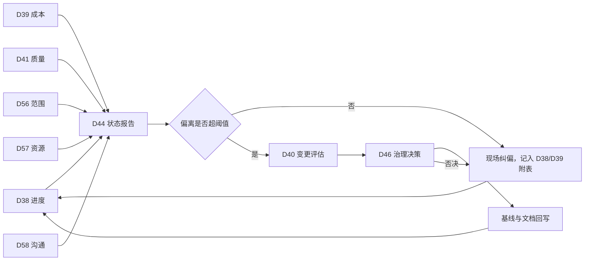

# 执行与监控活动（A28~A48、A55~A59）

> 本册是 [`00-总览与活动总表.md`](00-总览与活动总表.md) 的细目之二，覆盖执行 12 条与监控 14 条活动。条目口径与编号规则同总表 §一。
> 执行活动解决"按计划干活并留下证据"，监控活动解决"发现偏离并把偏离按规矩改回来"。两段共用一个循环：交付、测量、比对、处置。
> A55 与 A59 编在执行段末尾，A56 至 A58 编在监控段末尾——按总表 §1.5，新增活动在末尾追加，不改既有编号，先后次序看阶段列。

---

## 一、执行阶段（A28~A37）

### A28 任务派工

**阶段** 执行　**域** 整合　**触发** 按周期　**主责** 领域负责人　**批准** 项目经理

- **目的**：把工作包变成手上的一张张任务卡，每张卡都有输入件、输出件和验收人。
- **输入**：D09 WBS 字典、D13 进度基准。
- **输出文档** `D28 派工单与任务卡`
  - 主件《派工规则》章节：1 任务卡怎么开、怎么关；2 完成判定，写自检项与验收项；3 移交与返工的规则；4 并行作业时的资源冲突处理。
  - 登记表《任务卡》字段：TASK 编号、内容、所属 WBS、负责人、开始日期、完成日期、输入件编号、输出件编号、完成判据、验收人、状态。
  - 记录《派工与关单记录》。
- **完成判据**：每张任务卡有输入件与输出件编号；关单需验收人签收；返工另开新卡并引用原卡号。
- **下游**：D38 进度状态报告、D41 检验测试记录与不符合项报告。

### A29 人员入场与权限开通

**阶段** 执行　**域** 资源　**触发** 按事件　**主责** 项目经理　**批准** 项目经理

- **目的**：让人到岗这件事有记录、有授权、有边界，离场时能干净地收回。
- **输入**：D18 人员配置计划、D04 决策权限矩阵。
- **输出文档** `D29 人员入场登记与配置表`
  - 主件《入场管理说明》章节：1 入场条件，培训、授权、账号三项各自的前置；2 环境与账号开通流程；3 权限最小化原则与例外；4 退场与交接要求。
  - 登记表《入场登记表》字段：PERS 编号、姓名、岗位、入场日期、授权项、培训完成情况、账号与权限清单、替角、预计退场日期、实际退场日期。
  - 记录《权限开通记录》。
- **完成判据**：每个入场者有授权记录；权限清单逐项可查；退场有回收确认。
- **下游**：D37 团队运行记录。

### A30 培训与能力建设

**阶段** 执行　**域** 资源　**触发** 按事件　**主责** 项目经理　**批准** 职能经理

- **目的**：把能力缺口补上，并留下"谁能上岗"的判定依据，而不是默认到场即胜任。
- **输入**：D18 人员配置计划中的能力要求。
- **输出文档** `D30 培训计划与记录`
  - 主件《培训计划》章节：1 能力需求与差距，从 D18 推出来；2 培训安排与考核方式；3 上岗资格规则，什么条件算能上岗；4 外部培训的引入与验收。
  - 附表《培训记录表》字段：TRN 编号、课程、对象、方式、课时、考核结果、上岗资格、日期。
  - 记录《考核记录》。
- **完成判据**：关键岗位的上岗资格有考核记录；差距项都有对应课程；考核不合格者的再培训安排明确。
- **下游**：D37 团队运行记录。

### A31 过程质量保证与审计

**阶段** 执行　**域** 质量　**触发** 按周期　**主责** 质量负责人　**批准** 项目经理

- **目的**：查过程是不是照计划在走，而不是等产品出来再查结果。
- **输入**：D16 质量计划、D26 项目管理计划。
- **输出文档** `D31 质量审计报告`
  - 主件《质量审计报告》章节：1 审计范围与依据，过程、模板、计划各自核什么；2 抽样方法与证据清单；3 发现分级，严重、一般、观察三档的判定口径；4 结论与改进建议。
  - 登记表《审计发现表》字段：AUD 编号、发现、等级、依据条款、影响、整改要求、责任人、期限、复核结果。
  - 记录《整改验证记录》。
- **完成判据**：每条发现有依据条款与整改期限；等级判定口径写在报告里；整闭环需复核签字。
- **下游**：D42 问题登记册、D52 项目总结报告与经验教训登记册。

### A32 合同签订

**阶段** 执行　**域** 采购　**触发** 按事件　**主责** 采购负责人　**批准** 治理委员会

- **目的**：把口头的合作意向变成一份可执行、可验收、可终止的书面约定。
- **输入**：D24 供方选择文件包、D23 采购计划、D10 验收准则。
- **输出文档** `D32 合同及附件`
  - 主件《合同》章节：1 主体与标的；2 工作范围，单独成附件；3 交付与验收条款，引 ACC 编号；4 价格与支付节点；5 变更与索赔机制；6 违约与终止；7 知识产权与保密；8 争议解决。
  - 附表《支付节点表》字段：节点、条件、金额、证据件、审批人。
  - 附表《交付里程碑表》。
- **完成判据**：验收条款可执行，证据、判定方、时限三样齐备；支付节点与交付里程碑一一对应；变更机制写明时限。
- **下游**：D33 履约检查记录、D47 合同变更单与索赔处理记录、D51 合同关闭与结算单。

### A33 供方履约过程管理

**阶段** 执行　**域** 采购　**触发** 按周期　**主责** 采购负责人　**批准** 项目经理

- **目的**：在合同执行期间持续掌握供方的交付状态，尽早发现偏差而不是等到验收才发现。
- **输入**：D32 合同及附件、D13 进度基准。
- **输出文档** `D33 履约检查记录`
  - 主件《履约管理说明》章节：1 检查频次与方式；2 偏差分级与升级；3 对供方的评分口径；4 与项目内部进度的对账方式。
  - 附表《履约检查表》字段：CON 编号、检查项、计划值、实际值、偏差、评级、整改要求、期限、复核。
  - 记录《供方沟通记录》。
- **完成判据**：每次检查挂合同编号与采购包编号；偏差有整改与复核记录；评分口径前后一致。
- **下游**：D47 合同变更单与索赔处理记录、D51 合同关闭与结算单。

### A34 相关方沟通与期望管理

**阶段** 执行　**域** 相关方　**触发** 按周期　**主责** 项目经理　**批准** 项目经理

- **目的**：让每个相关方拿到该拿的信息，并让口头承诺都留下书面回执。
- **输入**：D19 沟通计划、D25 相关方参与计划。
- **输出文档** `D34 沟通记录与说明材料`
  - 主件《对外说明口径》章节：1 可对外披露的内容边界；2 说明材料的统一版本与生效日；3 常见问题的答复口径；4 谁可以代表项目发言。
  - 记录《沟通记录》字段：COM 编号、对象、时间、方式、主题、结论、承诺事项、跟进人、跟进结果。
  - 附表《说明材料版本表》字段：材料编号、版本、适用对象、生效日期、责任人。
- **完成判据**：对外承诺事项有责任人与回执；说明材料有版本与生效日；超出披露边界的内容有审批。
- **下游**：D44 项目状态报告与仪表盘、D48 相关方满意度与反馈处理记录。

### A35 会议与决议管理

**阶段** 执行　**域** 沟通　**触发** 按事件　**主责** 项目经理　**批准** 项目经理

- **目的**：让会开完就散，判断留下来——每条决议有编号、有人、有期限、有回访。
- **输入**：D19 沟通计划中的会议安排。
- **输出文档** `D35 会议纪要与决议跟踪表`
  - 主件《会议管理规则》章节：1 会议类型与参加人；2 决议成立条件，谁在场、如何表决、多少人同意；3 纪要发出时限；4 决议的撤改规则。
  - 记录《会议纪要》字段：议题、讨论要点、决议、DEC 编号、责任人、期限。
  - 附表《决议跟踪表》字段：DEC 编号、内容、责任人、期限、状态、关闭证据。
- **完成判据**：每条决议有编号、责任人、期限；过期未关闭的自动转入问题登记册。
- **下游**：D42 问题登记册、D46 决策日志。

### A36 文档与记录管理

**阶段** 执行　**域** 沟通　**触发** 一次性，持续执行　**主责** 配置管理员　**批准** 项目经理

- **目的**：让每份产出都有户口——编号、版本、状态、位置、谁有权改，缺一样将来就找不到。
- **输入**：总表 §四 的条目前缀分配、D26 项目管理计划。
- **输出文档** `D36 文档与记录管理规程`
  - 主件《文档与记录管理规程》章节：1 文档分类与命名规则；2 版本与状态规则，含谁能把文档推到"基线"态；3 存储位置、目录结构与权限；4 借阅与分发；5 保留期与销毁；6 受配置控制的文档清单与标识规则。
  - 登记表《文档登记册》字段：DOC 编号、名称、类别、版本、状态、责任人、存放位置、关联活动、受控标识、生效日期。
  - 记录《抽查记录》，按周期核对目录与登记册是否一致。
- **完成判据**：受控文档有版本号与批准记录；抽查能对上登记册；目录结构与规程描述一致。
- **下游**：D53 收尾报告与归档清册。

### A37 团队运行管理

**阶段** 执行　**域** 资源　**触发** 按周期　**主责** 项目经理　**批准** 项目经理

- **目的**：维持团队的工作节奏，把冲突处理在变成问题之前，并留下评价依据。
- **输入**：D17 项目组织与职责说明、D18 人员配置计划。
- **输出文档** `D37 团队运行记录`
  - 主件《团队运行规则》章节：1 工作节奏，例会、评审、值班的安排；2 冲突处理路径与时限；3 激励与认可方式；4 人员绩效评价口径。
  - 记录《冲突与处理记录》字段：编号、事项、涉及方、处理方式、结果、后续动作。
  - 附表《绩效评价表》字段：PERS 编号、评价周期、目标达成、协作、质量、结论、改进项。
- **完成判据**：冲突记录有结果与后续动作；绩效结论与 D18 的人员配置挂钩；评价周期与项目节奏一致。
- **下游**：D18 人员配置计划、D44 项目状态报告与仪表盘。

### A55 项目知识管理

**阶段** 执行　**域** 整合　**触发** 按周期　**主责** 项目经理　**批准** 项目经理

- **目的**：把过程中的做法随时沉淀下来，让后面接手的人用得上，而不是等收尾再凭回忆补写。
- **输入**：D35 会议纪要与决议跟踪表、D31 质量审计报告、D41 检验测试记录与不符合项报告、D42 问题登记册。
- **输出文档** `D55 项目管理知识库`
  - 主件《知识管理说明》章节：1 什么进库，判断、做法、数据、失败案例四类；2 入库的门槛，未经验证的不入库；3 复用方式，谁在什么场合取用；4 与模板库 O01 的回写关系；5 退库与作废规则。
  - 登记表《知识条目表》字段：KNW 编号、分类、场景、做法、结果、适用条件、提出人、验证状态、复用次数、去向。
  - 记录《知识复用记录》。
- **完成判据**：每条按"在什么条件下这样做，得到什么结果，所以下次怎么做"写；未验证的标"待验证"并给验证时点；复用记录能追到 KNW 编号。
- **下游**：D52 项目总结报告与经验教训登记册、组织级模板库 O01。

### A59 风险应对实施

**阶段** 执行　**域** 风险　**触发** 按事件　**主责** 项目经理　**批准** 项目经理

- **目的**：把批准的应对措施真正做掉，并留下"做没做、有没有效"的证据，不让应对计划停在纸上。
- **输入**：D22 风险应对计划、D43 风险状态更新与预警单。
- **输出文档** `D59 风险应对执行记录`
  - 主件《应对执行说明》章节：1 启动条件与授权，谁有权启动、启动后能调用什么资源；2 执行与验证的时点关系；3 措施无效时的转出路径，改措施还是转问题。
  - 记录《应对执行记录》字段：REX 编号、对应 RES 编号、对应 RISK 编号、启动日期、执行人、完成情况、有效性判定、残余风险、后续动作。
  - 附表《措施执行状态表》字段：RES 编号、措施、状态、完成日期、验证结论、责任方。
- **完成判据**：每条已启动的措施有 REX 编号与有效性判定；无效的措施写明转出路径与接手方；未启动的措施仍挂在 D22 的触发条件上，不被悄悄删掉。
- **下游**：D43 风险状态更新与预警单、D42 问题登记册。

---

## 二、监控阶段（A38~A48）

### A38 进度跟踪与控制

**阶段** 监控　**域** 进度　**触发** 按周期　**主责** 计划负责人　**批准** 项目经理

- **目的**：按期说清"到哪儿了、差多少、什么时候能补回来"，并把偏差挂到具体活动上。
- **输入**：D13 进度基准、D28 任务卡的关单记录。
- **输出文档** `D38 进度状态报告`
  - 主件《进度状态报告》章节：1 报告口径，数据日、完成定义、曲线取数规则；2 偏差分析，逐条挂 ACT 或 MS 编号；3 趋势与预测，给完工日期区间；4 需决策事项。
  - 附表《进度跟踪表》字段：ACT 或 MS、计划值、实际值、偏差、原因、纠正措施、责任人、预计恢复日。
  - 记录《偏差评审记录》。
- **完成判据**：偏差逐条挂编号；预测完工日期给区间而非单点；纠正措施有责任人与恢复日。
- **下游**：D44 项目状态报告与仪表盘、D40 变更控制包。

### A39 成本控制与偏差分析

**阶段** 监控　**域** 成本　**触发** 按周期　**主责** 成本负责人　**批准** 治理委员会

- **目的**：把花掉的钱与干出来的活对齐看，判断是"花得快"还是"干得慢"。
- **输入**：D15 成本基准、D38 进度状态报告。
- **输出文档** `D39 成本月报与偏差分析`
  - 主件《成本月报》章节：1 报告口径，计划值、实现值、实际值三者的取数规则与数据日；2 偏差与指数，成本偏差、进度偏差、成本绩效指数、进度绩效指数各一栏；3 完工预测，写清用哪种算法及理由；4 储备动用情况；5 需决策事项。
  - 附表《成本跟踪表》字段：预算科目、计划值、实现值、实际值、偏差、指数、预测完工成本、说明。
  - 记录《偏差评审记录》。
- **完成判据**：每个偏差能追到预算科目与工作包；完工预测给算法而不给一个孤立的数；储备动用有批准记录。
- **下游**：D44 项目状态报告与仪表盘、D15 成本基准与预算批准书的新版本。

### A40 变更控制

**阶段** 监控　**域** 整合　**触发** 按事件　**主责** 项目经理　**批准** 治理委员会

- **目的**：让每一次改动都有来源、有影响分析、有裁决人、有回写，不让改动从流程外渗进来。
- **输入**：三条基线文档、D32 合同及附件、D04 决策权限矩阵。
- **输出文档** `D40 变更控制包`
  - 主件《变更管理规程》章节：1 什么算变更，什么只是纠偏；2 提交与受理条件；3 影响分析要求，范围、进度、成本、质量、合同、风险各一项；4 裁决权限，挂 D04；5 实施与回写规则。
  - 登记表《变更请求单》字段：CHG 编号、提出人、日期、变更内容、原因、影响分析六项、建议、裁决、裁决人、实施状态、回写文档与版本。
  - 记录《裁决记录》。
- **完成判据**：每份 CHG 有六项影响分析；裁决人符合权限表；实施后有回写证据，回写版本可在 D36 查到。
- **下游**：D10、D13、D15 的新版本，D44 项目状态报告与仪表盘。

### A41 质量检验与不符合项处置

**阶段** 监控　**域** 质量　**触发** 按事件　**主责** 质量负责人　**批准** 项目经理

- **目的**：按检验点判产品的合格与否，并把不合格品的去向一次说清。
- **输入**：D16 质量计划的检验点表、D38 交付进度。
- **输出文档** `D41 检验测试记录与不符合项报告`
  - 主件《检验实施说明》章节：1 检验依据，引 CHK 编号；2 抽样与判定规则；3 不合格分级与处置路径，返工、让步、拒收各自的权限；4 记录的保存要求。
  - 记录《检验记录》字段：CHK 编号、对象、日期、样本、结果、判定、检验人。
  - 登记表《不符合项报告》字段：DEF 编号、发现、等级、影响范围、原因、处置结论、责任方、期限、验证结果。
- **完成判据**：每个 DEF 有处置结论与验证记录；让步接收须有批准人签字；检验记录能追到 CHK 编号。
- **下游**：D42 问题登记册、D49 验收报告。

### A42 问题管理

**阶段** 监控　**域** 风险　**触发** 按事件　**主责** 项目经理　**批准** 项目经理

- **目的**：接住所有已经发生、必须有人协调的事，防止它们在会议纪要里反复出现却无人收口。
- **输入**：D35 决议跟踪表、D31 审计发现、D43 风险转化的条目。
- **输出文档** `D42 问题登记册`
  - 主件《问题管理规则》章节：1 什么问题进册，已发生、需协调、跨部门三类；2 与风险的区别；3 升级条件与时限；4 关闭证据要求。
  - 登记表《问题条目表》字段：ISS 编号、问题、来源、影响、优先级、责任人、期限、状态、解决证据、关闭日期。
  - 记录《升级记录》。
- **完成判据**：每条有单一责任人；超期问题强制升级并留下记录；关闭必须附证据。
- **下游**：D44 项目状态报告与仪表盘、D52 项目总结报告与经验教训登记册。

### A43 风险监控与预警

**阶段** 监控　**域** 风险　**触发** 按周期　**主责** 项目经理　**批准** 项目经理

- **目的**：盯着触发信号，信号一到就发预警、就启动应对，不等风险变成问题。
- **输入**：D20 风险登记册、D22 风险应对计划。
- **输出文档** `D43 风险状态更新与预警单`
  - 主件《风险监控规则》章节：1 复查频次与参与人；2 触发信号的观察方式与数据来源；3 预警发布与响应时限；4 风险转问题的判定口径。
  - 附表《风险状态表》字段：RISK 编号、上期评级、本期评级、触发信号状态、措施进展、预警级别、处置决定。
  - 记录《预警单》字段：WP 编号、风险、信号、预警级别、响应动作、响应人、时限、结果。
- **完成判据**：评级变化有理由；预警有响应人与时限；转为问题的条目在 D42 有对应 ISS 编号。
- **下游**：D44 项目状态报告与仪表盘、D42 问题登记册。

### A44 综合绩效报告

**阶段** 监控　**域** 整合　**触发** 按周期　**主责** 项目经理　**批准** 治理委员会

- **目的**：把各条线的数据合成一页能让人做决定的报告，而不是把四份报表订在一起。
- **输入**：D38、D39、D41、D42、D43 的当期数据。
- **输出文档** `D44 项目状态报告与仪表盘`
  - 主件《项目状态报告》章节：1 总体结论，红黄绿三色及各自的判定规则；2 目标达成进展；3 三大基线偏差摘要；4 关键风险与问题；5 需治理层决策事项；6 下期重点。
  - 附表《指标看板》字段：指标、口径、目标值、本期值、趋势、状态灯、数据来源文档与编号。
  - 记录《报告分发表》。
- **完成判据**：每个数字挂数据来源文档与编号；状态灯有判定规则；决策事项写成"要谁在什么时候定什么"。
- **下游**：D45 阶段门评审记录、D46 决策日志。

### A45 阶段门评审

**阶段** 监控　**域** 整合　**触发** 按里程碑　**主责** 项目经理　**批准** 治理委员会

- **目的**：在阶段交界处停下来，用证据判"能不能进下一段"，而不是靠进度表上写着到了。
- **输入**：D26 项目管理计划、各领域当期文档、D10 验收准则。
- **输出文档** `D45 阶段门评审记录`
  - 主件《阶段门结论》章节：1 门禁条件，进入下一阶段必须满足的条件清单；2 证据核对，逐条给证据件编号；3 结论，通过、有条件通过、不通过三选一；4 遗留项与转移安排。
  - 记录《门禁核对表》字段：GATE 编号、条件、要求、证据编号、判定、意见。
  - 记录《遗留项转移单》。
- **完成判据**：每条门禁条件有证据件编号；有条件通过必须写明补做项、责任人与期限；遗留项全部有接手方。
- **下游**：下一阶段活动、D46 决策日志。

### A46 治理层决策

**阶段** 监控　**域** 整合　**触发** 按事件　**主责** 治理委员会　**批准** 治理委员会

- **目的**：把治理层的每个决定留成一条可回查的账，事后能说清当时看到的是哪几个选项、依据是什么。
- **输入**：D44 项目状态报告与仪表盘、D40 变更控制包、D45 阶段门评审记录。
- **输出文档** `D46 决策日志`
  - 主件《决策规则》章节：1 什么必须形成决策记录；2 决策记录的最小字段；3 决议的生效条件与撤销方式；4 与纪要、变更单的引用关系。
  - 登记表《决策条目表》字段：DEC 编号、议题、背景、选项、决定、依据、决策人、日期、生效条件、关联变更号、执行状态。
  - 记录《执行回访记录》。
- **完成判据**：重要决策能追到选项与依据；撤销决策不删原条，另开新条并引用；执行状态按期回访。
- **下游**：全项目。

### A47 合同变更与索赔处理

**阶段** 监控　**域** 采购　**触发** 按事件　**主责** 采购负责人　**批准** 治理委员会

- **目的**：把合同范围内的增减与相互索赔按合同条款办，不让它演变成项目末尾的一笔糊涂账。
- **输入**：D32 合同及附件、D33 履约检查记录。
- **输出文档** `D47 合同变更单与索赔处理记录`
  - 主件《合同变更规则》章节：1 变更发起与确认流程；2 索赔成立条件与时限；3 计价方式；4 争议处理路径与升级层级。
  - 记录《合同变更单》字段：CCN 编号、CON 编号、变更内容、原因、计价、工期影响、批准人、生效日期。
  - 登记表《索赔台账》字段：CLM 编号、事项、依据条款、金额或工期、提交日、答复、结论、支付状态。
- **完成判据**：每条索赔挂合同条款；时限与合同一致，超时须留痕并说明；变更与索赔的金额进入 D39。
- **下游**：D51 合同关闭与结算单、D39 成本月报与偏差分析。

### A48 相关方满意度管理

**阶段** 监控　**域** 相关方　**触发** 按周期　**主责** 项目经理　**批准** 项目经理

- **目的**：定期测量相关方的真实感受，并把负面反馈变成可跟踪的条目而不是抱怨。
- **输入**：D25 相关方参与计划、D05 相关方登记册。
- **输出文档** `D48 相关方满意度与反馈处理记录`
  - 主件《满意度管理说明》章节：1 调查口径，对象、维度、频率；2 反馈处理路径与时限；3 结果的使用方式，与参与计划的调整关系。
  - 附表《满意度结果表》字段：STAKE 编号、维度、评分、意见、转化条目编号、处理结果。
  - 记录《反馈处理记录》。
- **完成判据**：负面反馈转成 ISS 或 DEC 编号；每轮调查有可比基线；处理结果回告相关方。
- **下游**：D44 项目状态报告与仪表盘、D52 项目总结报告与经验教训登记册。

### A56 范围控制

**阶段** 监控　**域** 范围　**触发** 按周期　**主责** 项目经理　**批准** 项目经理

- **目的**：守住 D10 的边界，把悄悄长出来的工作抓出来计入变更，而不是到验收才发现多做了。
- **输入**：D10 范围基准与验收准则、D28 任务卡的关单记录、D40 变更控制包。
- **输出文档** `D56 范围控制记录`
  - 主件《范围控制说明》章节：1 什么算越界，与"合理细化"的界线；2 核查频次与取数来源，用任务卡与交付记录比对基准；3 发现的蔓延如何处置，补变更还是砍掉；4 与 D40 的接口。
  - 登记表《范围偏差与蔓延条目》字段：SCP 编号、发现日期、内容、来源 WBS、是否已获批准、影响评估、处置方式、转入 CHG 编号、关闭状态。
  - 记录《蔓延核查记录》。
- **完成判据**：每条 SCP 有处置结论；未获批准的工作要么补变更、要么停掉，不存在"先干着再说"的中间态；核查能追到具体 WBS 与任务卡。
- **下游**：D40 变更控制包、D49 验收报告。

### A57 资源负荷监控

**阶段** 监控　**域** 资源　**触发** 按周期　**主责** 项目经理　**批准** 项目经理

- **目的**：看清每个人被派了多少活、关键能力是不是只有一个人在扛，提前发现过载与单点。
- **输入**：D18 人员配置计划、D28 派工单与任务卡、D38 进度状态报告。
- **输出文档** `D57 资源负荷报告`
  - 主件《资源监控说明》章节：1 负荷的计量口径，按人月还是按周投入比例；2 过载与空转的判定阈值；3 关键能力的单点识别规则；4 调整手段，调序、加人、减范围三者的优先次序。
  - 附表《资源负荷表》字段：RSR 编号、人员或岗位、周期、应投入、实际投入、负荷率、承接工作包、单点标记、调整建议。
  - 记录《负荷调整记录》。
- **完成判据**：超出阈值的负荷有调整建议与责任人；单点能力有替角安排或接受理由；负荷率能追到任务卡。
- **下游**：D18 人员配置计划、D26 项目管理计划的新版本、D44 项目状态报告与仪表盘。

### A58 沟通有效性监督

**阶段** 监控　**域** 沟通　**触发** 按周期　**主责** 项目经理　**批准** 项目经理

- **目的**：查信息是不是真的到了该到的人手上，而不是只查"发了没有"。
- **输入**：D19 沟通计划、D34 沟通记录与说明材料、D05 相关方登记册。
- **输出文档** `D58 沟通有效性检查`
  - 主件《沟通检查说明》章节：1 检查维度，到达率、理解度、及时性、渠道成本四项；2 取数方式，回执、抽问、决议执行情况三种；3 检查频次与抽样比例；4 渠道调整的决策口径。
  - 登记表《沟通检查条目》字段：CCK 编号、对应 COM 编号、对象、检查维度、取证方式、结果、问题描述、改进动作、复检结果。
  - 记录《渠道改进记录》。
- **完成判据**：每个检查条目挂 COM 编号；问题有改进动作与复检；连续两轮未改善的升到 D42。
- **下游**：D19 沟通计划的新版本、D42 问题登记册、D44 项目状态报告与仪表盘。

---

## 三、监控闭环

监控段最容易出的两个问题，都在这张图上有对应的位置：一是偏离不超阈值却也没人纠，图里那条 `否` 分支没有落点；二是变更批了但没回写，图里 `C4` 到 `M1` 的那条边断了。每个周期对着图点一遍这两处，能挡住大部分失控。

六条输入线各有各的取数方式，混着取数会让 D44 变成拼报表：进度与成本取自基线与台账，质量取自检验点与不符合项，范围取自任务卡与基准的比对，资源取自派工与配置的比对，沟通取自回执与决议执行情况。六条线里只要有一条缺数据，D44 的状态灯就只能靠感觉点，这正是监控段最常见的失守方式。
