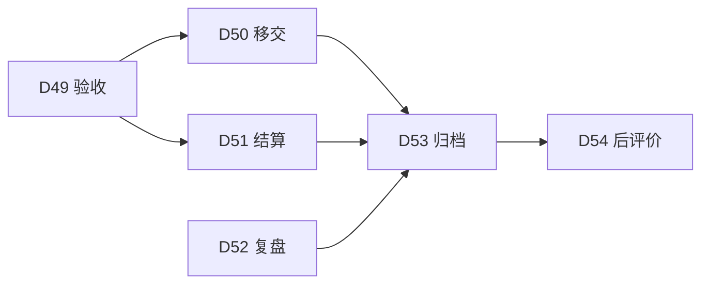

# 收尾活动（A49~A54）

> 本册是 [`00-总览与活动总表.md`](00-总览与活动总表.md) 的细目之三，覆盖收尾 6 条活动。条目口径与编号规则同总表 §一。
> 收尾不是"剩下的活干完"，而是六件各自独立、各有交付物的事：验收、移交、结算、复盘、归档、后评价。六件里少做一件，项目就关不干净。

---

## 一、收尾阶段（A49~A54）

### A49 可交付成果验收

**阶段** 收尾　**域** 范围　**触发** 按里程碑　**主责** 项目经理　**批准** 客户/发起人

- **目的**：把"做完没做完"按开工前定的准则逐条判完，并让每一条判定都能指到证据。
- **输入**：D10 范围基准与验收准则、D41 检验测试记录与不符合项报告、D08 范围说明书的交付物清单。
- **输出文档** `D49 验收报告`
  - 主件《验收报告》章节：1 验收范围与依据，逐条引 ACC 编号；2 验收过程与方法，谁在场、按什么程序；3 逐条判定结果；4 未通过项的处置与再验安排；5 验收结论与签署。
  - 记录《验收判定表》字段：ACC 编号、证据件编号、判定、判定人、日期、备注。
  - 记录《再验记录》。
- **完成判据**：每条 ACC 有判定与证据件编号，缺一条即验收不成立；未通过项有处置结论与期限；判定人不是执行该工作的人。
- **下游**：D50 移交清单与交接确认书、D51 合同关闭与结算单。

---

### A50 移交与运行交接

**阶段** 收尾　**域** 整合　**触发** 一次性　**主责** 项目经理　**批准** 接收方

- **目的**：把成果连同知识、账号、数据一起交到接手的人手里，并划清此后的责任。
- **输入**：D49 验收报告、D32 合同及附件、D36 文档登记册。
- **输出文档** `D50 移交清单与交接确认书`
  - 主件《交接说明》章节：1 移交范围，系统、文档、账号、数据、知识五类各列一遍；2 接收方与培训安排；3 遗留问题与责任划转；4 保障期安排与响应时限；5 交接不成立时的处理。
  - 附表《移交清单》字段：ITEM 编号、名称、形态、数量、状态、接收人、确认日期。
  - 记录《交接确认书》与《培训签到记录》。
- **完成判据**：每项有接收人签收；遗留问题明确保障期内由谁负责；账号与数据移交有权限变更记录。
- **下游**：D53 收尾报告与归档清册、D54 项目后评价报告。

---

### A51 合同关闭与结算

**阶段** 收尾　**域** 采购　**触发** 一次性　**主责** 采购负责人　**批准** 治理委员会

- **目的**：把每份合同的钱、货、责一次结清，不留悬空条款。
- **输入**：D32 合同及附件、D33 履约检查记录、D47 合同变更单与索赔处理记录。
- **输出文档** `D51 合同关闭与结算单`
  - 主件《合同关闭报告》章节：1 履约总结；2 结算口径与金额构成；3 扣款与违约金；4 争议与遗留事项；5 关闭结论。
  - 附表《结算明细》字段：CON 编号、项目、金额、依据、审批人。
  - 记录《双方确认记录》。
- **完成判据**：结算金额与支付记录逐笔对上；关闭结论有双方确认；未了争议另立条目并写接手方。
- **下游**：D53 收尾报告与归档清册。

---

### A52 项目复盘与经验教训

**阶段** 收尾　**域** 整合　**触发** 一次性　**主责** 项目经理　**批准** 治理委员会

- **目的**：把这一趟的判断留成下一次能用的东西，而不是一段"大家都很辛苦"的感受。
- **输入**：D44 项目状态报告与仪表盘、D46 决策日志、D31 质量审计报告、D42 问题登记册、D48 相关方满意度与反馈处理记录。
- **输出文档** `D52 项目总结报告与经验教训登记册`
  - 主件《项目总结报告》章节：1 目标达成情况，对照 D03 的成功判据逐条判；2 关键决策回顾，引 DEC 编号；3 偏差原因分析，分可控与不可控；4 可复用的做法；5 不该再做的事。
  - 登记表《经验教训条目表》字段：LSN 编号、场景、做法、结果、适用条件、建议动作、归属去向、接收方、采纳状态。
  - 记录《复盘会记录》。
- **完成判据**：每条教训写成"在什么条件下这样做，得到什么结果，所以下次怎么做"；每条有归属去向，能落到模板、制度或培训三处之一；归属接收方确认收到。
- **下游**：D53 收尾报告与归档清册、组织级模板库 O01。

---

### A53 项目收尾与归档

**阶段** 收尾　**域** 整合　**触发** 一次性　**主责** 项目经理　**批准** 治理委员会

- **目的**：把项目的口子全部收上，并让归档清册与过程登记逐条对得上。
- **输入**：D36 文档登记册、D49 至 D52 各份文档。
- **输出文档** `D53 收尾报告与归档清册`
  - 主件《收尾报告》章节：1 收尾核对，合同、财务、人员、资产、权限五类逐项确认关闭；2 归档范围与存放位置；3 遗留责任与移交安排；4 项目关闭结论。
  - 附表《归档清册》字段：DOC 编号、名称、版本、存放位置、保留期、销毁方式、移交人、移交日期。
  - 记录《账号与权限关闭记录》。
- **完成判据**：归档清册与 D36 文档登记册逐条对上，缺项即收尾不通过；账号与权限全部关闭有记录；未归档的文档写明原因与去向。
- **下游**：D54 项目后评价报告。

---

### A54 项目后评价

**阶段** 收尾　**域** 整合　**触发** 一次性，投产运行一段时间后　**主责** 项目经理　**批准** 治理委员会

- **目的**：等项目真正用起来以后，回头看当初的预计兑现了多少，并把差距归到可改进的地方。
- **输入**：D02 可行性论证报告、D03 项目章程、投产后的运行数据。
- **输出文档** `D54 项目后评价报告`
  - 主件《项目后评价报告》章节：1 评价时点与口径，投产后多久、按哪些指标；2 目标达成度，对照 D03 的成功判据；3 投入产出的实际值；4 与可行性论证的偏差及原因；5 结论与建议，逐条指定接收方。
  - 附表《论证与实际对照表》字段：论证时的预计值、实际值、偏差、原因分类、可否避免。
  - 记录《评价审读记录》。
- **完成判据**：与 D02 逐项对照，不允许只写实际值不写预计值；结论给出可操作的改进建议并指定接收方；偏差原因分可控与不可控两类。
- **下游**：组织级决策与模板库修订。

---

## 二、收尾六件的关系

验收是其他五件的前置：验收不过，移交没有标的，结算没有依据，复盘只能记过程，归档缺一条主线。因此验收这一步在收尾段不可并行，只能排在第一位。

---

## 三、文档齐套判定

项目关闭前，按下表逐行确认。任一行为"缺"即项目未关闭。

| 序号 | 判定项 | 判定方法 |
|---|---|---|
| 1 | 59 份输出文档的主件均有生效版本 | 对 D01~D59 逐份查首页的状态字段 |
| 2 | 三条基线各有唯一生效版本 | 查 D10、D13、D15 的版本号，不得有两份标"基线" |
| 3 | 全部 CHG 已关闭或有明确接手方 | 查 D40 登记表的实施状态列 |
| 4 | 全部 ISS 已关闭或有明确接手方 | 查 D42 登记表的关闭日期列 |
| 5 | 全部 DEF 有处置结论与验证结果 | 查 D41 登记表的验证列 |
| 6 | 全部合同已关闭并结算 | 查 D51 结算明细与支付记录的逐笔对应 |
| 7 | 验收准则逐条有判定与证据 | 查 D49 判定表的行数等于 ACC 条数 |
| 8 | 经验教训每条有归属去向且接收方确认 | 查 D52 登记表的采纳状态列 |
| 9 | 归档清册与文档登记册逐条对齐 | 两份表的 DOC 编号集合完全一致 |
| 10 | 账号与权限全部关闭 | 查 D53 的关闭记录 |
| 11 | 知识条目已归并 | 查 D52 的每条经验教训是否引用了 D55 的 KNW 编号，或写明了不引用的理由 |

第 1 行是最容易被含糊过去的一行：项目收尾时常见的做法是"主件写过就算有"，但状态若是"送审"，这份文档在制度上并不存在。判定只认状态字段，不认文件夹里有没有文件。

第 11 行防的是另一种含糊：收尾时另起一批"经验教训"，与过程中 D55 登记过的条目对不上号，写出来的东西没人验证过，也追不回去。
