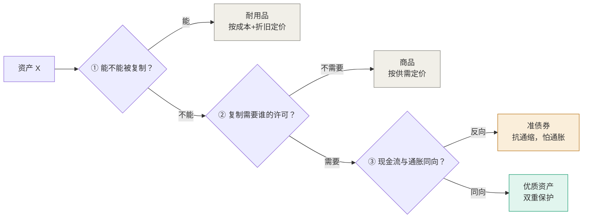
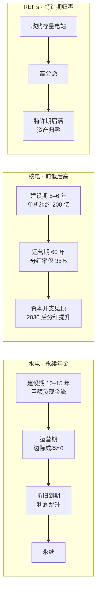

# 优质资产图谱与电力商业模式研究

> **研究问题**：二十年后什么算优质资产？以昆明房产为切口验证判据；并深挖水电、核电两类"稀缺电力资产"的商业模式与可投资形态。
>
> **方法**：先立判据，再验案例，后落到可执行工具。所有判断以"稀缺性来源"为锚，不以"增长速度"为锚。

---

| 项目 | 内容 |
|---|---|
| 编号 | 05 |
| 生成日期 | 2026-10-28 |
| 数据截止 | 2026-10-28（行情）／2026-10（宏观） |
| 对话来源 | 单场对话（2026-10-28 上午） |
| 议题性质 | 前瞻性研究 + 资产判据 + 商业模式拆解 |
| 后续处理 | 同议题追加进本文件，不另立新文件（CLAUDE.md §报告纪律③） |

> **本节追加的纪律**：本报告为**指令生成**（2026-10-28 用户点名"整理成一份研究报告"）。同一议题的后续场次**追加进本文件**，不另立新文件；过程稿不得自成文件。

---

## 目录

1. [摘要：一句话结论与五条判断](#一摘要一句话结论与五条判断)
2. [研究框架：优质资产的定义与三重判据](#二研究框架优质资产的定义与三重判据)
3. [2046 的地基：五个不可逆变量](#三2046-的地基五个不可逆变量)
4. [重定价：什么变贵，什么变便宜](#四重定价什么变贵什么变便宜)
5. [2046 优质资产图谱：五层结构](#五2046-优质资产图谱五层结构)
6. [案例研究一：昆明房产算不算（中铁佳苑）](#六案例研究一昆明房产算不算中铁佳苑)
7. [案例研究二：昆明的优质资产在哪](#七案例研究二昆明的优质资产在哪)
8. [可执行性：普通人如何触达五类资产](#八可执行性普通人如何触达五类资产)
9. [深度专题：电力资产的商业模式](#九深度专题电力资产的商业模式)
10. [深度专题：黄金与非主权信用](#十深度专题黄金与非主权信用)
11. [方法论：三问自检与判断公式](#十一方法论三问自检与判断公式)
12. [失效条件与风险清单](#十二失效条件与风险清单)
13. [附录：数据来源与口径说明](#十三附录数据来源与口径说明)

---

## 一、摘要：一句话结论与五条判断

**核心结论**：二十年后，优质资产不再是"能增长的东西"，而是"AI 复制不了、制度保护得住、物理上补不出来的东西"。**定价锚从"增长速度"换成"不可复制性"。**

这个转换的机制是：AI 让"可复制"的东西边际成本趋零，于是价值向两端集中——上游的物理底座（能源、材料、空间），下游的信任与合法性（牌照、产权、品牌）。**中间层被压扁。**

五条判断：

| # | 判断 | 强度 |
|---|---|---|
| 1 | 优质资产 = 对未来稀缺的占有权，稀缺性由"供给端有锁"决定，不由需求热度决定 | 高 |
| 2 | "便宜"是资产的敌人。要素便宜的地方往往没有资产，只有耐用品 | 高 |
| 3 | 全国需求 ≠ 稀缺。供给由本地政府决定，需求池扩张慢于供给池时价格必跌 | 高 |
| 4 | 在电力板块内，"稀缺水电+核电"与"整个电力行业"是两种资产，ETF 把二者混同 | 高 |
| 5 | 黄金的定价锚已从实际利率切向主权信用，传统模型解释力接近归零 | 中高 |

---

## 二、研究框架：优质资产的定义与三重判据

### 2.1 定义

**优质资产 = 对"未来稀缺"的占有权。**

拆开是两个东西：
- **索取权**：对未来现金流的法律主张（债券、股票、租金）
- **占有权**：对不可复制资源的排他控制（水坝、牌照、矿脉、区位）

过去四十年（1986–2026），优质资产的共同点是踩中"三低一高"——低通胀、低利率、低成本劳动力、高全球化。在这个体制里，**索取权跑赢占有权**：股价、房价、债券全线上涨，因为折现率一路下行。

这个体制正在终结。未来的宏观结构是：财政主导、通胀中枢上移、人口反转、地缘区块化、AI 让复制免费。

**结论：索取权的黄金时代结束，占有权的时代开始。**

### 2.2 三重判据

任何资产，问三个问题：

三条全过的，才配叫优质资产。**三条里最关键的是第二条——"许可"**。它把"稀缺"从市场概念变成了政治概念：真正锁死供给的，从来不是成本，是审批。

### 2.3 与"价值投资"的区别

传统价值投资问："它便宜吗？"（相对内在价值）

本框架问："**它的稀缺性由谁保证？**"

差别在于：前者是相对定价问题，后者是制度结构问题。一个资产可以在任何估值水平上"贵"或"便宜"，但它的稀缺性来源是结构性的、不随价格改变的。

---

## 三、2046 的地基：五个不可逆变量

### 3.1 变量表

| 变量 | 关键数据 | 资产含义 |
|---|---|---|
| **电力成为新的"土地"** | 全球数据中心用电 415 TWh(2024) → 约 945 TWh(2030) → 约 1,200 TWh(2035)（IEA）；BNEF 预计 2035 年占全球用电 4.5%、2050 年 8.7% | 稀缺的不是发电量，是**并网权与可调度容量** |
| **人口倒转** | 中国 65+ 占比 15.6%(2024) → 约 30%(2050)；总人口 2021 年 14.13 亿见顶，2050 年约 13.1 亿（UN） | 劳动力"两个世界"，养老与自动化同时受益 |
| **货币信用重构** | 美国联邦债务破 40 万亿美元，年付息约 1.17 万亿；2025 年底黄金占全球官方储备 **27%，首次超过美债的 22%**（ECB） | "无风险资产"概念本身被重定义 |
| **全球化 → 区块化** | 供应链主权化，效率让位于安全 | 同一资产在"友岸/非友岸"有两个价格 |
| **气候成为当期定价因子** | 保险撤退先行，资本跟随 | 宜居性、水源、避灾区位开始单独定价 |

### 3.2 基建侧的量级参照

- 全球基建需求（至 2040）：**94 万亿美元**（Global Infrastructure Hub），缺口 **18 万亿**
- McKinsey 口径：**106 万亿美元**，其中交通 36 万亿、**电力 23 万亿**、数字 19 万亿、社会 16 万亿、水与固废 6 万亿、农业 5 万亿、国防 2 万亿

**电力与数字两项合计 42 万亿，是最大的结构性开支方向。**

---

## 四、重定价：什么变贵，什么变便宜

| 类别 | 20 年方向 | 理由 |
|---|---|---|
| 可调度电力 / 电网容量 / 储能 / 核电 | ↑↑ | 并网排队成为硬约束，审批权即定价权 |
| 水权、水资源 | ↑↑ | 干旱 + 数据中心水冷 + 农业争水三重挤压 |
| 关键矿产的**加工产能**（非矿本身） | ↑ | 矿不稀缺，冶炼分离才稀缺 |
| 气候韧性土地、高纬宜居区 | ↑ | 保险重定价先行 |
| 黄金 / 非主权信用资产 | ↑ | 官方储备结构性再配置，国策级而非交易级 |
| 顶级人力资本（决断、关系、手艺） | ↑ | 认知劳动被压价，"签字的人"与"能上手的人"更贵 |
| 长久期名义国债 | ↓ | 财政主导下，本质是卖出通胀期权 |
| 普通住宅、传统商业地产 | ↓ | 人口与远程办公，回归折旧型消费品 |
| 标准化白领服务 / 信息中介 | ↓↓ | 直接被 agent 替代 |
| 同质化数字内容 / 流量 | ↓↓ | 供给爆炸，单价趋零 |
| 单一技能人力资本 | ↓ | 技能半衰期压缩到 5–7 年 |

**这张表的读法**：不要把它当成"买什么"的清单，要当成"什么在失去定价权"的诊断。下半张表是绝大多数中国家庭资产的主要构成。

---

## 五、2046 优质资产图谱：五层结构

按"稀缺性来源"分层——这是本框架的核心分类法：

| 层 | 代表形态 | 稀缺来源 | 主要风险 |
|---|---|---|---|
| **物理底座** | 并网权+可调度容量、水权、矿产精炼、气候安全区位、港口/航道/轨位频谱 | 自然垄断 + 许可 | 价格管制、政治征收 |
| **权利层** | 标准必要专利、频谱/空域/碳配额、非公开高质量领域数据、准入牌照 | 法律创设 | 制度变更、强制许可 |
| **制度信用层** | 产权保护本身、主权信用、认证/评级/保险、可验证品牌 | 集体信任，无法单方生产 | 信用事件、战争 |
| **网络层** | 电网/管道/铁路/港口/光纤、"算力+电力"捆绑体、卖铲子环节 | 规模 + 转换成本 | 技术路线颠覆 |
| **人力与生物层** | 高技能个体、健康与长寿、可验证能力认证、家族/信任网络 | 生物学 + 社会资本 | 难以规模化持有 |

### 5.1 一条最实用的分辨

> **数据中心不是电力资产。GPU 三五年折旧，电网资产三五十年。**

把这两件事混为一谈，是这一轮最大的估值陷阱。算力若过剩，所谓"算力地产"会变成 21 世纪的写字楼——供给侧在三年内可以翻倍的东西，不构成稀缺。

---

## 六、案例研究一：昆明房产算不算（中铁佳苑）

### 6.1 案例选择理由

昆明是一个理想的检验场：它是中国唯一"夏天不热、冬天不冷"的大城市，气候资源在全国具有唯一性。如果连这样的城市，其住宅都无法成为资产，那"气候稀缺 = 房产价值"这个直觉就值得怀疑。

中铁佳苑是昆明呈贡区的头部楼盘，是"优质住宅"的典型样本。

### 6.2 标的画像

| 项目 | 数据 |
|---|---|
| 位置 | 呈贡区彩云南路与联大街交叉口 |
| 交通 | 地铁 1/4 号线换乘站联大街站约 400 米 |
| 建成 | 2018–2020 年 |
| 规模 | 12 栋 15–17 层板楼，623 户，容积率 3.32，绿化率 30.46% |
| 产品 | 100–160 ㎡，两梯两户/一梯一户，精装带地暖 |
| 物业费 | 1.86–1.88 元/㎡·月 |
| 配套 | 万达广场、七彩云南第壹城、中医院、大学城 |

### 6.3 价格位置

| 对照 | 均价（2026-10） | 溢价 |
|---|---|---|
| 中铁佳苑 | 约 11,500–12,000 元/㎡ | — |
| 呈贡区 | 7,142 元/㎡ | **+64%** |
| 周边 1 公里 | 8,457 元/㎡ | +38% |
| 昆明全市 | 9,100 元/㎡ | +29% |

昆明全市二手房：2021 年高点 **13,217 元/㎡** → 2026 年 10 月 **9,121 元/㎡**，五年 **−31%**。

### 6.4 第一次判断与修正

**初判**：呈贡买家池本地化 → 属耐用品，非资产。

**修正**（用户指出"中铁佳苑有很多外省人"）：呈贡省外客群占比实为 **37%**（昆明房协《2025 年度昆明房地产行业蓝皮书》），高于昆明主城 31%；安宁、晋宁、嵩明达 40%。全省 2025 年省外购房 32.1%、3.9 万套，近七年最高；川渝客户占省外客群比例从 25% 升至 27%。

**初判的错误**：把"有没有外省买家"当成判据，太粗。

### 6.5 修正后的框架：三类买家，三种定价函数

| 买家类型 | 动机 | 价格锚 | 对价格的作用 |
|---|---|---|---|
| 本地刚需 | 住 | 本地收入 | 托底 |
| **消费型全国买家**（旅居/避暑/养老） | 生活成本套利 | 替代成本（老家装空调 / 去三亚租房） | 撑成交量，**不撑价格中枢** |
| 配置型全国买家（资产保值） | 回报率 | 与其他资产比价 | 推价格中枢 |

呈贡那 37% 属第二类。证据链：

1. **平均旅居时长 83 天**——候鸟，非移民
2. **2025 年昆明新增常住人口 5.7 万，旅居人数 158.75 万人次 = 28 倍**——流量进得来，存量留不下
3. **租金锚极低**：报道案例中重庆退休夫妇在呈贡租 76 ㎡两居，年租 9,600 元（月租 800 元）
4. 购房动机调研：气温、菜价、房租便宜，无一条是"保值"

### 6.6 最关键的机制：全国需求 ≠ 稀缺

> **稀缺取决于供给，而供给由本地政府决定。**

2026 年昆明首批"旅居社区"住宅地落在呈贡核心区，容积率低至 1.6、要求 70% 小户型。这本质上是政府把"22℃的夏天"批发成土地指标。未来 3–5 年，专为该客群定制的供给会成倍放量。

**需求池扩张 30%，供给池扩张 100%，价格只能往下走。**

这就是"37% 省外客群 + 五年 −31%"可以同时成立的原因。

### 6.7 判断锚点的升级

从"看买家名单有没有外省人"升级为三个可量化指标：

| 指标 | 阈值 | 含义 |
|---|---|---|
| **房价收入比** | 本地双职工家庭 5–7 倍 = 定价锚在本地；20 倍以上 = 与本地脱钩 | 呈贡 1.17 万 × 90 ㎡ ≈ 105 万，本地年收入 15–20 万 → 5–7 倍 → **锚仍在本地** |
| **复访率 / 旅居时长** | 年均居住 6 个月以上才算定居 | 呈贡 83 天 = 候鸟 |
| **二手成交周期与议价空间** | 消费型资产挂牌长、砍价狠 | — |

### 6.8 结论

**中铁佳苑是"昆明最好卖的耐用品"，不是优质资产。**

修正后的完整表述：
- 它的**流动性**与**抗跌性**优于区域平均（同比约 −3%～−5%，好于全市 −5.7%），这是真实优势
- 但它的买家买的是"22℃的夏天"，出价上限由退休金决定，不由资产比价决定
- **需求是真的，只是这条需求曲线不负责抬高价格中枢**

**观察窗口**：呈贡那批 1.6 容积率旅居地块交付三五年后的二手转手率。如果业主开始互相接盘、而非被新盘抢走客户，呈贡才算长出"资产"。

---

## 七、案例研究二：昆明的优质资产在哪

### 7.1 底层矛盾

昆明的比较优势是**要素便宜**（电、水、地、气候）。而"便宜"恰恰是资产的敌人——便宜意味着供给充足、可复制、无租金。

**所以昆明的优质资产几乎都不在住宅里，而在"把便宜要素锁住"的地方。**

判断公式：

> **这个资产的价格，是由昆明的要素成本决定的，还是由全国的稀缺性决定的？**
> 前者是耐用品，后者才是资产。

### 7.2 第一梯队

**① 绿电 + 土地 + 并网的算力基础设施（要壳，不要卡）**

昆明同时握着四张牌：云南绿电富集、年均 15℃ 自然冷却（PUE 可压至 1.2 以下）、海拔 1,891 米空气密度低散热更快、**全国唯一同时拥有边境口岸和数据口岸的省会**（昆明国际通信业务出入口局）。

数据中心三大成本是电、水、散热——昆明占两项半。

**关键分辨**：30 年折旧的机房是资产，3 年折旧的 GPU 是耗材。真正稀缺的是"有电、有地、有并网指标、有能耗指标"的那块壳。能耗指标（"东数西算"配额）由政府批，属权利层资产。

**② 三甲医疗 + 照护能力的复合体（不是"康养地产"）**

这是昆明唯一能把流量转成存量的阀门。旅居调研中最刺耳的一句是 64 岁北京旅居客的话："外面再好，最怕生病。"

资产不在"卖给旅居客的房子"，而在**"让旅居客敢留下来的医疗服务能力"**：三甲医院 3 公里圈内的适老化改造社区、护理床位、异地医保直接结算资质、急诊绿色通道。房子是壳，医疗是现金流。

**③ 关键金属的加工产能（股权，不是房子）**

云南在四个品种上有全球级话语权：**锡**（锡业股份，全球第一）、**锗**（云南锗业）、**铂族金属**（贵研铂业）、**铟**。供给刚性、扩产周期以十年计。

加上云南白药这类"保密配方 + 品牌"的组合——配方是法律锁死的。

### 7.3 第二梯队

**④ 稀缺参数的土地**：海拔 1,800–2,200m + 稳定水源 + 非断裂带 + 三甲 15 分钟 + 容积率 ≤1.5。

这个组合全国近乎独一份。符合该参数的地块被滇池保护条例、生态红线、耕地红线三重锁死。注意：不是"滇池边"（临湖限高限距、治理责任重），是"看得见滇池、但不临湖的缓坡"。

**⑤ 口岸与通道资产**：中老铁路 + 托管磨憨。可持有的是保税仓、冷链、跨境物流园。国家级战略 + 政策护城河 + 稳定现金流，缺点是流动性极差。

**⑥ 生物资源特许权**：种质资源库、GAP 种植基地、提取物专利、花卉自主品种权（斗南是亚洲最大花市，但品种专利九成在境外）。

### 7.4 什么不算

呈贡高层住宅 · 滇池边文旅大盘 · "康养地产"概念盘（卖的是房不是医）· 远郊旅居小镇（供给可由政府无限批发）。

**共同点：它们卖的都是"昆明的便宜"，而便宜可以被复制。**

### 7.5 最大的风险藏在最大的优势里

"绿电洼地"这个前提，建立在水电站来水正常之上。云南 2023–2024 年连续大旱，水电出力下滑，部分时段需外购电。气候变化正在让"云南水电"从稳定电源变成波动电源——这直接削弱第一条逻辑。

**昆明最硬的资产（绿电）和最脆的一环（来水）是同一件事。**

---

## 八、可执行性：普通人如何触达五类资产

### 8.1 前提认知

> **普通人买不到"资产"，只能买到"资产的证券化替身"。**

这两者的差别决定了你最终拿到的是现金流，还是波动。

### 8.2 可及性矩阵

| 类别 | 普通人的工具 | 门槛 | 可及性 |
|---|---|---|---|
| ① 电力与并网权 | 水电/核电龙头股；电力 ETF；**能源类公募 REITs** | 低 | ✅ 真正可执行 |
| ② 水与气候韧性土地 | 水务公用事业股、水务 REITs；海外农地 REITs（QDII） | 中 | ⚠️ 半可及（中国无开放水权市场） |
| ③ 关键矿产加工产能 | 有色/稀土 ETF；矿业龙头股 | 低 | ⚠️ 买到的是价格弹性，不是产能 |
| ④ 黄金与非主权信用 | 实物金条、黄金 ETF、积存金 | 极低 | ✅ 唯一能买到"本体"的一类 |
| ⑤ 人力资本与信任品牌 | 你自己；品牌类股票 | 零 | ✅ 回报最高，最易被忽略 |

### 8.3 三条落地要点

**① 电力：买"折旧完的机组"，不买"在建的工地"。**

核心指标：**股息率 − 十年期国债收益率**。差值 2 个百分点以上才有持有价值。因为电价受管制，电力股本质是"准债券"。

**② 矿产：要接受 20 年内 3–4 次腰斩。** 矿是资源，加工是制造业。加工的利润来自加工费（TC/RC），加工费下行的年份冶炼厂是赔钱的。

**③ 人力资本：可验证性比技能更稀缺。** 在 AI 让内容通胀的世界里，稀缺的是"证明这件事是你做的"。方向不是再读一个学位（学历在贬值），是公开作品 + 专业认证 + 健康。

### 8.4 两个确定性最高的动作（比选资产更重要）

1. **把费率压到最低。** 年化 1.5% 的费率差，20 年复利后终值差 30% 以上。这是唯一确定的、无风险的、100% 归你的收益。
2. **把时间拉长，把杠杆归零。** 这五类资产的兑现周期以十年计。用三年内要用的钱买它们，必然在错误的时间被迫卖出。

### 8.5 一条红线

**别碰非标。** 任何"年化 8%、保本、熟人介绍、有政府背书"的东西，本质是把上述五类的风险打包后卖给你，但把收益截留了。

---

## 九、深度专题：电力资产的商业模式

### 9.1 本质定义

> **水电和核电不是"发电企业"，是"用主权级信用，把未来的电费贴现到今天的融资结构"。**

它们的核心能力不是发电，是**以极低成本获得超长期资金**。这解释了为什么这个行业里活下来的全是央企，而不是效率更高的民企。

### 9.2 现金流形态：三种资产，三条曲线

三条线的形状不同，投资逻辑就完全不同。用同一种方法买它们，一定会在某一类上亏钱。

### 9.3 水电：四根支柱

**成本结构（长江电力 2025 年）**

| 项目 | 数值 | 含义 |
|---|---|---|
| 营收 / 归母净利 | 862.4 亿 / 345.0 亿 | 毛利率 61.67%，行业第一 |
| 经营现金流 | 605.6 亿 | **净现比 1.76** |
| 折旧占成本 | **60% 以上** | 账面成本，非现金支出 |
| 人工 | 极低 | 数千人管理 7,179 万 kW |

**净现比 1.76 是全场最关键的数字**：每 1 元账面利润背后有 1.76 元现金到账。差额来自折旧——折旧是会计动作，钱早就花完了。

由此推出水电最值钱的一句话：

> **折旧到期日，就是利润释放日。**

大坝折旧 40–50 年，机组 15–20 年。机组折旧先到期，现金流入不变但利润表少一笔扣除，利润"凭空"跳升。2026H1 长电毛利率同比 +1.77pct，研报判断为"部分机组折旧到期"。

**四根支柱：**

| 支柱 | 内容 | 证据 |
|---|---|---|
| **资源垄断** | 长江干流不可能再建第二座三峡 | 装机 7,179.5 万 kW，占全国水电 16% |
| **边际成本趋零** | 多发一度电增量成本≈0 | 现货价格跌到火电亏本，水电仍赚钱 |
| **六库联调** | 用系统对冲随机变量 | 2026H1 乌东德来水 −16.94%、三峡 +28.74%，调度后三峡发电 +31.62% |
| **准债券现金流** | 可预测 → 可高杠杆 → 可高分红 | 股利支付率 70.92%，承诺 2026–2030 ≥70% |

### 9.4 核电：同构，但命不同

| 维度 | 水电 | 核电 |
|---|---|---|
| "燃料" | 免费的雨水 | 铀（占成本 15–20%） |
| 边际成本 | ≈0 | 约 0.1–0.15 元/kWh |
| 利用小时 | 3,000–4,500（可调节） | 7,000–8,000（基荷） |
| 设计寿命 | 大坝 100 年+ | 60 年（可延寿至 80） |
| 建设周期 | 10–15 年 | 5–6 年（但常延误） |
| 尾部风险 | 地震、极端干旱 | **核事故——不可逆** |

**核电的护城河是"厂址 + 牌照"，不是"技术"。** 全国可建厂址可能只有几十个，要通过地质、水文、人口密度、应急疏散等整套审批。存量厂址本身就是稀缺资产——这是中广核能占到全国 44.47% 在运+在建装机（34.25 GW 在运 / 21.81 GW 在建）而不被挑战的根本原因。

**结构性缺陷：资本开支吃掉十年分红。** 中广核分红率约 35%、A 股股息率 2.3%、自由现金流为负（同时建 18 台机组）。而长电机组早已建完，分红率 70.92%。

> **同样叫"公用事业"，长电是收租阶段，中广核是还贷阶段。** 用同一套估值逻辑买它们，必错其一。

**尾部风险的特殊性**：核事故是"厚尾"——概率极低但后果不可逆、不可分散。这在数学上意味着其合理折现率应高于水电。市场给两者相近的 PE（约 19–20 倍），实则低估了这个尾部。

### 9.5 与其他企业对比

| 维度 | 制造业 | 消费品牌 | 科技平台 | **水电** | **核电** |
|---|---|---|---|---|---|
| 增长来源 | 产能+份额 | 提价+复购 | 网络效应 | 几乎没有 | 核准节奏 |
| 边际成本 | 中 | 低 | 趋零 | **≈0** | 低 |
| 定价权 | 弱 | 强 | 强 | **弱（管制）** | **弱（管制）** |
| 资本开支 | 持续 | 低 | 中 | 一次性 | 周期性巨额 |
| 折旧占成本 | 5–10% | 低 | 低 | **30–40%** | 30–40% |
| 现金流可预测性 | 低 | 中 | 低 | **极高** | 高 |
| 资产寿命 | 10–20 年 | 20–50 年 | 5–10 年 | **100 年+** | 60–80 年 |
| 管理层重要性 | 决定性 | 重要 | 决定性 | **几乎为零** | 低 |
| 规模报酬 | 先增后减 | 递增 | 递增 | **递增（流域）** | 递增（集群） |
| 抗通胀 | 中 | 强 | 中 | **弱** | 弱 |
| 估值方法 | PE/PEG | DCF | PS/用户 | **DCF/股息率** | DCF/装机 |

**"管理层重要性几乎为零"被严重低估。** 一个水电厂不会因为换了董事长就多发一度电。这意味着你不需要判断人，只需判断资产和价格——在投资里这是巨大的认知优势，因为判断人几乎不可能，判断资产相对可能。

### 9.6 优劣势

**优势**

1. 可预测性极高——能算出十年后现金流，误差 10% 以内
2. 抗周期——衰退时用电降 3–5%，制造业利润可跌 80%
3. 通缩/通胀双向不对称保护——通缩时是债券，通胀时是实物资产
4. 商业模式看得懂——不需要理解技术路线
5. 不需要天才管理层

**劣势**

1. 成长性封顶——长电装机已到天花板，净利增速降至 6% 左右
2. 定价权在政府手里——最根本的缺陷
3. 利率敏感——高杠杆 + 长久期，利率上行直接杀估值
4. 不可抗力——来水、地震、核事故
5. 资本开支陷阱（核电）——成长期分红能力被建设吞掉

### 9.7 最深的一层：它们是"利率的看跌期权"

> **买长江电力，本质是在赌"未来二十年利率中枢下移"。**

这不是比喻。长电 2026H1 财务费用 42.01 亿、同比 −13.61%，**利润增长的大头来自降息而非发电量**。资产端是水坝，负债端是利率，利润在两者之间被放大。

这解释了一个反常现象：**中国水电股 PE 19–20 倍，显著高于全球同类公用事业（通常 12–15 倍）。** 原因只有一个——中国十年期国债 0.95%，而美国 5.13%。它享受的是中国低利率环境的估值红利。

**最大的脆弱点也随之清楚：一旦中国利率正常化，估值会被重挫。不是业绩变差，是折现率变了。**

### 9.8 三类工具的实际数据（2026-10）

**个股**

| 指标 | 长江电力 | 中国广核 | 中国核电 |
|---|---|---|---|
| 股价 / 市值 | 29.54 元 / 7,228 亿 | — | — |
| 在运装机 | 7,179.5 万 kW | 34.25 GW / 30 台 | 24 GW+ |
| 在建 + 核准 | — | 21.81 GW / 18 台 | 17.57 GW / 15 台 |
| 股息率 | **3.39%** | A 2.3% / **H 3.6%** | 2–3% |
| 分红率 | **70.92%** | 约 35% | ≥30% |
| PE（2026E） | 19.9 | 19.9 | 约 19 |
| PB | **2.90（近十年 92.9% 分位）** | — | — |

**电力 ETF**

| 项目 | 561560 华泰柏瑞 | 159611 广发 |
|---|---|---|
| 规模 | 18.70 亿 | 90.33 亿 |
| 管理费 + 托管费 | 0.50% + 0.10% = **0.60%** | 同 |
| 跟踪指数 | 中证全指电力公用事业（H30199，59 只成分股） | 同 |

**指数结构（前十合计 51.51%）**

| 权重 | 成分 | 性质 |
|---|---|---|
| 11.63% | 长江电力 | 真·稀缺水电 |
| 8.21% | 中国核电 | 真·核电 |
| 5.52% | 三峡能源 | 风光（补贴退坡） |
| 5.23% | 国电电力 | 火电为主 |
| 4.00% | 国投电力 | 水电+火电 |
| 3.65% | 中国广核 | 真·核电 |
| 3.53% | 川投能源 | 真·水电 |
| 3.47% | 永泰能源 | **民营煤电** |
| 3.39% | 华能国际 | 火电 |
| 2.30% | 浙能电力 | 火电 |

**结论：真正的稀缺水电+核电仅约 35%，火电+风光占一半以上。** 这不是"稀缺电力"，是"整个电力行业"。

**费率的算术题**：长电股息率 3.39%，扣 0.60% 费率剩 2.79%——**为"省事"把 18% 的股息收入交给了基金公司。**

**能源类 REITs**

| REIT | 底层 | P/NAV | 年化分派率 |
|---|---|---|---|
| 中航京能光伏 | 光伏 | 1.07 | 11.19% |
| 嘉实中国电建清洁能源 | **水电**（五一桥） | **1.83** | 10.68% |
| 国泰君安济南能源供热 | 供热 | 1.48 | 14.66% |
| 华夏华电清洁能源 | 风光 | 1.10 | 6.34% |
| 鹏华深圳能源 | 燃气发电 | 1.10 | 5.86% |
| 中信建投明阳智能 | 风电 | 1.14 | 5.36% |
| 中信建投国家电投 | 风电+光伏 | 1.20 | 4.81% |
| 华夏中核清洁能源 | 核电配套 | 1.29 | 2.89% |
| 华夏特变电工新能源 | 光伏 | 1.29 | 2.53% |
| 工银瑞信蒙能清洁能源 | 风光 | 1.45 | 1.03% |

分派率从 1.03% 到 14.66%，跨度 14 倍——**离散度本身说明多数人不会给这类资产定价。**

**三个陷阱：**

**① 分派率含本金返还。** 特许经营权有到期日（20–36 年），到期资产归零。10% 分派中可能有 3–4 个点是本金在还给你。**该看 IRR，不是分派率。**

**② "年化分派率"不能简单乘二。** 中信建投国家电投 2026 中报：年化现金流分派率 **1.83%**；全年预测分派 **7.96%**。差 4 倍——因为风电分派高度集中在特定季度。

**③ 单个电站的风险远超直觉。** 嘉实中国电建 2026Q2 真实报表：
- 底层仅一座 **13.7 万 kW** 水电站（四川甘孜五一桥）
- 发电量 −9.05%（来水偏少）
- 市场化结算电价 0.1443 元/kWh，**同比 −24.07%**
- 当期净利润 **亏损 761 万**，经营现金流为负
- 年化分派率 4.10%
- 市场给 **P/NAV 1.83 倍**——全板块最高溢价

**一个季度就能亏钱，但市场愿意付 83% 溢价。** 这个价格赌的是"水电永续"的想象，不是当期现金流。

风电更糟：发电功率与风速的**三次方**成正比。中信建投国家电投中报净利润 −9,536 万，原因是风速 5.66 m/s vs 去年 6.41 m/s，−11.6%，发电量断崖。

### 9.9 共同的最大风险：电价市场化

2026 年数据已在说话：
- 中广核市场化电量占比 **65.9%**（+9.8pct），市场电价 **−1.69%**
- 五一桥水电市场化电价 **−24.07%**

**电力正从"政府定价的公用事业"变成"市场化定价的商品"，而市场还在用公用事业的估值框架定价。** 这个错配就是未来的杀估值来源。

但分化是结构性的：

| 电源 | 度电成本 | 市场化中的位置 |
|---|---|---|
| 水电 | 0.05–0.1 元 | **赢家**：满发仍赚钱 |
| 火电 | 0.3–0.4 元 | **输家**：煤价一涨就被挤出 |
| 核电 | 约 0.3 元 | 中性偏负：有基荷与容量电价保护 |

**这恰恰是 ETF 最致命的地方：它把赢家和输家绑在一个篮子里，让你拿不到分化的钱。**

### 9.10 排序结论

| 排序 | 标的 | 理由 | 前提 |
|---|---|---|---|
| 1 | **中广核 H（1816.HK）** | 同一资产打五折，股息率 3.6%，赌 2030 后分红率翻倍 | 能接受 5 年低分红 |
| 2 | **长江电力 / 华能水电** | 最干净的永续现金流，分红承诺写进公告 | 等 PB 回到 2.5 以下或分批 |
| 3 | **能源类 REITs（精选）** | P/NAV 1.0–1.2、分派 6%+、底层分散 | 能自己算 IRR |
| 4 | **电力 ETF** | 只在完全不想选股时用 | 清楚买的是 35% 纯度 |

**提醒**：四类的当前价格都不算便宜——长电 PB 十年 93 分位、中国电建 REIT 溢价 83%、核电 PE 近 20 倍。**好资产 + 坏价格，照样亏钱。**

---

## 十、深度专题：黄金与非主权信用

### 10.1 概念澄清

**判据**：它的价值，是否依赖某个发行人的偿付承诺。

| 资产 | 有没有发行人 | 算不算非主权 | 你冒的风险 |
|---|---|---|---|
| 实物金条 | 无 | ✅ 是 | 保管、盗窃、成色纠纷 |
| 黄金 ETF | 有（基金+托管行+做市商） | ❌ 是"黄金的索取权" | 托管方违约、挪用 |
| 比特币 | 无 | ✅ 是 | 私钥、交易所、监管 |
| 外币存款 | 有（外国主权） | ❌ 只是"另一个主权" | 汇率、冻结 |
| 国债 | 有（主权） | ❌ 是"主权的承诺" | 通胀违约、显性违约 |
| 海外房产 | 有（属地主权） | ❌ 受管辖、可被征收 | 政治风险 |
| 金饰 | 无 | ⚠️ 是，但溢价 30–40% | 买入即亏 |

**真正符合"非主权信用"的只有黄金、白银（半个）、比特币。**

**关键认知**：非主权资产没有消除风险，只是把**信用风险**换成了**保管风险**。2011 年 MF Global 倒闭，客户 segregated account 里的钱被挪用——"纸黄金"的信用风险暴露得干干净净。

> **黄金的非主权属性，只有在你真正持有实物时才成立。ETF 是打了折的非主权。**

### 10.2 传统定价模型已经归零

教科书：金价与实际利率负相关。实际利率涨，持有黄金机会成本上升，金价跌。

**2026 年 10 月的数：**

| 指标 | 数值 |
|---|---|
| 10 年期美债收益率 | **5.126%** |
| 2 年期美债收益率 | 4.821% |
| 美元指数 | 101.78 |
| 12 月加息 25bp 市场概率 | **76%** |
| 现货黄金 | **4,060 美元/盎司** |
| 国内现货金 | 871 元/克 |

**黄金是零收益资产。持有它的机会成本 5.1%，是 2007 年以来最高水平之一。按老模型，金价该在 1,200 美元。它现在 4,060。**

**多出来的约 2,800 美元，是主权信用溢价。**

分水岭：2022 年西方冻结俄罗斯约 3,000 亿美元央行资产。全世界央行同时意识到——**账上的美元资产，在极端情形下不是你的。**

购金逻辑从"投资收益"切换到"储备安全"，出现**"非对称购金"：价格越低越买，不看利率。**

**央行数据：**

| 数据 | 数值 |
|---|---|
| 连续净买入年数 | **16 年** |
| 2026 Q2 净购金 | 289 吨，同比 **+62%**，历史同期最高 |
| 2026 全年预测 | 约 **755 吨**（摩根大通），远超 2022 年前均值 |
| 黄金占全球官方储备 | **27%**（2025 年底） |
| 美债占全球官方储备 | 22%（30 年来首次被超越） |
| 央行持金价值 | 约 4 万亿美元 > 持有美债 3.9 万亿 |
| 中国央行 | 7,608 万盎司，连续 21 个月增持 |
| 新兴市场央行持金 | 仅为发达经济体一半，**结构性买盘未走完** |

**当前定价函数**：金价 = f(财政可持续性, 储备多元化, 制裁风险)，而非 f(实际利率)。

### 10.3 当前价位

2026 年走势：

| 时点 | 价格 / 事件 |
|---|---|
| 2026-01-29 | 全年高点，约 **5,400 美元**（去美元化+央行购金+地缘避险三共振） |
| 2026-02 起 | 美伊冲突推油价至 110 美元，通胀预期升温，美联储转鹰 |
| 2026-08-25 | 阶段性高点后二次下探 |
| 2026-10-22 | **4,060 美元**，自 1 月高点 **−25%**，失守 4,100 |

**这是"加息交易"压制，不是逻辑崩塌。** 依据：央行购金未停（中国央行月度购金从 16 万盎司加速到 64 万盎司），ETF 三季度仍流入 117 亿美元。

机构目标（仅参照，非预测）：

| 机构 | 目标 |
|---|---|
| 瑞银 CIO | 12 个月 5,400 |
| J.P. Morgan PB | 6,000–6,300 |
| 道富 SSGA | 4,750–5,500 |
| 富国银行 | 2026 年底 6,100–6,300 |

瑞银同时给出更关键的判断：**需要每季度约 500 吨的投资需求，才足以推动金价上行。** 央行是慢变量，快变量是投资需求。**短期金价由情绪定，长期由央行定。**

### 10.4 形态与费率

| 形态 | 买入成本 | 年化持有成本 | 非主权纯度 | 适合 |
|---|---|---|---|---|
| 上金所 Au99.99 | 溢价约 0.5–1% | 账户/保管费 | 高（可提实物） | 大额配置 |
| 银行实物金条 | 溢价 3–8% | 保险箱租金 | **最高** | 保险仓位 |
| 黄金 ETF（518880 等） | 交易佣金 | **0.5% + 0.1% = 0.6%** | 中（有托管方） | 流动性仓位 |
| 银行积存金 | 点差 1–2% | 无 | 中 | 定投 |
| 金饰 | **溢价 30–40%** | — | 低 | ❌ 不是投资品 |

**两条硬结论：**

**① 金饰永远不是投资。** 买入那刻亏 30%，需金价涨 50% 才回本。

**② 黄金 ETF 的 0.6% 费率，对零收益资产是重税。** 买长电，3.4% 股息付 0.6% 还剩 2.8%；买黄金，0% 现金流付 0.6%，纯亏。真正二十年不动的保险仓位应是实物——5% 溢价摊到二十年是每年 0.25%，比 ETF 便宜。

### 10.5 中国买金的两个特殊约束

1. **资本管制让"境内金"与"国际金"不同价。** 极端情形下价差扩大——对持有者是溢价，对想换出去的人是折价。**"黄金能带你穿越国界"这个说法，在中国要打折扣。**
2. **出口与携带限制。** 个人携带黄金出境有额度限制，"非主权资产"在物理上仍受主权管辖。

**结论：在中国，黄金是"打折的非主权"——比纸币强得多，但不是绝对。**

### 10.6 配置：别用价格锚，用比例锚

黄金不产生现金流，DCF 无法定价。唯一可用的锚是它占全球财富的比例：

| 指标 | 数值 |
|---|---|
| 全球地上黄金存量 | 约 **21.6 万吨**（约 6.9 亿盎司） |
| 按 4,060 美元/盎司市值 | 约 **28 万亿美元** |
| 全球金融资产（股+债） | 约 500–550 万亿美元 |
| 黄金占比 | 约 **5%** |
| 1980 年峰值占比 | 约 20% |
| 2011 年峰值占比 | 约 7% |

按此锚，金价理论区间 2,000（回到 2%）到 8,000（回到 10%）——**区间宽到没有意义，这恰恰说明黄金不能靠估值决策，只能靠配置比例管理。**

**建议中枢：10–15%。** 理由不是看涨，而是：它不是生息资产，all in 等于放弃复利；但在地缘碎片化 + 财政主导的环境里，低于 10% 等于没买保险。保险的价值不在于"涨"，在于"别的时候都在"。

### 10.7 失效条件（最重要的一条）

**1980–2000 年，黄金从 850 美元跌到 250 美元，跌 70%，跌了整整 20 年。**

原因三条：沃尔克把利率加到 20%、央行开始净卖出、冷战结束带来和平红利。

**任何说"黄金长期必涨"的人，都在忽略这二十年。黄金的熊市尺度是"代际"的，不是"年度"的。**

当前逻辑的失效条件：

1. 美国财政重回纪律（债务/GDP 转降）——概率极低，40 万亿债务、1.17 万亿年息，无回头路
2. 全球重回通缩型债务清算（而非通胀型稀释）——那时现金为王
3. 央行转为净卖出——目前无迹象
4. 出现真正的技术替代

### 10.8 比特币：是期权，不是保险

逻辑上成立：无发行人、固定供给 2,100 万枚、抗审查。

但差在三处：
- **压力测试年限**：黄金 5,000 年，比特币 17 年
- **波动率**：约黄金的 4–5 倍
- **生存依赖**：电力、网络、协议持续有效

**合规**：2021 年十部委通知明确虚拟货币相关业务活动属非法金融活动。持有不违法，但交易、兑换、做中介均违规。境内普通人**没有合规的直接通道**。

功能定位：

> **黄金是保险**——付保费，希望永远不用，用的时候要能赔。
> **比特币是期权**——付权利金，赌小概率大涨幅，归零也能接受。

用比特币替代黄金的保险仓位，等于用彩票替代寿险。比例上至多 1–3%，且必须是"亏光不影响生活"的钱。

---

## 十一、方法论：三问自检与判断公式

### 11.1 三问自检

| # | 问题 | 不通过的后果 |
|---|---|---|
| 1 | 它能不能被复制？ | 能复制 → 耐用品，按成本+折旧定价 |
| 2 | 复制它需要谁的许可？ | 不需要许可 → 商品，按供需定价 |
| 3 | 它的现金流与通胀同向还是反向？ | 反向 → 准债券，抗通缩怕通胀 |

### 11.2 判断公式

> **这个资产的价格，是由"本地的要素成本"决定的，还是由"全国的稀缺性"决定的？**
> 前者是耐用品，后者才是资产。

### 11.3 投资的二问

> 如果答案是"别人愿意出更高的价"，那是**投机**；
> 如果答案是"它每年能给我多少现金"，那才是**投资**。

### 11.4 一个贯穿全篇的洞察

**"便宜"是资产的敌人。**

昆明的电、水、地、气候都便宜，所以昆明没有多少资产；云南的水电便宜，所以水电股的分红率能到 70%；中国的电价便宜且受管制，所以电力股是"准债券"而不是"通胀资产"。

**便宜意味着供给充足、可复制、无租金。资产的本质是对稀缺的占有，而稀缺从来不是市场自然产生的，是被人为锁住的。**

---

## 十二、失效条件与风险清单

### 12.1 框架级失效条件

| 条件 | 影响 |
|---|---|
| 能源出现阶梯式突破（可控核聚变商业化） | 能源稀缺叙事崩塌，第一梯队资产全灭 |
| 全球重回通缩型债务清算 | 现金与长久期债券重新称王，实物资产与黄金同跌 |
| 产权制度全球性重建或大规模战争 | 物理底座与权利层全部重估 |
| AI 效率提升远超预期（推理成本年降 10 倍持续二十年） | 算力与电力需求曲线整体下移 |

### 12.2 具体资产风险

| 资产 | 主要风险 |
|---|---|
| 昆明房产 | 供给弹性大、产业薄、高层住宅 25–30 年物理折旧与流动性双杀 |
| 水电股 | 来水波动、电价市场化、利率上行杀估值、估值处历史高位 |
| 核电股 | 资本开支周期、电价市场化、核安全尾部风险、分红能力被建设吞掉 |
| 电力 ETF | 费率侵蚀股息、指数含大量火电稀释敞口 |
| 能源 REITs | 分派含本金返还、单一资产风险、来水/风速波动、国补退坡、高溢价 |
| 黄金 | 机会成本高、存在 20 年尺度熊市、境内非主权属性打折 |

### 12.3 一条贯穿性提示

**这五类资产的当前价格都不算便宜。** 长电 PB 处十年 93 分位、中国电建 REIT 溢价 83%、核电 PE 近 20 倍、金价虽有 −25% 回调但仍在历史高位区。

**真正该等的信号只有一个：稀缺性没坏、但价格被打下来的那一天。**

---

## 十三、附录：数据来源与口径说明

### 13.1 主要数据源

| 类别 | 来源 |
|---|---|
| 电力需求 | IEA《Energy and AI》(2025/2026 更新)、BloombergNEF |
| 人口 | 联合国《世界人口展望》、国家统计局、昆明市 2025 年统计公报 |
| 央行储备与黄金 | 欧洲央行国际储备报告(2026-06)、世界黄金协会、中国人民银行 |
| 基础设施 | Global Infrastructure Hub、McKinsey《The Infrastructure Moment》(2025-09) |
| 昆明楼市 | 58 同城/安居客/房天下挂牌数据、昆明房协《2025 年度昆明房地产行业蓝皮书》 |
| 上市公司 | 2025 年报、2026 中报、券商研报（中信/华泰/兴业/广发/华源） |
| REITs | 上交所/深交所定期报告、方正证券能源类 REITs 估值表(2026-05) |
| 金价与利率 | 伦敦现货金、COMEX、美债收益率、CME FedWatch |

### 13.2 口径说明

1. **房价数据**为各平台挂牌均价，非成交价，存在 5–10% 的口径差异。
2. **REITs 分派率**为"可供分配金额/期末市值"，与 IRR 不等价，且不同报告期口径差异大（半年报年化 vs 全年预测可差 4 倍）。
3. **股息率**为 TTM 口径，随股价变动。
4. **机构目标价**为卖方预测，存在系统性乐观偏差，仅作参照。
5. **2026 年数据**部分为市场机构预测值，非官方终值。

### 13.3 本研究的方法论定位

本研究属**前瞻性判断**，不属**预测**。区别在于：

- 预测试图回答"会发生什么"（不可验证、易过时）
- 判断试图回答"在什么条件下，什么会被重新定价"（可验证、可持续）

因此本报告的结论应被读作**一组条件命题**，而非一组结论。第十二章列出的失效条件，与正文的判断同等重要。

---

*报告完。同议题后续讨论追加进本文件，不另立新文件。*
