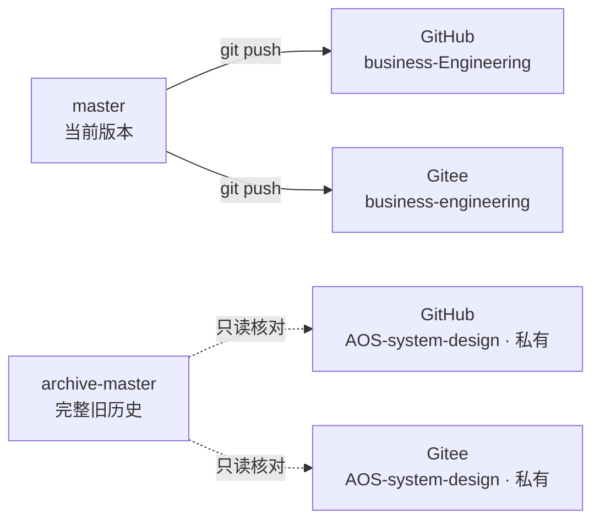

# 仓库维护手册

本文说明本仓库的远端拓扑、日常推送方式、防误推措施和新设备接入步骤。仓库内容本身的组织见 [`README.md`](README.md) 与 [`CLAUDE.md`](CLAUDE.md)。

---

## 一、远端拓扑

当前版本只存在于 `business-engineering` 仓；`AOS-system-design` 仓是私有历史档案，冻结只读。

| 远端名 | 地址 | 用途 |
|--------|------|------|
| `origin` | `git@github.com:Yongjunzhou/business-Engineering.git` | 新仓 GitHub，同时承担 fetch |
| `origin` 的第二个推送地址 | `git@gitee.com:mickeychow/business-engineering.git` | 新仓 Gitee，随 `origin` 一起推送 |
| `gitee` | `git@gitee.com:mickeychow/business-engineering.git` | 新仓 Gitee，供 fetch 与状态核对 |
| `archive-github` | `git@github.com:Yongjunzhou/AOS-system-design.git` | 旧仓 GitHub，私有档案 |
| `archive-gitee` | `git@gitee.com:mickeychow/AOS-system-design.git` | 旧仓 Gitee，私有档案 |



本地分支：

| 分支 | 内容 | 上游 |
|------|------|------|
| `master` | 当前版本，日常开发分支 | `origin/master` |
| `archive-master` | 旧仓完整历史，只作本地留档 | `archive-github/master` |

本地标签 `pre-skill-revision` 只指向旧历史，不存在于新仓，也不要推送。

---

## 二、日常推送

`origin` 配有两个推送地址，一条命令即可双推：

```bash
git add -A
git commit -m "修改摘要"
git push
```

成功时输出两组 `To github.com:...` 与 `To gitee.com:...`。只有一组成功说明另一端失败，修好后重跑 `git push`，它只补推落后的那一端。

推送后核对两端哈希一致：

```bash
git rev-parse HEAD
git ls-remote origin master
git ls-remote gitee master
```

`origin` 的 fetch 地址是 GitHub；核对 Gitee 状态用 `git fetch gitee` 或 `git ls-remote gitee master`。

---

## 三、防误推

### 3.1 识别目标

- 远端名含 `archive-` 的是旧仓，只读；
- 推送输出里的仓库名不是 `business-Engineering`（Gitee 侧为 `business-engineering`）就立即停止；
- `git remote -v` 可随时核对完整映射。

### 3.2 禁止使用的命令

```bash
git push --all
git push --mirror
git push --tags
git push origin archive-master
```

`archive-master` 与 `pre-skill-revision` 含完整旧历史，进入新仓会破坏"只保留当前版本"的边界。

### 3.3 pre-push 钩子

钩子随 Git 克隆存在，但不进入版本库。每台设备安装一次：

```bash
cat > .git/hooks/pre-push <<'EOF'
#!/bin/sh
# 阻止误推旧仓，以及把旧历史分支或标签推入新仓。
remote="$1"
url="$2"

case "$url" in
  *AOS-system-design*)
    echo "拒绝推送：remote '$remote' 指向历史归档仓 $url" >&2
    exit 1
    ;;
esac

case "$url" in
  *business-[Ee]ngineering*)
    while read -r local_ref local_sha remote_ref remote_sha; do
      case "$local_ref" in
        refs/heads/archive-master|refs/tags/pre-skill-revision)
          echo "拒绝推送：$local_ref 含旧仓完整历史，不得进入新仓" >&2
          exit 1
          ;;
      esac
    done
    ;;
esac

exit 0
EOF
chmod +x .git/hooks/pre-push
```

钩子拦截三类操作：推送目标为 `AOS-system-design`、推送 `archive-master`、推送 `pre-skill-revision` 标签。临时撤销时删除 `.git/hooks/pre-push`。

---

## 四、新设备接入

> 本节的可拷贝操作版本见 [`REPO-ONBOARDING.md`](REPO-ONBOARDING.md)；本节保留拓扑与验证要点。

### 4.1 检查旧克隆

```bash
cd <旧仓库目录>
git status
git log --oneline -3
```

存在未提交改动时先提交或复制出来；存在独有提交时先推送到旧仓。

### 4.2 旧目录留档，新仓克隆到原路径

```bash
cd ..
mv AOS AOS-旧仓档案-20261019
git clone git@github.com:Yongjunzhou/business-Engineering.git AOS
cd AOS
```

保持原路径可让本机记忆目录的绝对路径设置继续有效。

### 4.3 配置双推

```bash
git remote set-url --add --push origin git@github.com:Yongjunzhou/business-Engineering.git
git remote set-url --add --push origin git@gitee.com:mickeychow/business-engineering.git
git branch -u origin/master master

git remote add gitee git@gitee.com:mickeychow/business-engineering.git
git fetch gitee
```

### 4.4 安装钩子

按 §3.3 的命令安装。

### 4.5 验证

```bash
git ls-remote origin master
git ls-remote gitee master
git push --dry-run
```

两端哈希相同，且 `git push --dry-run` 输出两组 `Everything up-to-date` 或两组 `To ...`。

### 4.6 记忆加载点

新仓克隆在原路径时无需动作；换了路径则执行：

```bash
node .ai-agent/tools/setup-memory.js
```

随后重启会话。

---

## 五、仓库内容边界

新仓只含当前版本，以下内容不在新仓：

| 内容 | 去向 |
|------|------|
| `90-hold/` | 旧仓 `AOS-system-design` |
| `80-sessions/` | 旧仓 `AOS-system-design` |
| 两个"旧版归档"目录 | 旧仓 `AOS-system-design` |
| `.ai-agent/tools/md2pdf/node_modules/` | 不跟踪，由 `npm install` 重建 |
| 评审技能 `temp/` 临时产物 | 不跟踪，见 [`.gitignore`](.gitignore) |

旧仓是旧版本的权威档案，私有且冻结。执行仓库拆分的机器上另存有一份移出内容，路径为 `E:\mywork\AOS-移出仓外-20261019\`；该目录只属于那台设备，不作为项目依据。

---

## 六、常见故障

| 现象 | 处理 |
|------|------|
| `git push` 只推了一端 | 检查 `git remote -v` 中 `origin` 是否有两个推送地址 |
| `non-fast-forward` 被拒绝 | 先 `git pull --rebase origin master`，再 `git push`；不要 force push |
| 提示 unrelated histories | 新仓与旧仓是独立历史，不要互拉；旧仓只作档案 |
| 钩子拒绝推送 | 检查目标 URL 与分支名；指向旧仓或旧历史引用时钩子按设计拦截 |
| 会话加载的记忆是旧副本 | 运行 `node .ai-agent/tools/setup-memory.js` 并重启会话 |

---

## 七、日常检查清单

- [ ] `git status` 工作区干净
- [ ] `git push` 输出两组 `To ...`，均无报错
- [ ] `git ls-remote origin master` 与 `git ls-remote gitee master` 哈希一致
- [ ] 没有向 `archive-*` 推送
